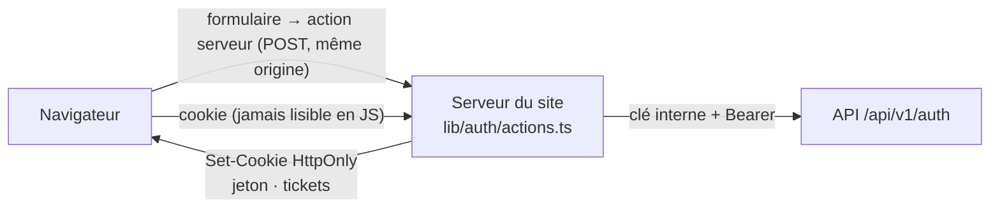

# ADR-0019 — Le site branché sur l'identité (cookies, actions serveur)

- **Statut** : Accepté
- **Date** : 2026-10-08
- **Tâche** : S4-T05
- **Complète** : [ADR-0011](0011-site-branche-api.md), [ADR-0015](0015-identite-sessions-otp.md), [ADR-0017](0017-connexion-sessions.md), [ADR-0018](0018-mot-de-passe-oublie.md)

## Contexte

Depuis le S2, les formulaires (connexion, inscription, code, mot de passe oublié) parlaient à un adaptateur de démonstration
(code 123456, rien d'enregistré). L'API sait maintenant inscrire, connecter et réinitialiser (S4-T02 à T04).
L'ADR-0015 a choisi des **sessions en base** et un **cookie posé par le site** (le site sert d'intermédiaire, « BFF »).
Choix du 2026-10-08 : en-tête **« Bonjour, Awa » + menu**, **retour à la page d'avant** après la connexion,
page **« Mon compte »** avec l'identité et les deux déconnexions.

## Décision

| Sujet                  | Choix                                                                                                                                                                     | Raison                                                                                      |
| ---------------------- | ------------------------------------------------------------------------------------------------------------------------------------------------------------------------- | ------------------------------------------------------------------------------------------- |
| Appels                 | **Actions serveur** de Next.js (`lib/auth/actions.ts`), derrière le port `AuthClient` ; l'API est appelée avec la clé interne (`lib/auth/api-identity.ts`, `server-only`) | Le navigateur ne parle jamais à l'API ; Next.js refuse une action venue d'une autre origine |
| Jeton de session       | Cookie `__Host-kemdia_session` : `HttpOnly`, `Secure`, `SameSite=Lax`, `Path=/`, 30 jours                                                                                 | Illisible par un script (XSS), jamais envoyé en HTTP ni à un sous-domaine                   |
| Tickets (code)         | Cookies `__Host-kemdia_inscription` (24 h) et `__Host-kemdia_mdp_oublie` (1 h), mêmes protections ; effacés au bon code                                                   | Le ticket n'est jamais dans la page ni dans l'adresse                                       |
| Cookie glissant        | `proxy.ts` repose le cookie pour 30 jours à chaque **vraie page** (`Sec-Fetch-Dest: document`), sans appeler l'API                                                        | Suit la session de l'API (30 jours glissants) ; les préchargements ne le touchent pas       |
| Qui est connecté ?     | L'en-tête et « Mon compte » demandent à l'API (`GET /auth/session`) ; réponse gardée **10 s** par session (empreinte du jeton) et demandes simultanées regroupées         | Une page et ses liens préchargés = un seul appel                                            |
| Session refusée        | Le cookie est effacé (après une vérification fraîche) ; une **panne** de l'API n'efface rien                                                                              | Personne n'est déconnecté par une panne                                                     |
| Déconnexions           | « Se déconnecter » (cet appareil) ; « Déconnecter tous mes appareils » → page de connexion avec un avis ; le cookie est effacé avec les mêmes attributs (`Secure`)        | Un cookie `__Host-` ne s'efface que par un `Set-Cookie` sécurisé                            |
| Retour après connexion | `?retour=` résolu comme le ferait le navigateur, chemin interne uniquement, jamais une page d'identité ; sinon l'accueil                                                  | Pas de redirection ouverte (MED-01)                                                         |
| Téléphone              | Option « SMS — bientôt » visible mais inactive ; l'API répond `CANAL_INDISPONIBLE` si un numéro arrive quand même                                                         | `SMS_ENABLED=false` tant que le client n'a pas choisi de fournisseur                        |
| Erreurs                | Codes de l'API traduits en français (`lib/auth/messages.ts`), avec le délai `Retry-After` ; message de connexion neutre                                                   | Clair pour le client, rien ne révèle qui est client                                         |

## Options écartées

- **Jeton dans `localStorage` ou lisible en JavaScript** : volable par la moindre faille XSS.
- **Le navigateur appelle l'API directement** (CORS + cookie de l'API) : deux domaines sur Render, cookies tiers bloqués par Safari ; la clé interne ne doit pas sortir du serveur.
- **Cookie de 400 jours sans prolongation** : plus simple, mais un cookie qui dure bien plus longtemps que la session n'apporte rien.
- **Cookie repris à chaque requête** (y compris les préchargements) : un préchargement parti avant la déconnexion remettait le cookie effacé (constaté pendant l'essai réel).

## Conséquences

- ➕ Les formulaires n'ont presque pas changé : seul l'adaptateur derrière `AuthClient` a été remplacé.
- ➕ Aucun secret dans la page, l'adresse ou les journaux du site (testé).
- ➖ Une session fermée **depuis un autre appareil** peut encore s'afficher « connectée » sur l'en-tête jusqu'à 10 s (l'API refuse toute action réelle).
- ➖ Le site appelle l'API avec sa clé : les limites par adresse IP de l'API ne voient pas encore le visiteur réel (S4-T07, avec les jetons CSRF et la CSP à _nonce_).
- ➖ Un navigateur qui n'envoie pas `Sec-Fetch-Dest` (très ancien) garde son cookie sans prolongation : reconnexion au bout de 30 jours.
