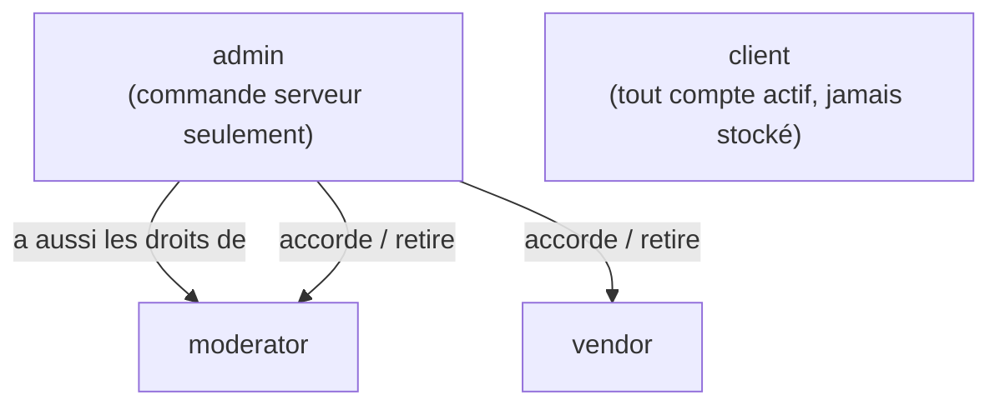
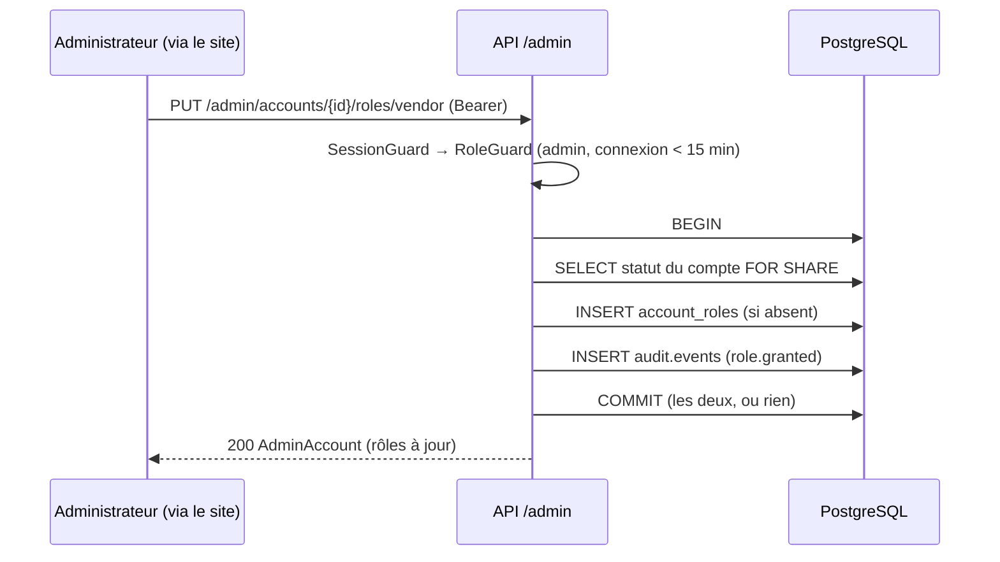

# ADR-0020 — Rôles (RBAC) et journal d'audit

- **Statut** : Accepté
- **Date** : 2026-10-08
- **Tâche** : S4-T06
- **Complète** : [ADR-0006](0006-monolithe-modulaire-7-modules.md), [ADR-0015](0015-identite-sessions-otp.md), [ADR-0017](0017-connexion-sessions.md)

## Contexte

Jusqu'ici, un compte n'avait aucun rôle : l'API savait seulement si quelqu'un était connecté (`SessionGuard`).
Le S6 apporte les vendeurs, la modération des produits et des avis, et l'administration (KYC, BR-003, FR-019, FR-020).
L'ancien projet Django avait deux failles graves sur ce sujet (voir [l'audit](../../securite/heritage-audit-django.md)) :

- **CRIT-06** : n'importe qui pouvait devenir superutilisateur ;
- **MED-07** : aucune hiérarchie entre les membres de l'équipe.

Il fallait aussi garder une trace des actions sensibles (qui, quoi, sur quoi, quand), ce que l'ancien projet faisait
avec un middleware qui saturait le serveur (MED-18).

Choix du propriétaire (2026-10-08) : 4 rôles cumulables ; seul l'administrateur attribue `vendor` et `moderator` ;
`admin` jamais par l'API ; premier administrateur par **commande en ligne** ; journal des **actions sensibles gardé 1 an** ;
**API + « Vos rôles » sur Mon compte** (écrans d'administration au S6, avec la double authentification) ;
routes d'administration avec **connexion de moins de 15 minutes**.

## Décision

### Rôles

| Sujet             | Choix                                                                                                                                          | Raison                                                                                                 |
| ----------------- | ---------------------------------------------------------------------------------------------------------------------------------------------- | ------------------------------------------------------------------------------------------------------ |
| Liste             | `client` (implicite), `vendor`, `moderator`, `admin` ; **cumulables** (un vendeur reste client)                                                | Simple, couvre le MVP ; livreur après le MVP                                                           |
| Stockage          | Table `identity.account_roles` (compte, rôle, date, qui l'a accordé) ; lue **avec le compte à chaque requête**                                 | Un rôle retiré ne sert plus, tout de suite (pas de jeton à faire expirer)                              |
| Hiérarchie        | `admin` ⇒ `moderator` ; `vendor` à part                                                                                                        | MED-07                                                                                                 |
| Attribution       | Un administrateur accorde/retire `vendor` et `moderator` ; **jamais `admin` par l'API** ; **jamais sur soi-même** (vérifié aussi en SQL)       | CRIT-06 : un rôle n'accorde que des droits inférieurs aux siens                                        |
| Premier admin     | `pnpm --filter @kemdia/api admin:grant <e-mail>` (et `admin:revoke`) sur un compte **déjà inscrit et vérifié**                                 | Aucun mot de passe par défaut, aucun secret dans Git ; l'accès à la base prouve qu'on est l'exploitant |
| Garde             | `@Authorize(rôle, { recentLogin })` = `SessionGuard` + `RoleGuard`, exportée par le module `identity` pour tous les modules                    | Une seule façon de protéger une route ; fermée par défaut                                              |
| Règles cumulées   | Les règles du contrôleur **et** de la méthode doivent toutes être respectées                                                                   | Une règle de méthode ne peut pas affaiblir celle du contrôleur                                         |
| Connexion récente | Routes `/api/v1/admin/*` : session **ouverte** il y a moins de 15 min (sinon `RECONNEXION_REQUISE`)                                            | Limite les dégâts d'une session volée en attendant la 2FA (MED-15, S6)                                 |
| Double contrôle   | La garde HTTP **et** le cas d'utilisation (`RoleService`) vérifient les règles ; l'état du compte est relu **sous verrou** dans la transaction | La règle tient même si une route est mal protégée                                                      |

### Journal d'audit

| Sujet        | Choix                                                                                                                                               | Raison                                                                 |
| ------------ | --------------------------------------------------------------------------------------------------------------------------------------------------- | ---------------------------------------------------------------------- |
| Où           | Nouveau module **`audit`** (schéma PostgreSQL `audit`, table `events`), sans route ni dépendance ; port public `AuditLog` / `AuditReader`           | Tous les modules y écrivent ; le lire reste réservé à l'administration |
| Quoi         | Liste **fermée** : `role.granted`, `role.revoked`, `password.reset`, `sessions.revoked_all` (S6 : KYC, modération…)                                 | Pas de journal « fourre-tout » ; aucune donnée secrète                 |
| Contenu      | Qui (compte ou serveur), quoi, sur quoi (UUID), quand (**horloge de la base**), d'où (IP vue par l'API, identifiant de requête), petits détails     | Répond à « qui a fait quoi » ; jamais de mot de passe, code ou jeton   |
| Atomicité    | L'action et sa ligne sont écrites dans **la même transaction** (`TransactionContext`, AsyncLocalStorage) ; si la trace échoue, l'action est annulée | Pas d'action sensible sans trace                                       |
| Intégrité    | Déclencheurs SQL : **aucune modification**, suppression seulement après 365 jours, `TRUNCATE` interdit, date imposée par la base                    | Protège d'une erreur ou d'une injection dans l'API                     |
| Conservation | **365 jours**, purge toutes les 6 h par lots de 1 000                                                                                               | Choix du propriétaire ; limite les données personnelles gardées        |
| Lecture      | `GET /api/v1/admin/audit` (du plus récent au plus ancien, curseur, filtres action et compte)                                                        | Pas d'écran avant le S6                                                |

## Options écartées

- **Rôles dans le jeton de session** : il faudrait attendre l'expiration pour qu'un retrait prenne effet.
- **Un compte administrateur créé par la migration ou par une variable `ADMIN_PASSWORD`** : secret à gérer, compte par défaut connu.
- **Variable `ADMIN_BOOTSTRAP_EMAIL` lue au démarrage** : change les réglages Render, et quiconque inscrit cette adresse en premier devient admin.
- **Un administrateur peut nommer un administrateur** : un seul compte volé suffirait à en créer d'autres.
- **Journaliser toutes les connexions** : beaucoup de lignes et de données personnelles pour peu d'usage (les blocages restent dans `login_guards`).
- **Journal dans le module `identity`** : les futurs modules (vendeurs, commandes) devraient dépendre d'`identity` pour écrire.
- **Lire le journal dans un contrôleur du module `audit`** : `audit` dépendrait d'`identity` (garde) et inversement ; les routes de lecture sont donc dans `identity`.

## Conséquences

- ➕ CRIT-06 et MED-07 fermés côté API (testés : HTTP, cas d'utilisation, base).
- ➕ Les modules du S5-S6 protègent leurs routes en une ligne (`@Authorize("vendor")`) et journalisent avec `AuditLog.record`.
- ➖ Chaque requête authentifiée lit les rôles avec le compte (une jointure de plus, sur clé primaire).
- ➖ Le propriétaire des tables peut encore désactiver les déclencheurs : la vraie protection viendra des **deux rôles PostgreSQL** du S7.
- ➖ L'adresse IP enregistrée est celle du **serveur du site** pour les actions passées par le site ; celle du visiteur arrive avec le S4-T07.
- ➖ L'identifiant de requête peut être fourni par l'appelant (`X-Request-Id`) : il sert à relier les journaux, pas de preuve.
- ➖ Pas encore d'écran : l'administration se fait par l'API (documentation `/api/docs`) jusqu'au S6.
