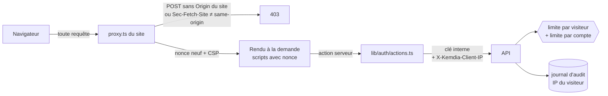

# ADR-0021 — CSRF, CSP à nonce, limites par visiteur et par compte

- **Statut** : Accepté
- **Date** : 2026-10-09
- **Tâche** : S4-T07
- **Complète** : [ADR-0010](0010-api-rest-openapi.md), [ADR-0019](0019-site-branche-identite.md), [ADR-0020](0020-roles-journal-audit.md)

## Contexte

Le site parle maintenant à l'API pour de vrai (comptes, sessions, rôles). Trois protections restaient à poser :

- **CSRF** (HIGH-16 de l'ancien projet : on pouvait changer le stock d'un vendeur depuis un autre site). Next.js compare déjà l'origine
  des actions serveur, mais **laisse passer une requête sans en-tête `Origin`** (avec un simple avertissement).
- **CSP** : `script-src 'self' 'unsafe-inline'` laissait s'exécuter n'importe quel script injecté dans une page.
- **Limites** (MED-05) : l'API limitait par adresse IP, mais le site l'appelle pour tous les visiteurs depuis **une seule adresse** et
  était donc exempté. Rien ne limitait un compte, et le journal d'audit enregistrait l'adresse du serveur du site.

Choix du propriétaire (2026-10-09) : **scripts à nonce, styles inchangés** ; **contrôle d'origine strict** ; adresse du visiteur
transmise selon un **réglage du site désactivé par défaut** ; compteurs **en mémoire** de l'API.

## Décision

| Sujet               | Choix                                                                                                                                                                | Raison                                                                                          |
| ------------------- | -------------------------------------------------------------------------------------------------------------------------------------------------------------------- | ----------------------------------------------------------------------------------------------- |
| CSRF                | `proxy.ts` refuse (403) toute méthode autre que GET/HEAD/OPTIONS sans `Origin` de même hôte, ou avec `Sec-Fetch-Site` ≠ `same-origin`                                | Méthode « vérification de l'origine » de l'OWASP ; rien à changer dans les formulaires          |
| Portée du proxy     | **Toutes** les adresses sauf `_next/static` et `_next/image`                                                                                                         | Next.js exécute une action serveur sur n'importe quelle adresse (même une image)                |
| CSP — scripts       | `script-src 'self' 'nonce-…' 'strict-dynamic'` ; nonce de 16 octets, neuf à chaque requête ; Next.js l'ajoute à ses scripts                                          | Un script injecté n'a pas le nonce : il est bloqué                                              |
| CSP — styles        | `style-src 'self' 'unsafe-inline'` gardé                                                                                                                             | React écrit des attributs `style="…"` qu'aucun nonce ne couvre ; un style n'exécute pas de code |
| Rendu               | Toutes les pages **à la demande** (`await connection()` dans le layout racine)                                                                                       | Une page pré-générée n'aurait pas de nonce : ses scripts seraient bloqués                       |
| Adresse du visiteur | Le site lit l'en-tête nommé par `CLIENT_IP_HEADER` (vide par défaut ; `x-forwarded-for` → **dernière** adresse) et l'envoie dans `X-Kemdia-Client-IP`                | L'hébergeur seul sait quel en-tête est fiable ; rien n'est deviné                               |
| Confiance           | L'API ne croit `X-Kemdia-Client-IP` **qu'avec la clé interne** ; adresse illisible → compteur commun « inconnue »                                                    | Personne d'autre ne peut se faire passer pour un autre visiteur                                 |
| Limites par adresse | Appliquées au visiteur transmis par le site, **×3** (CGNAT des opérateurs mobiles) ; IPv6 regroupées par **/64** ; appels du site sans visiteur (catalogue) exemptés | Protège sans bloquer des abonnés qui partagent une adresse                                      |
| Limites par compte  | `SessionGuard` : 120/min par route et par compte ; « tous mes appareils » 5/min ; administration 30/min ; `@AccountRateLimit(n)` pour les modules suivants           | Suit la personne même si elle change d'adresse (MED-05)                                         |
| Réponse             | 429 avec le code `TROP_DE_REQUETES` et `Retry-After`                                                                                                                 | Le site distingue une limite d'une panne                                                        |
| Compteurs           | Mémoire de l'API (`@nestjs/throttler`), nettoyés chaque minute                                                                                                       | Une seule instance au MVP ; Redis quand il y en aura plusieurs (S7)                             |

## Options écartées

- **Jeton CSRF dans chaque formulaire** : protection équivalente ici (actions serveur en POST, cookies `SameSite=Lax`, origine vérifiée), mais chaque formulaire change.
- **Styles à nonce aussi** : il faudrait réécrire toutes les barres, notes et carrousels en classes ; gain faible (un style ne lance pas de code).
- **CSP en mode « rapport » d'abord** : rien n'aurait été bloqué ; le test de bout en bout vérifie déjà que tous les scripts portent le nonce.
- **Prendre la dernière adresse de `X-Forwarded-For` sans réglage** : si l'hébergeur a plusieurs relais, tous les visiteurs partageraient une adresse et se bloqueraient entre eux.
- **Compteurs dans PostgreSQL ou Redis** : une écriture par requête, ou un service de plus, sans besoin réel tant qu'il n'y a qu'une instance.

## Conséquences

- ➕ HIGH-16 et MED-05 fermés ; LOW-03 renforcé (fin de `'unsafe-inline'` pour les scripts).
- ➕ Le journal d'audit enregistre l'adresse du visiteur dès que `CLIENT_IP_HEADER` est réglé.
- ➖ Plus aucune page pré-générée : chaque page est calculée à la demande (budget de performance vérifié à chaque PR).
- ➖ Compteurs perdus à chaque redémarrage de l'API, et propres à une instance.
- ➖ Un navigateur très ancien qui n'envoie pas `Origin` sur un formulaire (Firefox < 70) ne peut plus rien envoyer.
- ➖ Pas encore de collecte des violations de CSP (`report-to`) : un script légitime bloqué ne se verrait que par un test ou un client.
- ➖ Sur la démo, `CLIENT_IP_HEADER` reste vide tant que l'en-tête fiable de Render n'est pas vérifié (voir le guide de la démo).
