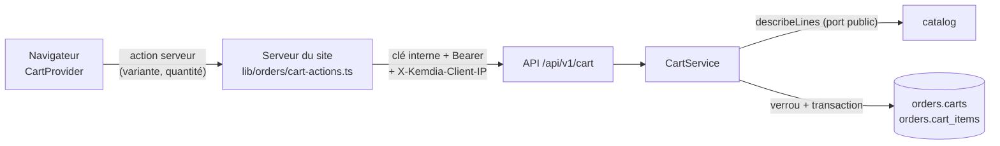

# ADR-0023 — Panier serveur du compte connecté

- **Statut** : Accepté
- **Date** : 2026-10-10
- **Tâche** : S5-T01
- **Complète** : [ADR-0004](0004-panier-cote-client.md) (panier du navigateur), [ADR-0006](0006-monolithe-modulaire-7-modules.md) (module `orders`), [ADR-0019](0019-site-branche-identite.md) (actions serveur), [ADR-0022](0022-reveil-demo-retrait-colonnes.md) (étape 2 : colonnes supprimées)

## Contexte

Depuis le S1, le panier vit dans le navigateur (`localStorage`, ADR-0004) : il est perdu en changeant de téléphone, et rien
ne vérifie le stock avant le tunnel de commande. Le Sprint 5 apporte les commandes (S5-T02) ; il faut d'abord un **panier
enregistré côté serveur** pour les comptes, **revérifié** à chaque lecture (BR-001) avec les **prix du catalogue** (BR-004).

Choix du propriétaire (2026-10-10) :

- **compte obligatoire pour commander** : le visiteur garde son panier dans le navigateur, et se connecte pour commander ;
- à la connexion, si le navigateur **et** le compte ont un panier : **additionner** les deux ;
- connecté, le panier vit **sur le serveur seul** (le même sur tous les appareils) ;
- panier supprimé après **90 jours** sans activité.

## Décision

| Sujet                   | Choix                                                                                                                                                                                                                                                             | Raison                                                                                                                                                        |
| ----------------------- | ----------------------------------------------------------------------------------------------------------------------------------------------------------------------------------------------------------------------------------------------------------------- | ------------------------------------------------------------------------------------------------------------------------------------------------------------- |
| Module                  | Nouveau module **`orders`** (schéma PostgreSQL `orders`) ; lit le catalogue par `CatalogService.describeLines` (port public), protège ses routes avec `SessionGuard`                                                                                              | ADR-0006 : le panier prépare la commande ; aucune relation SQL entre modules (UUID du compte et de la variante)                                               |
| Contenu enregistré      | **Variante + quantité** seulement, jamais de prix                                                                                                                                                                                                                 | BR-004 : le prix est relu dans le catalogue à chaque lecture                                                                                                  |
| Vérification            | Chaque réponse revérifie chaque ligne : prix actuel, produit en vente, stock suffisant (`ok`, `reason`, `available`) ; total des seules lignes commandables ; `ok` global = on peut passer en caisse                                                              | C'est la vérification du passage en caisse (BR-001) ; une variante supprimée du catalogue est retirée                                                         |
| Limites                 | 50 lignes, 1 à 20 par ligne (contrat, domaine, contrainte SQL + déclencheur, panier du navigateur — test d'alignement) ; quantité trop grande **ramenée au stock**                                                                                                | Mêmes limites que le panier du navigateur ; pas d'erreur pour un « + » de trop                                                                                |
| Concurrence             | Chaque modification : `INSERT … ON CONFLICT DO UPDATE` sur `carts` (crée le panier **et le verrouille**), relecture, règle du domaine, écriture de ce qui change — en une transaction ; attente du verrou **1 s au plus** (`lock_timeout`), sinon `PANIER_OCCUPE` | Deux onglets qui ajoutent en même temps : aucun ajout perdu, jamais plus de 50 lignes ; une rafale d'un compte n'épuise pas les connexions des autres clients |
| Réservation du stock    | **Aucune** dans le panier                                                                                                                                                                                                                                         | La réservation se fait à la création de la commande, dans la même transaction (BR-012, S5-T02)                                                                |
| Réunion                 | `POST /cart/merge` : quantités additionnées (bornées), lignes impossibles **ignorées et comptées** (`ignored`), jamais d'échec ; **idempotente** : `mergeId` tiré par le navigateur, dernière réunion appliquée retenue (`carts.last_merge_id`)                   | Choix « additionner » ; une réunion renvoyée (double chargement, réponse perdue) ne double rien                                                               |
| UUID                    | Variantes ramenées en minuscules à l'entrée de l'API (et du site)                                                                                                                                                                                                 | Majuscules et minuscules = même UUID pour PostgreSQL, pas pour le code (leçon du S4-T06)                                                                      |
| Ménage                  | Tâche horaire : paniers sans activité depuis **90 jours** supprimés ; une lecture note l'activité au plus une fois par heure                                                                                                                                      | Choix du propriétaire ; peu de données gardées, une écriture de moins par page vue                                                                            |
| Routes                  | `GET/DELETE /cart`, `POST /cart/items`, `PUT/DELETE /cart/items/{variantId}`, `POST /cart/merge` ; toujours le panier complet en réponse ; `Cache-Control: no-store` ; limite par compte 120/min (10/min pour la réunion)                                         | Le site n'a jamais à recalculer ; contrat 1.7.0                                                                                                               |
| Erreurs                 | `VARIANTE_INCONNUE` (404), `PRODUIT_INDISPONIBLE`, `PANIER_PLEIN` et `PANIER_OCCUPE` (409, `Retry-After: 1`) ; le déclencheur des 50 lignes donne aussi `PANIER_PLEIN`                                                                                            | Codes stables, message choisi par le site                                                                                                                     |
| Site : où est le panier | Le layout lit la **présence** du cookie de session (aucun appel) → `CartProvider signedIn` ; visiteur : `localStorage` ; connecté : actions serveur (`syncCart`, `addToServerCart`…)                                                                              | Rien ne bloque l'affichage ; Next.js redessine le layout après une connexion/déconnexion (cookie posé ou effacé par une action)                               |
| Site : réunion          | Au premier chargement connecté : le panier du navigateur reçoit un **identifiant de réunion** (gardé avec lui, effacé à toute modification), est envoyé, puis **vidé seulement après la réponse** ; s'il faut recommencer, le même identifiant repart             | Double rendu, deuxième onglet, réponse perdue : la réunion n'est appliquée qu'une fois, et rien n'est perdu si l'onglet se ferme pendant l'envoi              |
| Site : modifications    | Affichées tout de suite, puis remplacées par la réponse de l'API ; demandes envoyées l'une après l'autre ; refus → retour au dernier panier confirmé + message ; session expirée → retour au panier du navigateur                                                 | Réactif sur un réseau mobile lent, sans jamais garder un état que le serveur a refusé                                                                         |
| Site : panier du compte | **Jamais écrit dans `localStorage`**                                                                                                                                                                                                                              | Sinon il serait réuni une seconde fois au chargement suivant                                                                                                  |
| Passage en caisse       | Connecté : une ligne signalée bloque « Commander » (panier et tunnel) avec la raison                                                                                                                                                                              | BR-001 visible avant la commande                                                                                                                              |

**Relecture de sécurité indépendante** (S5-T01) : réunion rendue idempotente, panier du navigateur vidé après la réponse seulement, attente du verrou bornée, variante cachée dans les journaux de l'API, UUID comparés en minuscules aussi dans le catalogue, premier ménage 5 min après le démarrage.

Étape 2 de l'[ADR-0022](0022-reveil-demo-retrait-colonnes.md) faite dans la même tâche : migration
`20261010120000_retrait_colonnes_blocage` (suppression de `accounts.failed_logins`, `locked_until` et `accounts_failed_logins_check`).

## Options écartées

- **Panier serveur pour les visiteurs aussi** (cookie anonyme) : plus de code et d'abus possibles (commandes à la livraison fantômes) ; écarté avec le choix « compte obligatoire ».
- **Le navigateur reste la référence, copie sur le serveur** : deux appareils pourraient se contredire.
- **Réunion au moment exact de la connexion** (dans l'action de connexion) : il faudrait la répéter dans l'inscription et le mot de passe oublié ; au premier chargement connecté, tous les chemins sont couverts.
- **Garder les prix dans le panier** : prix périmés, et tentation de les réutiliser (CRIT-01 de l'ancien site).
- **Réserver le stock dès le panier** : stock bloqué par des paniers abandonnés ; la réservation appartient à la commande (BR-012).
- **Refuser une quantité supérieure au stock** : on la ramène au stock (comme le panier du navigateur) ; la réponse dit ce qui a été retenu (`maxQuantity`).

## Conséquences

- ➕ Même panier sur le téléphone et l'ordinateur ; plus aucun prix venu du navigateur ; disponibilité vérifiée avant la caisse.
- ➕ La commande (S5-T02) partira d'un panier déjà vérifié, sous verrou.
- ➖ Un appel à l'API au premier chargement de chaque visite d'un client connecté (aucun pour un visiteur).
- ➖ Seule la **dernière** réunion est retenue par panier, et un panier du navigateur modifié après un échec repart avec un nouvel identifiant : si la réunion précédente avait en fait abouti (réponse perdue), ses quantités peuvent être comptées deux fois (bornées au stock et à 20). Cas très rare, sans effet sur le prix ; le client voit son panier avant de commander.
- ➖ Une variante d'un produit repassé en brouillon reste visible dans le panier (titre, image actuels), signalée « plus disponible » : l'identifiant n'est pas devinable, et le client doit savoir quoi retirer.
- ➖ La commande est encore la maquette du S2 : « compte obligatoire pour commander » s'appliquera avec le vrai tunnel (S5-T07).
