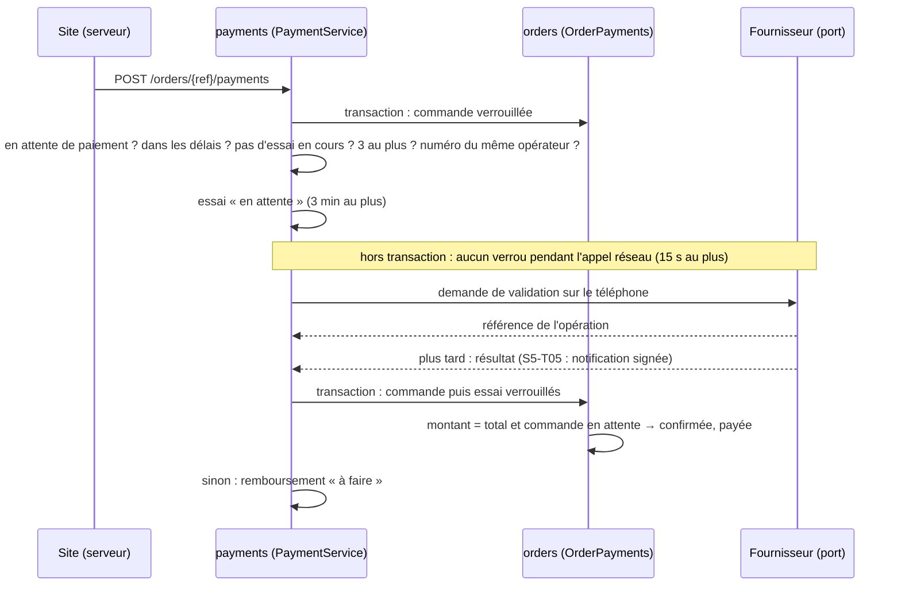

# ADR-0026 — Paiements : essais Mobile Money, paiement à la livraison réglable, remboursements suivis à la main

- **Statut** : Accepté
- **Date** : 2026-10-10
- **Tâche** : S5-T04
- **Complète** : [ADR-0024](0024-commandes-reservation-stock.md) (commandes), [ADR-0025](0025-coupons.md) (coupons), [ADR-0020](0020-roles-journal-audit.md) (administration, journal d'audit), [ADR-0006](0006-monolithe-modulaire-7-modules.md) (modules)

## Contexte

Les commandes existent (S5-T02) : une commande Mobile Money attend 30 minutes son paiement, puis elle est annulée. Il manque
le module `payments` : demander le paiement, recevoir le résultat de l'opérateur, et que faire de l'argent reçu pour une commande
annulée. Le fournisseur (agrégateur ou Airtel / Moov directement) n'est pas choisi (question ouverte n° 7) : le simulateur du
bac à sable et les notifications signées arrivent au S5-T05. Le paiement à la livraison (BR-011) avait des valeurs provisoires
écrites dans le code (question ouverte n° 1).

Choix du propriétaire (2026-10-10) :

| Question                                | Choix                                                                           |
| --------------------------------------- | ------------------------------------------------------------------------------- |
| Réglage du paiement à la livraison      | **En base, modifié par un administrateur** (zones et total maximum)             |
| Paiement Mobile Money échoué            | **Réessayer, 3 essais au plus** (même opérateur)                                |
| Remboursement                           | **Suivi manuel par un administrateur** (« à faire », puis « fait » + référence) |
| Encaissement du paiement à la livraison | **Noté par un administrateur** en attendant le livreur (S7)                     |

## Décision

| Sujet                           | Choix                                                                                                                                                                                                                                                                                                | Raison                                                                                   |
| ------------------------------- | ---------------------------------------------------------------------------------------------------------------------------------------------------------------------------------------------------------------------------------------------------------------------------------------------------- | ---------------------------------------------------------------------------------------- |
| Où                              | Nouveau module **`payments`** (schéma `payments` : tables `payments`, `refunds`) ; il dépend de `orders` par son port public **`OrderPayments`**, qui est seul à changer le statut d'une commande et ouvre la transaction                                                                            | ADR-0006 ; une seule porte pour l'état d'une commande ; pas de dépendance circulaire     |
| Réglage à la livraison          | Table `orders.cod_settings` (une ligne : zones, total maximum) ; `GET/PUT /admin/settings/cod` + journal ; le devis et la commande le lisent ; valeurs de départ = anciennes valeurs provisoires ; `codAvailability(ville, total, réglage)` du contrat reste le seul calcul                          | Choix du propriétaire ; la question 1 se tranche sans redéployer                         |
| Essais                          | **3 comptés** par commande, même opérateur (autre numéro possible) ; un essai attend **3 minutes** (jamais au-delà de l'échéance de la commande), puis expire ; un essai en cours bloque le suivant ; opérateur injoignable : essai noté échoué **sans compter** (10 lignes au plus par commande)    | Choix du propriétaire ; une panne de l'opérateur ne prive pas le client de ses essais    |
| Appel au fournisseur            | Hors transaction, **15 s au plus** ; notre identifiant d'essai est envoyé à l'opérateur et revient avec le résultat                                                                                                                                                                                  | Pas de verrou tenu pendant un appel réseau ; résultat reconnu même s'il arrive très vite |
| Résultat                        | `applyProviderResult` : référence exigée si l'essai en a une, **montant reçu exigé et comparé** ; même résultat deux fois → rien de plus ; réussite → commande confirmée **et notée payée** (`paid_at`), autres essais en attente expirés                                                            | Pas de commande confirmée pour un paiement partiel ou un faux résultat                   |
| Argent non attendu              | Réussite pour une commande annulée, déjà payée, ou d'un autre montant → **remboursement « à faire »** du montant reçu (un seul par paiement)                                                                                                                                                         | Aucune somme reçue sans trace                                                            |
| Annulation par l'administrateur | `POST /admin/orders/{ref}/cancel` (raison obligatoire) : toute commande pas encore expédiée, **même payée** ; stock et coupon rendus, essais en attente expirés, remboursement à faire par paiement reçu ; nouvelle raison d'annulation `admin` ; encaissée en espèces : refusée                     | Service client ; complète l'ADR-0024 (« Mobile Money payée : service client »)           |
| Annulation par le client        | Refusée dès que la commande est **payée** (Mobile Money confirmé ou espèces encaissées)                                                                                                                                                                                                              | Relecture de sécurité : stock remis en vente pour un article déjà livré                  |
| Remboursements                  | `GET /admin/refunds` (à faire : plus anciens d'abord ; faits : plus récents), `POST /admin/refunds/{id}/done` avec la référence de l'opérateur (**unique**) ; même référence renvoyée → rien ne change                                                                                               | Choix du propriétaire (suivi manuel) ; une opération ne rembourse qu'une fois            |
| Paiement à la livraison         | `POST /admin/orders/{ref}/cod-collected` : montant **exactement** égal au total, une fois ; commande notée payée                                                                                                                                                                                     | Choix du propriétaire, en attendant le livreur (S7)                                      |
| Fournisseur                     | Port `PaymentProvider` ; **simulé** (référence `SIM-…`, aucun argent) sur le poste de développement et la démo (`APP_ENV` = `local` ou `demo`) ; **aucun** ailleurs → `PAIEMENT_INDISPONIBLE` (503)                                                                                                  | Question 7 ouverte ; jamais de faux paiement en production                               |
| Harcèlement                     | **5 demandes par heure au plus vers un même numéro**, tous comptes confondus                                                                                                                                                                                                                         | Relecture de sécurité : on ne bombarde pas le téléphone d'un autre                       |
| Base de données                 | Statuts dans l'ordre prévu (en attente → réussi / échoué / expiré ; échoué ou expiré → réussi), champs figés, référence posée une fois, numéros et montants vérifiés, remboursement lié à un paiement reçu (même commande, même numéro), « fait » une seule fois ; rien ne s'efface ; `paid_at` figé | Même un bogue ne peut ni effacer ni réécrire une somme reçue ou rendue                   |
| Tâche planifiée                 | Toutes les minutes : essais sans réponse dans les délais notés expirés                                                                                                                                                                                                                               | Le client voit vite qu'il peut réessayer                                                 |
| Contrat                         | 1.10.0 : schémas `Payment`, `StartPaymentRequest`, `Refund*`, `CodSettings*`, `AdminCancelOrderRequest`, `CodCollectedRequest` ; `paidAt` dans la commande ; `PAYMENT_ERROR_CODES`, `MAX_PAYMENT_ATTEMPTS`, `PAYMENT_ATTEMPT_MINUTES` ; 4 actions d'audit                                            | Le site (S5-T07) affichera l'attente et les refus                                        |

Ordre des verrous, partout : **commande → variantes → coupon → paiement** (la tâche d'expiration ne prend que le verrou de l'essai).

## Options écartées

- **Appeler l'opérateur dans la transaction** : un opérateur lent garderait la commande verrouillée et épuiserait les connexions.
- **Remboursement automatique** : pas d'API de remboursement tant que le fournisseur n'est pas choisi ; le suivi manuel garde une trace sûre.
- **Encaissement qui fait passer la commande à « livrée »** : le passage expédiée → livrée appartient au transport (S7) ; on note seulement « payée ».
- **Réglage du paiement à la livraison en variable d'environnement** : il faudrait redéployer (et toucher aux réglages Render) pour changer une ville.
- **Exiger un code SMS pour payer depuis un autre numéro** : utile, mais lourd pour le MVP ; la limite par numéro suffit en attendant (à revoir au S5-T05 avec le vrai fournisseur).

## Conséquences

- ➕ Une somme reçue confirme la bonne commande ou finit en remboursement à faire, jamais perdue ; un paiement partiel ne confirme rien.
- ➕ Le service client annule une commande payée sans toucher la base ; le paiement à la livraison se règle sans redéployer.
- ➕ Le simulateur (S5-T05) et le vrai fournisseur n'auront qu'à appeler `applyProviderResult` et implémenter `PaymentProvider`.
- ➖ En production, tant qu'aucun fournisseur n'est branché, une commande Mobile Money peut être créée mais pas payée (elle expire en 30 minutes) : le site (S5-T07) ne proposera Mobile Money que là où il est disponible.
- ➖ Après une annulation par le client ou par la tâche d'expiration, un essai encore en attente peut aboutir dans les 3 minutes : l'argent est alors noté à rembourser (à la main).
- ➖ Les remboursements se font à la main chez l'opérateur ; la liste est limitée à 200 lignes (pagination avec les écrans du S6).
- ➖ « Un seul essai en attente par commande » est garanti par le verrou de la commande et les tests, pas par un index SQL.
