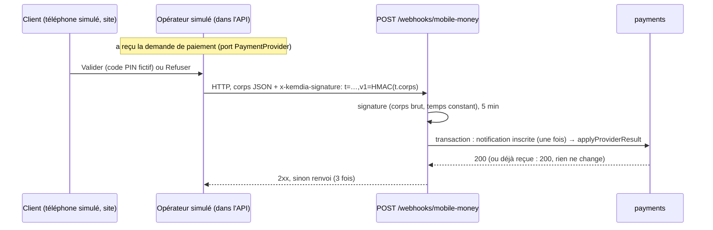

# ADR-0027 — Notifications signées de l'opérateur et bac à sable Mobile Money (téléphone simulé)

- **Statut** : Accepté
- **Date** : 2026-10-11
- **Tâche** : S5-T05
- **Complète** : [ADR-0026](0026-paiements.md) (paiements)

## Contexte

Depuis le S5-T04, le résultat d'un paiement est appliqué par `PaymentService.applyProviderResult`, mais rien ne l'appelle encore :
il manque le chemin par lequel l'**opérateur** prévient Kemdia (notification, « webhook »), et un opérateur à brancher. Le client
n'a pas choisi entre un agrégateur et les opérateurs (question ouverte n° 7), et aucun compte marchand n'est ouvert. Le jalon
v0.5.0 (premier achat de bout en bout) doit donc se faire sur un **opérateur simulé**. L'ancien site acceptait un paiement
déclaré par le navigateur (faille **CRIT-01**).

Choix du propriétaire (2026-10-11) :

| Question                        | Choix                                                                                           |
| ------------------------------- | ----------------------------------------------------------------------------------------------- |
| Validation dans le simulateur   | **Téléphone simulé** : une page montre la demande, « Valider » (code PIN fictif) ou « Refuser » |
| Où tourne le simulateur         | **Dans l'API, coupé en production**                                                             |
| Clé secrète en démo et en local | **Tirée au hasard au démarrage** (aucun `.env` ni réglage Render à toucher)                     |
| Rejeu                           | **Refusé, 5 minutes de tolérance**                                                              |

## Décision

| Sujet            | Choix                                                                                                                                                                                                                   | Raison                                                                                  |
| ---------------- | ----------------------------------------------------------------------------------------------------------------------------------------------------------------------------------------------------------------------- | --------------------------------------------------------------------------------------- |
| Signature        | En-tête `x-kemdia-signature: t=<secondes>,v1=<HMAC-SHA256 hex>` sur `<t>.<corps brut>` ; clé ≥ 32 octets ; comparaison en temps constant ; format strict ; vérifiée **avant** de lire le contenu                        | CRIT-01 : seul l'opérateur peut déclarer un paiement ; la date est signée avec le corps |
| Corps brut       | Gardé par l'analyseur JSON (`verify`) pour `/api/v1/webhooks/*` seulement ; absent (autre type, autre casse) → signature invalide                                                                                       | La signature porte sur les octets reçus, pas sur l'objet relu                           |
| Fenêtre          | **5 minutes** (avant ou après) → `NOTIFICATION_EXPIREE` ; fausse → `SIGNATURE_INVALIDE` (401, sans dire pourquoi)                                                                                                       | Choix du propriétaire                                                                   |
| Rejeu            | Table `payments.provider_events` (identifiant de la notification = clé primaire), inscrite **dans la même transaction** que le résultat ; déjà reçue → 200 `duplicate: true`, rien ne change ; refus → rien n'est gardé | Une notification compte une fois, même renvoyée ou reçue deux fois en même temps        |
| Contenu          | Schéma strict du contrat (`PaymentNotification`) : identifiant, type, essai, référence, montant (obligatoire si réussi), devise `XAF` ; puis les vérifications du S5-T04 (référence, montant)                           | Rien d'autre n'entre                                                                    |
| Opérateur simulé | `SandboxOperator` (port `PaymentProvider`) : demandes en mémoire (10 par compte, 1 000 en tout, 3 minutes) ; envoie la notification **par HTTP à l'API** (3 envois, 3 s chacun, renvoi aussi sur 409 / 429)             | Même chemin que le vrai opérateur : la démo prouve la vraie chaîne                      |
| Activation       | `APP_ENV=demo`, ou `local` hors `NODE_ENV=production` ; **jamais** en préproduction ni en production (aucun opérateur : webhook 503, routes du bac à sable 404)                                                         | Pas de faux paiement possible en production                                             |
| Clé              | Tirée au hasard au démarrage (32 octets), connue seulement du processus ; la clé du vrai opérateur sera une variable d'environnement, **ajoutée avec l'accord du propriétaire**                                         | Choix du propriétaire ; aucun secret à gérer pour la démo                               |
| Téléphone simulé | `GET/POST /api/v1/sandbox/mobile-money/requests` (session) : le compte connecté voit et répond à **ses** demandes ; code PIN fictif de 4 chiffres ; solde fictif de 500 000 FCFA (au-delà : « solde insuffisant »)      | Démo réaliste, sans argent                                                              |
| Site             | Page `/demo/telephone` (local, tests, démo ; sinon 404 ; non indexée) : action serveur revérifiée, message gardé après la réponse, liste relue toutes les 5 s                                                           | Le client de la démo « valide sur son téléphone » comme en vrai                         |
| Contrat          | 1.11.0 : `PaymentNotification`, `PaymentNotificationAck`, `Sandbox*` ; `PAYMENT_SIGNATURE_HEADER`, `PAYMENT_SIGNATURE_TOLERANCE_SECONDS` ; 4 codes d'erreur                                                             | Le vrai opérateur (ou l'agrégateur) se branchera sur le même format, ou un adaptateur   |

## Options écartées

- **Simulateur en service séparé** : plus proche de la réalité, mais un troisième service Render gratuit à gérer et à réveiller.
- **Appel direct de `applyProviderResult` par le simulateur** : plus simple, mais la démo ne prouverait ni la signature ni le rejeu.
- **Résultat automatique selon le numéro** : pas d'écran à faire, mais moins parlant pour une démonstration.
- **Clé en variable d'environnement dès maintenant** : inutile tant que l'opérateur est dans le même processus ; demanderait de toucher aux `.env` et à Render.
- **Liste blanche d'adresses IP de l'opérateur** : à ajouter avec le vrai opérateur s'il la fournit ; la signature reste la vraie protection.

## Conséquences

- ➕ CRIT-01 traité : une commande ne passe « payée » que par une notification signée, vérifiée par le serveur, comptée une fois.
- ➕ La démo publique permet un vrai parcours Mobile Money, sans argent ni compte marchand.
- ➕ Brancher le vrai opérateur = un adaptateur `PaymentProvider` + sa clé (et, si son format diffère, une traduction vers `PaymentNotification`).
- ➖ Demandes du simulateur en mémoire : perdues au redémarrage de l'API (l'essai expire alors en 3 minutes ; le client réessaie).
- ➖ Sur la démo, n'importe quel visiteur connecté peut « payer » ses propres commandes sans argent : c'est le but, et c'est limité à la démo.
- ➖ La table `provider_events` grandit sans purge (petites lignes) : purge à prévoir avec la conservation des données (S7).
