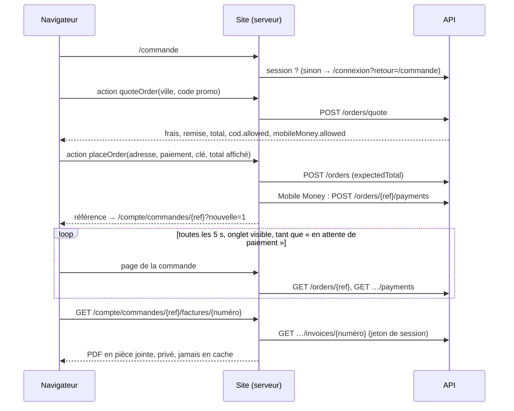

# ADR-0029 — Site branché sur les commandes : tunnel, attente du paiement, « Mes commandes »

- **Statut** : Accepté
- **Date** : 2026-10-15
- **Tâche** : S5-T07
- **Complète** : [ADR-0019](0019-site-branche-identite.md) (site branché, cookies), [ADR-0023](0023-panier-serveur.md) (panier serveur), [ADR-0024](0024-commandes-reservation-stock.md) (commandes), [ADR-0025](0025-coupons.md) (coupons), [ADR-0026](0026-paiements.md) (paiements), [ADR-0027](0027-notifications-signees-bac-a-sable.md) (bac à sable), [ADR-0028](0028-factures.md) (factures)

## Contexte

Depuis le S2, le tunnel `/commande` passait par un adaptateur de **démonstration** (`lib/orders/client.ts`) : faux numéro
`KMD-DEMO-…`, rien n'était enregistré. L'API sait tout faire depuis le S5-T06 (devis, commande, paiement Mobile Money simulé,
factures). Il reste à brancher le site, sans jamais laisser le navigateur décider d'un prix.

Choix du propriétaire (2026-10-15) :

| Question                                  | Choix                                                                                                   |
| ----------------------------------------- | ------------------------------------------------------------------------------------------------------- |
| Visiteur non connecté sur `/commande`     | **Redirection vers la connexion** (`/connexion?retour=/commande`), panier réuni à la connexion (S5-T01) |
| Où attendre la validation Mobile Money    | **Page de la commande** `/compte/commandes/KMD-…`, relue toutes les 5 s, résiste au rechargement        |
| « Mes commandes »                         | **Liste + détail + annulation** avant l'expédition, factures et avoirs à télécharger                    |
| Code promo                                | **Champ au récapitulatif** (étape 4), vérifié par le devis de l'API                                     |
| Compte obligatoire (rappel du 2026-10-10) | Oui                                                                                                     |

## Décision

| Sujet                     | Choix                                                                                                                                                                                                                                                                                                                                                                             | Raison                                                                                                |
| ------------------------- | --------------------------------------------------------------------------------------------------------------------------------------------------------------------------------------------------------------------------------------------------------------------------------------------------------------------------------------------------------------------------------- | ----------------------------------------------------------------------------------------------------- |
| Accès à l'API             | Adaptateur `server-only` `lib/orders/api-orders.ts` (clé interne + jeton du cookie `HttpOnly`), chaque réponse vérifiée par le contrat ; actions serveur `lib/orders/order-actions.ts` qui revérifient chaque argument                                                                                                                                                            | Même modèle que le panier (ADR-0023) ; le jeton ne quitte jamais le serveur du site                   |
| Montants                  | Tout montant affiché comme définitif vient du **devis** de l'API ; avant lui, estimation locale indicative ; la commande part avec `expectedTotal` = total du devis ; `PRIX_MODIFIE` → nouveau devis, le client confirme le nouveau total                                                                                                                                         | BR-004 ; le client ne paie jamais un total qu'il n'a pas vu                                           |
| Requête envoyée           | Adresse, moyen et numéro de paiement, code promo, clé d'idempotence, total affiché : **aucun article ni prix** (`buildOrderRequest`)                                                                                                                                                                                                                                              | L'API commande le panier du compte, lu sous verrou                                                    |
| Idempotence               | Une clé UUID par commande voulue, renvoyée telle quelle après une réponse perdue ; `CLE_DEJA_UTILISEE` (une commande a pu naître d'un envoi perdu) → panier relu et renvoi vers « Mes commandes » avant toute nouvelle clé                                                                                                                                                        | Jamais deux commandes pour un double clic ou un réseau coupé                                          |
| Mobile Money disponible ? | Le devis dit `mobileMoney.allowed` ; sans fournisseur (préproduction, production tant que la question n° 7 est ouverte) l'option est grisée et la livraison proposée ; l'API refuse aussi (`MOBILE_MONEY_INDISPONIBLE`, 422) **après** la clé d'idempotence. Règle unique : `config/mobile-money.ts`, lue par `orders` (port `MOBILE_MONEY`) et `payments` (choix du fournisseur) | Une commande impayable bloquerait le stock 30 minutes (ADR-0026 l'annonçait)                          |
| Demande de paiement       | Envoyée par l'action `placeOrder` juste après la commande ; échec → la commande existe quand même, la page affiche le message (code de liste blanche dans `?paiement=`) et « Envoyer la demande »                                                                                                                                                                                 | La commande n'est jamais perdue à cause de l'opérateur                                                |
| Attente                   | Page de la commande, `AutoRefresh` 5 s seulement si `pending_payment` et onglet visible ; « Réessayer » (essais restants affichés) ; lien vers `/demo/telephone` là où il existe                                                                                                                                                                                                  | Rechargement possible, aucune boucle quand l'état est final                                           |
| Annulation par le client  | Formulaire en deux temps ; l'API expire les demandes en attente **dans la même transaction** : registre `OrderCancelHooks` du module orders, où le module payments s'inscrit (pas de dépendance circulaire) ; le fournisseur peut retirer la demande (`PaymentProvider.cancel`, facultatif)                                                                                       | Le client ne valide pas sur son téléphone une commande déjà annulée ; sinon remboursement « à faire » |
| Commande payée            | Pas d'annulation en ligne (`canCancel` de l'API) : « contactez le service client »                                                                                                                                                                                                                                                                                                | ADR-0026                                                                                              |
| Factures                  | Route GET du site qui relaie le PDF : numéros revérifiés, session obligatoire, `attachment`, `nosniff`, `private, no-store`, contenu vérifié (`%PDF-`), lecture arrêtée à 2 Mo                                                                                                                                                                                                    | Le PDF est un document personnel ; l'API ne rend que ceux du compte                                   |
| Panier après la commande  | `CartProvider.reload()` relit le panier du compte (l'API a retiré les articles commandés)                                                                                                                                                                                                                                                                                         | L'en-tête et le panier sont justes sans recharger                                                     |
| Dates                     | Heure du Gabon (`Africa/Libreville`) côté serveur et navigateur                                                                                                                                                                                                                                                                                                                   | Même rendu partout                                                                                    |
| Tests de bout en bout     | API du job e2e en `APP_ENV=demo` (opérateur simulé, factures) ; un compte neuf par parcours ; numéro Airtel tiré au hasard (5 demandes par heure et par numéro)                                                                                                                                                                                                                   | Le premier achat complet est vérifié par un vrai navigateur                                           |

Contrat de l'API : **1.13.0** (`mobileMoney` dans `OrderQuote`, code `MOBILE_MONEY_INDISPONIBLE`).

## Conséquences

- ➕ Premier achat de bout en bout sur le site : compte, devis du serveur, Mobile Money simulé ou livraison, facture PDF.
- ➕ Le site ne propose jamais un moyen de paiement que l'API ne peut pas honorer.
- ➖ Le parcours « préproduction » (sans fournisseur, facturation obligatoire) n'est couvert que par les tests d'intégration de l'API, plus par un e2e.
- ➖ Annulation d'une demande chez le **vrai** opérateur : à brancher avec le fournisseur (`PaymentProvider.cancel`) ; d'ici là, un paiement validé après l'annulation est remboursé à la main.
- ➖ Images des lignes de commande : `next/image` n'accepte que `/images/**` ; une image externe renvoyée un jour par l'API devra être ajoutée à la configuration.

## Gardé tel quel (relecture de sécurité)

- L'objet injecté sous `MOBILE_MONEY` reste modifiable (utilisé par le test d'intégration) : sans effet hors des tests.
- Les liens `?nouvelle=1` et `?paiement=CODE` peuvent être fabriqués : seuls des textes fixes d'une liste blanche s'affichent, sur la commande du compte connecté.
