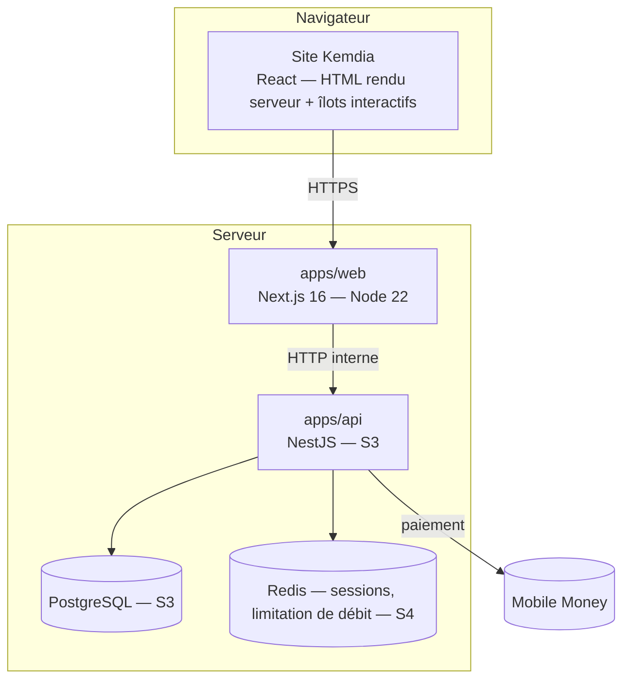
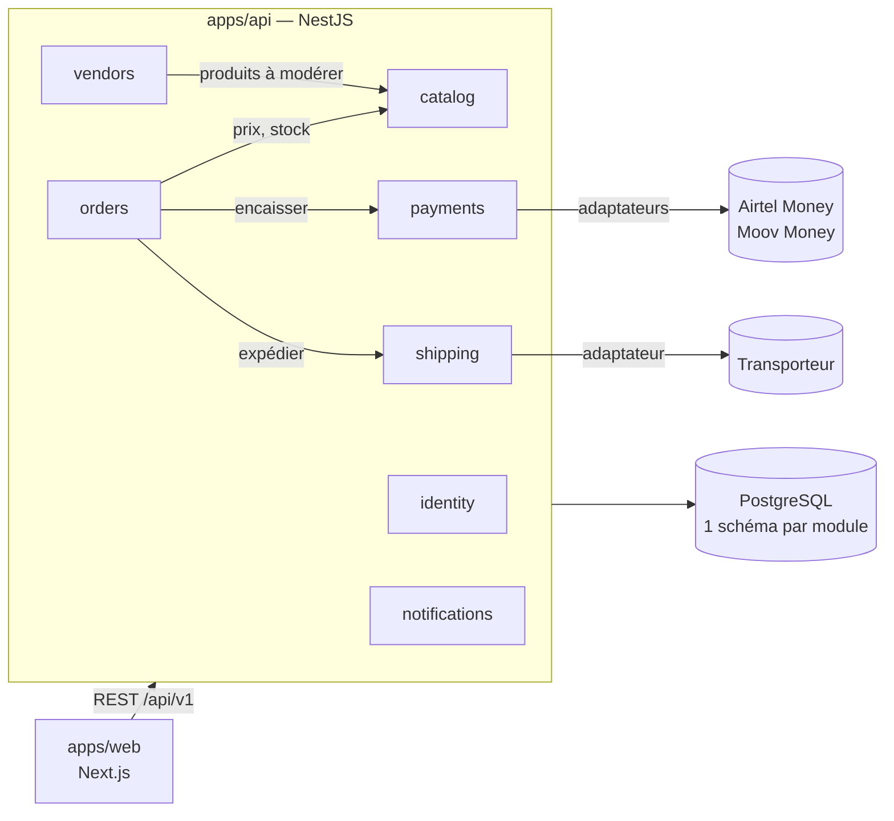
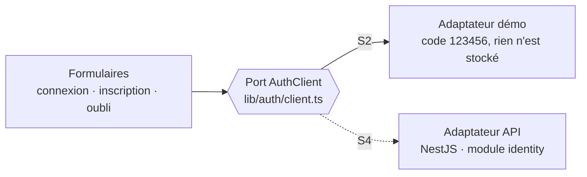
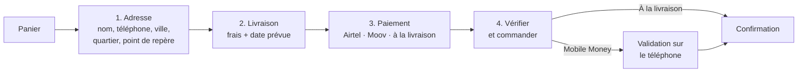
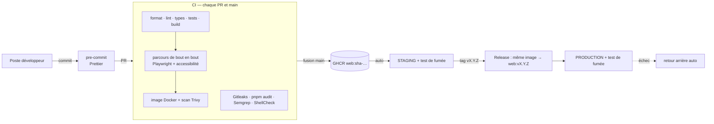
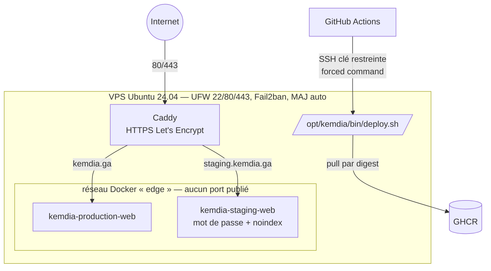

# Cahier d'architecture — Kemdia

| Version | Date       | Sprint | Changements                                                                                                                                |
| ------- | ---------- | ------ | ------------------------------------------------------------------------------------------------------------------------------------------ |
| **0.1** | 2026-10-05 | S1     | Création : contexte, exigences, stack, architecture frontend, sécurité, DevOps                                                             |
| **0.2** | 2026-10-05 | S1     | §7 pipeline CD complet, §8 architecture de déploiement (ADR-0005)                                                                          |
| **0.3** | 2026-10-05 | S1     | §8 environnement de démonstration gratuit (Render), version inscrite dans l'image                                                          |
| **0.4** | 2026-10-05 | S2     | Intégration du KSAD : vision et modèle économique (§1), MVP et règles métier (§2), modules du backend (§3.3, ADR-0006), concepts expliqués |
| **0.5** | 2026-10-05 | S2     | §5.4 parcours d'identité (connexion, inscription, code OTP) et port `AuthClient` ; §6.2 mesures de sécurité des formulaires ; §9 tests     |
| **0.9** | 2026-10-06 | S2     | §5.8 favoris, partage et aperçus, page vendeur ; §5.2 rendu à la demande (`SITE_URL`) ; §7 et §9 tests de bout en bout                     |
| **0.8** | 2026-10-05 | S2     | §5.7 tunnel de commande (port `OrderClient`, données envoyées) ; §6.2 mesures du tunnel                                                    |
| **0.7** | 2026-10-05 | S2     | §5.6 pages de liste (filtres) et panier ; §6.2 filtres par liste blanche                                                                   |
| **0.6** | 2026-10-05 | S2     | §5.5 charte graphique « place de marché » (Archivo à largeur variable, étiquette de prix), §5.6 structure des pages, §5.1 composants       |

> Document vivant : chaque rapport de sprint (`docs/rapports/`) indique quelles sections il a modifiées.
> Les sections marquées 🔜 seront rédigées au sprint indiqué.

---

## 1. Contexte et objectifs

**Kemdia** est une **marketplace hybride** destinée au marché africain, lancée d'abord au **Gabon** :
Kemdia vend son propre stock **et** accueille des vendeurs tiers, avec paiement Mobile Money et livraison organisée.
Vision détaillée, personas et analyse de marché : [synthèse du KSAD](../references/ksad-synthese.md) (Volumes 1 et 2).

### 1.1 Modèle économique

| Source de revenus             | Règle                                                   | Réf.   |
| ----------------------------- | ------------------------------------------------------- | ------ |
| Vente directe                 | Marge sur le stock propre de Kemdia                     | —      |
| Commission marketplace        | 8 % à 14 % sur les ventes des vendeurs tiers            | BR-020 |
| Affiliation (social commerce) | Partage de commission avec des ambassadeurs (après MVP) | BR-022 |
| Logistique                    | 15 % de chaque frais de livraison                       | BR-021 |

### 1.2 MVP — lancement visé fin 2027

| Élément   | Périmètre                                                                                                      |
| --------- | -------------------------------------------------------------------------------------------------------------- |
| Catalogue | ~500 produits : stock Kemdia + **50 vendeurs partenaires**                                                     |
| Comptes   | Inscription et connexion par **e-mail ou téléphone** (code OTP)                                                |
| Paiement  | **Moov Money, Airtel Money, paiement à la livraison**                                                          |
| Livraison | Transporteur partenaire (ex. COMAT), Libreville d'abord, 13 villes au catalogue des tarifs                     |
| Support   | WhatsApp Business + tchat                                                                                      |
| Hors MVP  | 2FA client, portefeuille Kemdia Pay v2, publicité vendeurs, suivi GPS, application mobile, expansion régionale |

### 1.3 Objectifs mesurables

| Objectif                        | Indicateur                                                            |
| ------------------------------- | --------------------------------------------------------------------- |
| Adoption                        | 5 000 acheteurs inscrits après le lancement                           |
| Paiement adapté au marché       | 90 % des transactions en Mobile Money                                 |
| Satisfaction                    | Note moyenne > 4/5 sur les premières commandes                        |
| Site rapide sur mobile en 3G/4G | Page d'accueil < 50 Ko compressée hors images ; pages critiques < 2 s |
| Sécurité de niveau production   | 0 faille critique/haute ouverte avant mise en ligne                   |
| Livraison fiable                | Délai respecté ≥ 95 %                                                 |

**Zone de couverture phase 1** : 13 villes du Gabon réparties en 4 zones tarifaires
(Libreville, Port-Gentil, Franceville, Lambaréné, Oyem, Moanda, Mouila, Tchibanga, Koulamoutou, Bitam, Mitzic, Lastourville, Makokou).

## 2. Exigences

### 2.1 Fonctionnelles

Les **règles métier** (BR-xxx) et les **exigences fonctionnelles** (FR-xxx) issues du KSAD sont numérotées, rattachées à un module
et à un sprint dans [`regles-metier.md`](regles-metier.md). Résumé :

| #   | Exigence                                                                 | Sprint                              |
| --- | ------------------------------------------------------------------------ | ----------------------------------- |
| F1  | Parcourir le catalogue par catégories (3 niveaux)                        | S1 ✅                               |
| F2  | Rechercher, filtrer, trier, paginer                                      | S1 ✅ · S2 (filtres) · S3 (serveur) |
| F3  | Fiche produit (photos, prix, stock, livraison estimée, variantes)        | S1 ✅ · S3 (variantes)              |
| F4  | Panier                                                                   | S1 ✅ (navigateur) · S5 (serveur)   |
| F5  | Ville / quartier de livraison au Gabon                                   | S1 ✅                               |
| F6  | Compte client par e-mail ou téléphone (OTP)                              | S4                                  |
| F7  | Commander et payer (Moov Money, Airtel Money, à la livraison)            | S5                                  |
| F8  | Suivre sa commande                                                       | S5 · S7                             |
| F9  | Vendeurs tiers : boutique, KYC, produits modérés, commandes, commissions | S6                                  |
| F10 | Back-office : modération, KYC, commandes, livraisons                     | S6                                  |
| F11 | Livraison via transporteur partenaire                                    | S7                                  |
| F12 | Affiliation                                                              | Après MVP                           |

### 2.2 Non fonctionnelles

| Domaine        | Exigence                                                                                                  |
| -------------- | --------------------------------------------------------------------------------------------------------- |
| Performance    | Rendu serveur, pages statiques quand possible, images WebP/AVIF redimensionnées, aucun CDN tiers bloquant |
| Accessibilité  | Navigation clavier, libellés ARIA, contraste, lien d'évitement, `prefers-reduced-motion`                  |
| SEO            | URL lisibles en français, métadonnées par page, sitemap, données structurées `Product`                    |
| Sécurité       | Voir §6 — OWASP Top 10, en-têtes, validation stricte, secrets hors Git                                    |
| Qualité        | Lint + types + tests obligatoires en CI ; revue de code par PR                                            |
| Exploitabilité | Image Docker, configuration par variables d'environnement, logs sans données personnelles                 |
| Conformité     | Loi gabonaise n°001/2011 sur la protection des données personnelles (APDPVP)                              |
| Disponibilité  | Objectif 99,9 % en production (KSAD Vol. 2), sauvegardes testées, surveillance                            |

## 3. Vue d'ensemble

### 3.1 Contexte (C4 niveau 1)


### 3.2 Conteneurs (C4 niveau 2) — cible



**État au Sprint 1** : seul `apps/web` existe ; le catalogue provient d'un fichier de démonstration
lu côté serveur par `src/lib/catalog.ts`, qui sera remplacé par des appels à l'API sans modifier les composants.

### 3.3 Modules du backend (cible MVP) 🔜 S3

Monolithe modulaire NestJS, architecture hexagonale, un schéma PostgreSQL par module
([ADR-0006](adr/0006-monolithe-modulaire-7-modules.md) — explications simples dans [concepts.md](concepts.md)).



## 4. Choix technologiques

| Couche     | Choix                                               | Version     | Justification                                                                |
| ---------- | --------------------------------------------------- | ----------- | ---------------------------------------------------------------------------- |
| Langage    | TypeScript (strict)                                 | 5.9         | Un seul langage front/back — [ADR-0002](adr/0002-stack-typescript-nextjs.md) |
| Frontend   | Next.js (App Router) + React                        | 16.3 / 19.2 | SSR/SSG, SEO, Server Components                                              |
| Style      | Tailwind CSS                                        | 4           | Design tokens centralisés, CSS final minimal                                 |
| Icônes     | lucide-react                                        | —           | Seules les icônes utilisées sont embarquées                                  |
| Polices    | Inter + Montserrat (auto-hébergées, @fontsource)    | —           | Aucune requête vers Google : vie privée + CSP stricte                        |
| Tests      | Vitest + Testing Library                            | 5           | Rapide, compatible TypeScript                                                |
| Monorepo   | pnpm + Turborepo                                    | 10 / 2      | [ADR-0003](adr/0003-monorepo.md)                                             |
| Conteneur  | Docker (Node 22 Alpine, utilisateur non-root)       | —           | Même artefact en préprod et prod                                             |
| CI/CD      | GitHub Actions                                      | —           | Intégré au dépôt                                                             |
| Backend 🔜 | NestJS + Prisma + PostgreSQL (un schéma par module) | —           | S3 — [ADR-0006](adr/0006-monolithe-modulaire-7-modules.md)                   |

## 5. Architecture du frontend (`apps/web`)

### 5.1 Organisation du code

```
apps/web/src
├── app/                     Routes (1 dossier = 1 URL)
│   ├── page.tsx             Accueil
│   ├── categorie/[slug]/    Liste par catégorie (rendu à la demande : tri/pagination)
│   ├── produit/[slug]/      Fiche produit (pré-générée au build)
│   ├── recherche/           Résultats de recherche (non indexés)
│   ├── connexion/  inscription/  mot-de-passe-oublie/   Parcours d'identité (S2)
│   ├── commande/  favoris/  vendre/                     Tunnel de commande, favoris, page vendeur (S2)
│   ├── promotions/  categories/  panier/  compte/  infos/[slug]/
│   ├── sitemap.ts  robots.ts  icon.svg  not-found.tsx  error.tsx
│   └── layout.tsx           Gabarit commun : en-tête, pied de page, fournisseurs
├── components/
│   ├── layout/              TopBar, Header, SearchForm, CategoryNav (méga-menu + tiroir), Footer, MobileTabBar
│   ├── home/                Hero + HeroCarousel, CategoryBubbles, FlashSales, CategoryTiles, Countdown, Newsletter
│   ├── catalog/             ProductListing (tri + pagination), Breadcrumbs, SortSelect
│   ├── product/             ProductCard, ProductRail, ProductGallery, BuyBox, StickyBuyBar, AddToCartButton
│   ├── auth/                Formulaires d'identité, saisie du code OTP, champs accessibles
│   ├── cart/                MiniCart
│   ├── location/            LocationModal (Gabon)
│   ├── providers/           Panier, ville de livraison, notifications
│   └── ui/                  Logo, Price, Rating, CategoryIcon
├── lib/                     Logique pure, testée
│   ├── catalog.ts           Accès catalogue (server-only) — futur client API
│   ├── cart.ts              Réducteur du panier + validation du stockage
│   ├── delivery.ts          Villes, zones, calcul des frais
│   ├── auth/                Validation (téléphone gabonais, e-mail, mot de passe) + port AuthClient
│   ├── search-params.ts     Validation des paramètres d'URL (liste blanche, adresse de retour)
│   └── format.ts  site.ts  types.ts  cn.ts
└── data/catalog.seed.json   Données de démonstration (S1 → remplacé par l'API en S3)
```

### 5.2 Rendu des pages

| Page                                                    | Mode                                             | Raison                                                                  |
| ------------------------------------------------------- | ------------------------------------------------ | ----------------------------------------------------------------------- |
| Liste des catégories, compte, panier, favoris, commande | Statique (build)                                 | Contenu identique pour tous ; panier et favoris remplis côté navigateur |
| Accueil, fiche produit                                  | À la demande (S2-T05)                            | Liens absolus des aperçus WhatsApp tirés de `SITE_URL` au démarrage     |
| Aperçus `opengraph-image`                               | Statique pré-générée (`generateStaticParams`)    | Image 1200 × 630 calculée une fois, à la construction                   |
| Catégorie, recherche, promotions                        | Dynamique                                        | Dépend de `?tri=`, `?page=` et des filtres                              |
| Infos                                                   | Statique, liste fermée (`dynamicParams = false`) | Toute autre URL → 404                                                   |

Composants **serveur** par défaut ; seuls les éléments interactifs sont des composants **client**
(`"use client"`) : panier, mini-panier, menu, modale de ville, galerie, compte à rebours, tri.

### 5.3 Correspondance avec l'ancien projet Django

| Django (ancien)                                                 | Kemdia (nouveau)                                              | Gain                                   |
| --------------------------------------------------------------- | ------------------------------------------------------------- | -------------------------------------- |
| `templates/base.html` (700 lignes : HTML + JS + CSS mêlés)      | `app/layout.tsx` + composants                                 | Séparation, typage                     |
| 3 partials `product_card_*.html` (~760 lignes)                  | 1 `ProductCard` + prop `badge`                                | Pas de duplication                     |
| `header.html` + `location_modal.html` + JS inline               | `Header`, `HeaderActions`, `LocationModal` (`<dialog>` natif) | Accessibilité, pas d'`innerHTML`       |
| `navigation.html` + `category_mega_menu.html`                   | `CategoryNav`                                                 | Méga-menu clavier + tiroir mobile      |
| 18 fichiers CSS + Bootstrap + Font Awesome + AOS + Swiper (CDN) | Tailwind + tokens `@theme`, lucide, défilement natif          | Aucun CDN tiers, ~36 Ko HTML compressé |
| Géolocalisation par IP via service externe                      | Choix explicite ville/quartier                                | Pas de fuite d'IP, pas de SSRF         |

### 5.4 Parcours d'identité (S2-T01)

Interface complète, branchée sur un **adaptateur de démonstration** : aucun serveur contacté, aucune donnée conservée.
Au Sprint 4, seul l'adaptateur change (module `identity` de l'API) ; les formulaires restent identiques.



| Parcours            | Étapes                                                                                 | Règles / exigences |
| ------------------- | -------------------------------------------------------------------------------------- | ------------------ |
| Inscription         | Prénom, nom, **SMS ou e-mail**, mot de passe, CGV → code à 6 chiffres → compte vérifié | FR-001, BR-041     |
| Connexion           | **Un seul champ** e-mail ou téléphone + mot de passe ; `?retour=` validé               | FR-004, MED-01     |
| Mot de passe oublié | Identifiant → code → nouveau mot de passe                                              | FR-012             |

Numéros acceptés : mobiles gabonais à 9 chiffres `06…` (Moov) et `07…` (Airtel), avec ou sans `+241` ;
forme enregistrée `+241077123456` (à confirmer avec le fournisseur SMS au S4).

### 5.5 Charte graphique (tokens `globals.css`)

Direction (S2-T10) : **une place de marché dense**, inspirée des usages des grands sites (Amazon, Jumia) sans reprendre leur identité,
avec une signature propre : le prix affiché comme une **étiquette de marché**.

| Token                     | Valeur                            | Usage                                                                  |
| ------------------------- | --------------------------------- | ---------------------------------------------------------------------- |
| `brand-600`               | `#d61f2c`                         | Rouge Kemdia : actions, bandeau ventes flash, bannière                 |
| `accent-400`              | `#ffc629`                         | Jaune : pastilles de remise (inclinées), bouton « Acheter maintenant » |
| `ink-900`                 | `#14181e`                         | Texte, navigation                                                      |
| `ink-50`                  | `#eef0f3`                         | Fond « marché » : les blocs blancs ressortent                          |
| `forest-600`              | `#0b7a4b`                         | Livraison, stock, espace vendeur                                       |
| `gabon-green/yellow/blue` | `#009e60` / `#fcd116` / `#3a75c4` | Rappels discrets du drapeau                                            |

**Typographie** : une seule famille, **Archivo** à largeur variable (auto-hébergée, aucun CDN) :

| Rôle   | Réglage                                     | Classe                 |
| ------ | ------------------------------------------- | ---------------------- |
| Texte  | largeur 100 %, graisse 400–600              | `font-sans`            |
| Titres | largeur 112 %, graisse 800                  | `h1`–`h3`              |
| Prix   | largeur 78 %, graisse 800, chiffres alignés | `font-price` (`Price`) |

### 5.6 Structure des pages principales

| Page          | Organisation                                                                                                                                                                                                          |
| ------------- | --------------------------------------------------------------------------------------------------------------------------------------------------------------------------------------------------------------------- |
| Accueil       | Catégories à gauche · carrousel de bannières · raccourcis compte / vendeur ; ronds des rayons ; ventes flash (stock restant, compte à rebours) ; tuiles « un rayon, 4 produits » ; rangées de produits                |
| Fiche produit | Galerie · informations et prix (économie en FCFA) · encadré d'achat (date de livraison selon la ville, 2 boutons, garanties) ; sections Description / Caractéristiques / Avis                                         |
| Listes        | Catégorie, recherche, promotions : même gabarit `CatalogView` — filtres à gauche (prix, marque, promotion, stock, note ; panneau qui monte du bas sur mobile), filtres actifs en pastilles, tri, 20 produits par page |
| Panier        | Barre « livraison offerte » (reste à ajouter), lignes détaillées, récapitulatif collé à droite (en bas sur mobile), suggestions                                                                                       |
| Mobile        | Barre d'onglets en bas (Accueil, Rayons, Promos, Panier, Compte) ; sur la fiche produit, remplacée par une barre d'achat                                                                                              |

Accessibilité du carrousel : pause au survol et au focus, aucun défilement automatique si l'utilisateur réduit les animations,
bannières masquées rendues inactives (`inert`).

### 5.7 Tunnel de commande (S2-T02)

Page `/commande`, en 4 étapes sur une seule page (chaque étape terminée se replie en résumé avec « Modifier ») :



| Choix                           | Raison                                                                                                      |
| ------------------------------- | ----------------------------------------------------------------------------------------------------------- |
| **Point de repère** obligatoire | Au Gabon, on se repère plus souvent ainsi que par numéro de rue ; c'est ce qui permet au livreur de trouver |
| Numéro de paiement pré-rempli   | Celui de l'adresse ; l'opérateur est déduit (07 → Airtel, 06 → Moov) et vérifié                             |
| Paiement à la livraison         | Grisé avec la raison si la ville ou le montant ne le permettent pas (BR-011, valeurs provisoires)           |
| Port `OrderClient`              | Adaptateur de démonstration en S2 ; API `orders` + `payments` en S5, sans changer l'interface               |

**Données envoyées au serveur** (`buildOrderRequest`) : identifiants et quantités des articles, adresse, moyen et numéro de paiement.
**Jamais de prix, de total ni de frais** : le serveur les recalcule (BR-004, faille CRIT-01 de l'ancien site).

### 5.8 Favoris, partage et page vendeur (S2-T04 à T06)

| Fonction            | Fonctionnement                                                                                                                                  |
| ------------------- | ----------------------------------------------------------------------------------------------------------------------------------------------- |
| Favoris (FR-014)    | `FavoritesProvider` + `lib/favorites.ts` : stockés dans le navigateur, revalidés au chargement, 100 au plus ; synchronisés avec le compte au S4 |
| Partage WhatsApp    | Lien `wa.me` (texte encodé, `utm_source=whatsapp`), partage natif du téléphone ou copie du lien                                                 |
| Aperçus (OpenGraph) | `opengraph-image.tsx` : image 1200 × 630 par produit (photo, prix, remise) et pour le site, **générées à la construction**                      |
| Page vendeur        | `/vendre` : offre marketplace, étapes, conditions (KYC, BR-024), FAQ, demande d'ouverture (démo ; module `vendors` au S6)                       |

**Adresse publique lue au démarrage** : les aperçus WhatsApp exigent des liens absolus. La même image Docker sert la démo,
le staging et la production : l'adresse vient donc de la variable `SITE_URL` du serveur (`siteUrl()`), et les pages partagées
(accueil, fiches produit, `sitemap.xml`, `robots.txt`) sont rendues à la demande. Le catalogue étant en mémoire, cela coûte
quelques millisecondes par page.

## 6. Sécurité

### 6.1 Principes

1. **Ne jamais faire confiance au client** : URL, formulaires, `localStorage`, en-têtes sont validés.
2. **Le serveur calcule tous les montants.**
3. **Aucun secret, aucune donnée réelle dans Git.**
4. **Moindre privilège** : conteneur non-root, système de fichiers en lecture seule, rôles stricts (S6).
5. **Défense en profondeur** : validation + échappement + CSP + en-têtes.

### 6.2 Mesures en place (S1)

| Mesure                                                                                                                                     | Où                                | Faille(s) de l'ancien projet évitée(s) |
| ------------------------------------------------------------------------------------------------------------------------------------------ | --------------------------------- | -------------------------------------- |
| Content-Security-Policy, X-Frame-Options, HSTS, Referrer-Policy, Permissions-Policy, nosniff                                               | `next.config.ts`                  | LOW-03                                 |
| En-tête `X-Powered-By` supprimé                                                                                                            | `next.config.ts`                  | Empreinte technologique                |
| React échappe tout texte ; aucun `innerHTML` sur des données                                                                               | Tous les composants               | CRIT-04 (XSS)                          |
| Tri/page/recherche validés par liste blanche et bornes                                                                                     | `lib/search-params.ts`            | MED-13                                 |
| Filtres (prix, marque, stock, promo, note) : valeurs connues uniquement, marques comparées au catalogue                                    | `lib/filters.ts`                  | MED-13                                 |
| Commande : seuls identifiants + quantités envoyés (aucun montant) ; numéro de paiement vérifié selon l'opérateur                           | `lib/checkout.ts`                 | CRIT-01, HIGH-05                       |
| Optimiseur d'images limité à `/images/**` (URL externes refusées : 400)                                                                    | `next.config.ts`                  | HIGH-03 (SSRF)                         |
| `localStorage` validé champ par champ                                                                                                      | `lib/cart.ts`, `LocationProvider` | Altération du panier                   |
| Ville choisie dans une liste fermée, aucune redirection construite depuis l'URL                                                            | `LocationModal`                   | MED-01, MED-06, MED-14                 |
| Code catalogue `server-only`                                                                                                               | `lib/catalog.ts`                  | Fuite de logique côté client           |
| `.gitignore` : `.env*`, `*.sqlite3`, dumps                                                                                                 | racine                            | CRIT-02, CRIT-03, CRIT-05, LOW-02      |
| Gitleaks (historique complet), pnpm audit, CodeQL, Dependabot, Trivy                                                                       | CI                                | CRIT-02, HIGH-07                       |
| Pages d'erreur sans détail technique                                                                                                       | `error.tsx`                       | Fuite d'informations                   |
| Adresse de retour après connexion limitée aux chemins internes (`parseReturnTo`)                                                           | `lib/search-params.ts`            | MED-01 (redirection ouverte)           |
| Messages identiques que le compte existe ou non (connexion, mot de passe oublié)                                                           | `components/auth/`                | Énumération des comptes                |
| Mot de passe : 8 caractères min., lettre + chiffre, liste des plus courants refusée ; jamais stocké dans le navigateur, effacé après envoi | `lib/auth/validation.ts`          | Mots de passe faibles                  |
| Code OTP : 5 essais max. puis nouveau code obligatoire, renvoi après 60 s (simulé, appliqué par le serveur au S4)                          | `lib/auth/client.ts`              | MED-05, MED-10 (préparation)           |
| Attributs `autocomplete` corrects (gestionnaires de mots de passe, code SMS auto-rempli)                                                   | Formulaires                       | Mots de passe réutilisés               |

Le suivi détaillé des 45 failles est dans [`docs/securite/heritage-audit-django.md`](../securite/heritage-audit-django.md).

### 6.3 Prévu 🔜

- S4 : CSP à _nonce_ via `proxy.ts`, cookies de session `HttpOnly; Secure; SameSite=Lax`, protection CSRF, limitation de débit.
- S5 : signature des webhooks Mobile Money, idempotence des paiements, transactions SQL pour stock et coupons.

## 7. DevOps — CI/CD



| Fichier                          | Rôle                                                                                          |
| -------------------------------- | --------------------------------------------------------------------------------------------- |
| `.github/workflows/ci.yml`       | Qualité → bout en bout → image → scan → publication GHCR + Docker Hub (main) → staging + démo |
| `.github/workflows/release.yml`  | Tag `vX.Y.Z` → promotion de l'image testée → Release GitHub → production                      |
| `.github/workflows/_deploy.yml`  | Déploiement réutilisable : SSH restreint, test de fumée, retour arrière                       |
| `.github/workflows/security.yml` | Gitleaks, pnpm audit, Semgrep, ShellCheck ; CodeQL si dépôt public ; chaque lundi             |
| `.github/dependabot.yml`         | Mises à jour hebdomadaires (npm, actions épinglées par SHA, image Docker)                     |
| `apps/web/Dockerfile`            | Multi-étapes, `standalone`, non-root, sans npm, healthcheck `/api/health`                     |
| `deploy/`                        | Scripts et configuration serveur (voir §8)                                                    |
| `.husky/pre-commit`              | Formatage automatique avant chaque commit                                                     |

**Principes** : _build once, deploy many_ · déploiement par digest immuable · actions épinglées par SHA ·
aucun secret dans Git · tout changement passe par une PR.
**Stratégie de branches** : `main` toujours déployable ← PR depuis `feature/Sx-Tyy-description`.
Voir [`workflow-git.md`](../guides/workflow-git.md) et [`deploiement.md`](../guides/deploiement.md).

## 8. Déploiement

Décision : [ADR-0005](adr/0005-strategie-deploiement.md).



| Élément              | Choix                                                                                                              |
| -------------------- | ------------------------------------------------------------------------------------------------------------------ |
| Hébergement          | VPS Ubuntu 24.04 (2 vCPU / 4 Go), Europe de l'Ouest — à réévaluer avec l'APDPVP pour les données personnelles (S7) |
| Conteneur applicatif | Lecture seule, `cap_drop: ALL`, `no-new-privileges`, 512 Mo max, logs bornés                                       |
| Environnements       | `demo` (Render Free, public, auto à chaque fusion) · `staging` (auto, protégé) · `production` (tag de version)     |
| Fiabilité            | Healthcheck, `compose up --wait`, test de fumée, retour arrière automatique, verrou anti-déploiements concurrents  |
| Traçabilité          | Release GitHub par version, résumé de chaque déploiement dans Actions, `/opt/kemdia/deploy.log`                    |
| À venir              | PostgreSQL + sauvegardes chiffrées (S3), surveillance et alertes (S7), _blue/green_ sans coupure (S7)              |

## 9. Qualité et tests

| Niveau              | Outil                                                 | État S1                                                                                                                                                                          |
| ------------------- | ----------------------------------------------------- | -------------------------------------------------------------------------------------------------------------------------------------------------------------------------------- |
| Unitaires (logique) | Vitest                                                | 78 tests : formatage, livraison (dont dates), panier, catalogue, paramètres d'URL, identité (S2)                                                                                 |
| Composants          | Testing Library                                       | 16 tests : carte produit, saisie OTP, parcours d'identité, carrousel, barre d'onglets (S2)                                                                                       |
| Bout en bout        | Playwright + axe-core                                 | 16 scénarios × 2 appareils (téléphone Pixel 7, ordinateur) : achat complet, filtres, favoris, partage, vendeur, en-têtes de sécurité, XSS, accessibilité WCAG AA de 7 pages (S2) |
| Statique            | ESLint (règles Next + React Hooks), TypeScript strict | ✅                                                                                                                                                                               |

## 10. Glossaire

Explications détaillées, avec des exemples Kemdia : [concepts.md](concepts.md).

- **SSR / SSG** : rendu des pages sur le serveur, à la demande / à l'avance.
- **Server / Client Component** : composant React exécuté uniquement sur le serveur / aussi dans le navigateur.
- **CSP** : en-tête qui indique au navigateur quelles sources de scripts, styles, images sont autorisées.
- **CI/CD** : intégration continue (vérifications automatiques) / déploiement continu.
- **ADR** : _Architecture Decision Record_, fiche qui trace une décision et sa justification.
