# Cahier d'architecture — Kemdia

| Version | Date       | Sprint | Changements                                                                                                                                 |
| ------- | ---------- | ------ | ------------------------------------------------------------------------------------------------------------------------------------------- |
| **0.1** | 2026-10-05 | S1     | Création : contexte, exigences, stack, architecture frontend, sécurité, DevOps                                                              |
| **0.2** | 2026-10-05 | S1     | §7 pipeline CD complet, §8 architecture de déploiement (ADR-0005)                                                                           |
| **0.3** | 2026-10-05 | S1     | §8 environnement de démonstration gratuit (Render), version inscrite dans l'image                                                           |
| **0.4** | 2026-10-05 | S2     | Intégration du KSAD : vision et modèle économique (§1), MVP et règles métier (§2), modules du backend (§3.3, ADR-0006), concepts expliqués  |
| **0.5** | 2026-10-05 | S2     | §5.4 parcours d'identité (connexion, inscription, code OTP) et port `AuthClient` ; §6.2 mesures de sécurité des formulaires ; §9 tests      |
| **1.0** | 2026-10-06 | S2     | §2.2 et §9 budget de performance mesuré à chaque PR ; §7 étape performance ; fin du Sprint 2 (v0.2.0)                                       |
| **2.7** | 2026-10-09 | S4     | CSRF, CSP à nonce, limites (ADR-0021) : §3.7 limitation de débit, §5.2 rendu à la demande, §5.4 proxy, §5.9 `CLIENT_IP_HEADER`, §6          |
| **2.6** | 2026-10-08 | S4     | Rôles et journal d'audit (ADR-0020) : §3.3 module `audit`, §3.5 schéma `audit`, §3.7 routes `/admin`, §3.9 rôles, §3.10 (nouvelle), §6      |
| **2.5** | 2026-10-08 | S4     | Site branché sur l'identité (ADR-0019) : §5.4 réécrit (actions serveur, cookies, en-tête, Mon compte), §6.2 mesures du site                 |
| **2.4** | 2026-10-08 | S4     | Mot de passe oublié (ADR-0018) : §3.7 routes `/auth/password/*` ; §3.9 `reset_tickets`, version du mot de passe ; §6.3                      |
| **2.3** | 2026-10-08 | S4     | Connexion et sessions (ADR-0017) : §3.7 routes `/auth/login`, `/session`, `/logout` ; §3.9 blocage par identifiant, sessions, ménage ; §6.3 |
| **2.2** | 2026-10-07 | S4     | Inscription et e-mails (ADR-0016) : §3.4 variables e-mail, §3.7 routes `/auth/signup`, §3.9 tickets et envoi, §6.3                          |
| **2.1** | 2026-10-07 | S4     | Fondations du module `identity` (ADR-0015) : §3.4 `SMS_ENABLED`, §3.5, §3.9 (nouvelle), §5.4 SMS différé, §6.3, §6.4                        |
| **2.0** | 2026-10-07 | S3     | Fin du Sprint 3 (v0.3.0) : démo avec `CATALOG_TIMEOUT_MS=90000` (§5.9) ; rapport de clôture                                                 |
| **1.9** | 2026-10-07 | S3     | Dette S3-T08 : mode fichier retiré (§3.2, §5.9), accueil chargé zone par zone (§5.2), TypeScript 6 / ESLint 10 (§4, ADR-0014), §7, §9       |
| **1.8** | 2026-10-07 | S3     | Démo Render avec l'API et une base Neon (ADR-0013) : §3.2, §3.5, §3.8 démarrage de démo, §5.9, §7 jobs image de l'API et démo, §8, §9       |
| **1.7** | 2026-10-06 | S3     | Image Docker de l'API et migrations au déploiement (ADR-0012) : §3.5, §3.8 (nouvelle), §6.3, §7 job « image de l'API », §8, §9              |
| **1.6** | 2026-10-06 | S3     | Le site lit l'API (ADR-0011) : §3.2, §3.7 contrat `packages/contracts`, §5.1, §5.2, §5.7 panier par variante, §5.9 (nouvelle), §6.2, §7, §9 |
| **1.5** | 2026-10-06 | S3     | §3.7 API REST `/api/v1` et documentation OpenAPI (ADR-0010) ; §3.4 `docs/`, variables ; §4 ; §6.3 limitation de débit ; §9 tests de contrat |
| **1.4** | 2026-10-06 | S3     | BR-005 : 3 niveaux de catégories (domaine + déclencheur SQL) ; Fitness déplacé sous Sport & Loisirs ; §2.1, §3.6, §6.3, §9                  |
| **1.3** | 2026-10-06 | S3     | §3.6 module `catalog` (ADR-0009) : domaine, cas d'utilisation, persistance, import de démonstration ; §2.1 F3 ; §6.3 ; §9 tests             |
| **1.2** | 2026-10-06 | S3     | §3.5 base de données (ADR-0008) ; §3.4 dossier `database/`, `DATABASE_*` ; §4, §6.3, §7 job PostgreSQL, §8, §9 tests d'intégration          |
| **1.1** | 2026-10-06 | S3     | §3.4 socle de l'API (`apps/api`, ADR-0007) ; §4 versions du backend ; §6.3 sécurité de l'API (ancien §6.3 → §6.4) ; §7 et §9 tests de l'API |
| **0.9** | 2026-10-06 | S2     | §5.8 favoris, partage et aperçus, page vendeur ; §5.2 rendu à la demande (`SITE_URL`) ; §7 et §9 tests de bout en bout                      |
| **0.8** | 2026-10-05 | S2     | §5.7 tunnel de commande (port `OrderClient`, données envoyées) ; §6.2 mesures du tunnel                                                     |
| **0.7** | 2026-10-05 | S2     | §5.6 pages de liste (filtres) et panier ; §6.2 filtres par liste blanche                                                                    |
| **0.6** | 2026-10-05 | S2     | §5.5 charte graphique « place de marché » (Archivo à largeur variable, étiquette de prix), §5.6 structure des pages, §5.1 composants        |

> Document vivant : chaque rapport de sprint (`docs/rapports/`) indique quelles sections il a modifiées.
> Les sections marquées 🔜 seront rédigées au sprint indiqué.

---

## 1. Contexte et objectifs

**Kemdia** est une **marketplace hybride** destinée au marché africain, lancée d'abord au **Gabon** :
Kemdia vend son propre stock **et** accueille des vendeurs tiers, avec paiement Mobile Money et livraison organisée.
Vision détaillée, personas et analyse de marché : [synthèse du KSAD](../references/ksad-synthese.md) (Volumes 1 et 2).

### 1.1 Modèle économique

| Source de revenus             | Règle                                                   | Réf.   |
| ----------------------------- | ------------------------------------------------------- | ------ |
| Vente directe                 | Marge sur le stock propre de Kemdia                     | —      |
| Commission marketplace        | 8 % à 14 % sur les ventes des vendeurs tiers            | BR-020 |
| Affiliation (social commerce) | Partage de commission avec des ambassadeurs (après MVP) | BR-022 |
| Logistique                    | 15 % de chaque frais de livraison                       | BR-021 |

### 1.2 MVP — lancement visé fin 2027

| Élément   | Périmètre                                                                                                      |
| --------- | -------------------------------------------------------------------------------------------------------------- |
| Catalogue | ~500 produits : stock Kemdia + **50 vendeurs partenaires**                                                     |
| Comptes   | Inscription et connexion par **e-mail ou téléphone** (code OTP)                                                |
| Paiement  | **Moov Money, Airtel Money, paiement à la livraison**                                                          |
| Livraison | Transporteur partenaire (ex. COMAT), Libreville d'abord, 13 villes au catalogue des tarifs                     |
| Support   | WhatsApp Business + tchat                                                                                      |
| Hors MVP  | 2FA client, portefeuille Kemdia Pay v2, publicité vendeurs, suivi GPS, application mobile, expansion régionale |

### 1.3 Objectifs mesurables

| Objectif                        | Indicateur                                                            |
| ------------------------------- | --------------------------------------------------------------------- |
| Adoption                        | 5 000 acheteurs inscrits après le lancement                           |
| Paiement adapté au marché       | 90 % des transactions en Mobile Money                                 |
| Satisfaction                    | Note moyenne > 4/5 sur les premières commandes                        |
| Site rapide sur mobile en 3G/4G | Page d'accueil < 50 Ko compressée hors images ; pages critiques < 2 s |
| Sécurité de niveau production   | 0 faille critique/haute ouverte avant mise en ligne                   |
| Livraison fiable                | Délai respecté ≥ 95 %                                                 |

**Zone de couverture phase 1** : 13 villes du Gabon réparties en 4 zones tarifaires
(Libreville, Port-Gentil, Franceville, Lambaréné, Oyem, Moanda, Mouila, Tchibanga, Koulamoutou, Bitam, Mitzic, Lastourville, Makokou).

## 2. Exigences

### 2.1 Fonctionnelles

Les **règles métier** (BR-xxx) et les **exigences fonctionnelles** (FR-xxx) issues du KSAD sont numérotées, rattachées à un module
et à un sprint dans [`regles-metier.md`](regles-metier.md). Résumé :

| #   | Exigence                                                                 | Sprint                              |
| --- | ------------------------------------------------------------------------ | ----------------------------------- |
| F1  | Parcourir le catalogue par catégories (3 niveaux au plus, BR-005)        | S1 ✅                               |
| F2  | Rechercher, filtrer, trier, paginer                                      | S1 ✅ · S2 (filtres) · S3 (serveur) |
| F3  | Fiche produit (photos, prix, stock, livraison estimée, variantes)        | S1 ✅ · S3 ✅ (variantes, API)      |
| F4  | Panier                                                                   | S1 ✅ (navigateur) · S5 (serveur)   |
| F5  | Ville / quartier de livraison au Gabon                                   | S1 ✅                               |
| F6  | Compte client par e-mail ou téléphone (OTP)                              | S4                                  |
| F7  | Commander et payer (Moov Money, Airtel Money, à la livraison)            | S5                                  |
| F8  | Suivre sa commande                                                       | S5 · S7                             |
| F9  | Vendeurs tiers : boutique, KYC, produits modérés, commandes, commissions | S6                                  |
| F10 | Back-office : modération, KYC, commandes, livraisons                     | S6                                  |
| F11 | Livraison via transporteur partenaire                                    | S7                                  |
| F12 | Affiliation                                                              | Après MVP                           |

### 2.2 Non fonctionnelles

| Domaine        | Exigence                                                                                                                                                                                                                                                     |
| -------------- | ------------------------------------------------------------------------------------------------------------------------------------------------------------------------------------------------------------------------------------------------------------ |
| Performance    | Rendu serveur, images WebP/AVIF redimensionnées, aucun CDN tiers bloquant. **Budget vérifié à chaque PR** (téléphone, 3G 1,6 Mbit/s, latence 300 ms, cache vide) : premier affichage ≤ 2 s, plus grand élément ≤ 2,5 s, décalages ≤ 0,1, JavaScript ≤ 300 Ko |
| Accessibilité  | Navigation clavier, libellés ARIA, contraste, lien d'évitement, `prefers-reduced-motion`                                                                                                                                                                     |
| SEO            | URL lisibles en français, métadonnées par page, sitemap, données structurées `Product`                                                                                                                                                                       |
| Sécurité       | Voir §6 — OWASP Top 10, en-têtes, validation stricte, secrets hors Git                                                                                                                                                                                       |
| Qualité        | Lint + types + tests obligatoires en CI ; revue de code par PR                                                                                                                                                                                               |
| Exploitabilité | Image Docker, configuration par variables d'environnement, logs sans données personnelles                                                                                                                                                                    |
| Conformité     | Loi gabonaise n°001/2011 sur la protection des données personnelles (APDPVP)                                                                                                                                                                                 |
| Disponibilité  | Objectif 99,9 % en production (KSAD Vol. 2), sauvegardes testées, surveillance                                                                                                                                                                               |

## 3. Vue d'ensemble

### 3.1 Contexte (C4 niveau 1)

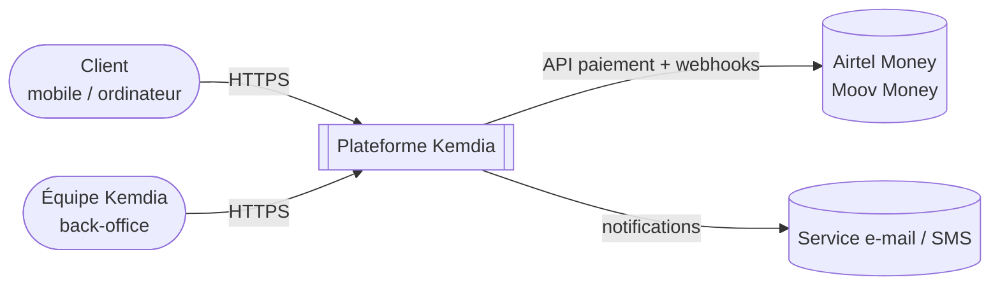

### 3.2 Conteneurs (C4 niveau 2) — cible

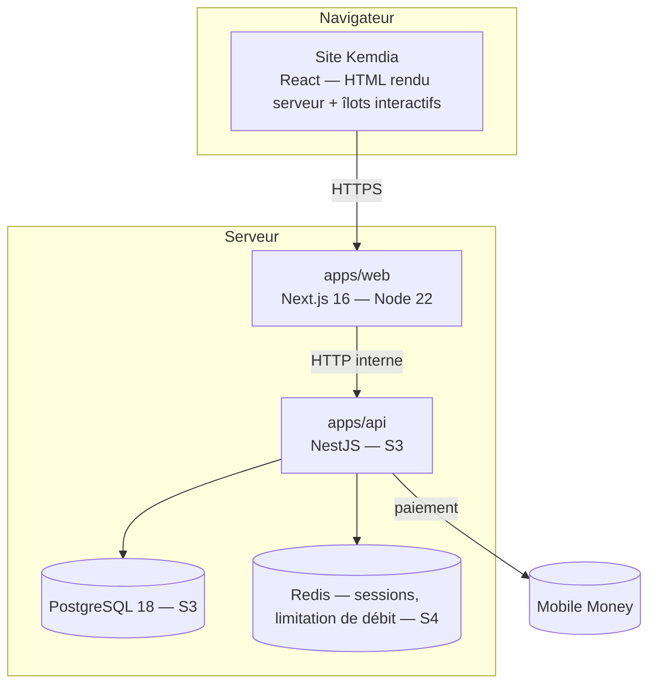

**État au Sprint 1** : seul `apps/web` existe ; le catalogue provient d'un fichier de démonstration
lu côté serveur par `src/lib/catalog.ts`, qui sera remplacé par des appels à l'API sans modifier les composants.

**État au S3-T02** : `apps/api` existe (socle, contrôle de santé, aucune route métier) et se connecte à PostgreSQL ;
le module `catalog` (S3-T03) lit et écrit catégories, produits et variantes ; ses routes HTTP arrivent au S3-T04,
exposé en HTTP sous `/api/v1` (S3-T04, §3.7) ; le site l'appellera au S3-T05.

**État au S3-T05** : le serveur du site lit le catalogue **dans l'API** (§5.9, [ADR-0011](adr/0011-site-branche-api.md)) ;
le navigateur ne l'appelle jamais directement. Le fichier de démonstration ne sert plus qu'à la démo Render, jusqu'au S3-T07.

**État au S3-T07** : la démo publique fait tourner les **trois** conteneurs — site et API sur Render Free, PostgreSQL sur Neon Free —
([ADR-0013](adr/0013-demo-render-api-neon.md), §8). Sur Render gratuit, le site appelle l'API par son **adresse publique** (HTTPS + clé interne) :
un service gratuit ne reçoit pas de trafic privé. Le fichier de démonstration ne sert plus qu'au développement sans base (retrait au S3-T08).

**État au S3-T08** : le site lit **toujours** l'API, dans tous les environnements (développement compris) ; sans `API_URL` ni clé,
il refuse de démarrer. Les données de démonstration ne servent plus qu'à remplir la base (`db:seed`, démo Render).

### 3.3 Modules du backend (cible MVP)

Monolithe modulaire NestJS, architecture hexagonale, un schéma PostgreSQL par module
([ADR-0006](adr/0006-monolithe-modulaire-7-modules.md) — explications simples dans [concepts.md](concepts.md)).

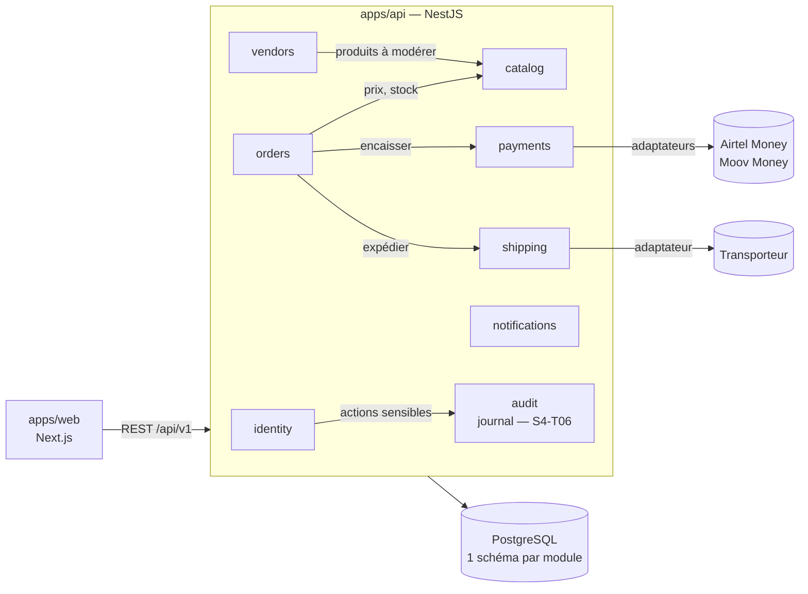

Le module **`audit`** (S4-T06, [ADR-0020](adr/0020-roles-journal-audit.md)) est un module de service : il ne dépend d'aucun autre,
n'a pas de route, et chaque module y inscrit ses actions sensibles (`AuditLog.record`) dans la même transaction que l'action.
Les routes protégées par rôle utilisent `@Authorize(…)`, exporté par `identity`.

### 3.4 Socle de l'API (`apps/api`, S3-T01)

Décision : [ADR-0007](adr/0007-socle-api-nestjs.md).

```
apps/api/
├── src/
│   ├── main.ts               Démarrage : configuration validée → application → écoute
│   ├── app.module.ts         Assemblage : configuration, journaux, santé, puis les modules métier
│   ├── config/               Schéma Zod des variables d'environnement (loadConfig) + jeton APP_CONFIG
│   ├── http/                 Réglages HTTP communs (configure-app), journaux, format des erreurs
│   ├── database/             Connexion PostgreSQL (PrismaService) et santé de la base (S3-T02)
│   ├── docs/                 Description OpenAPI générée + page /api/docs (S3-T04)
│   ├── generated/            Client Prisma généré (pnpm generate) — hors Git
│   ├── health/               GET /api/health (+ schéma de réponse)
│   └── modules/              Modules métier (catalog au S3-T03) — organisation : modules/README.md
├── prisma/
│   ├── schema/               main.prisma + un fichier par module (catalog.prisma…)
│   └── migrations/           Historique des migrations SQL (un seul pour tous les modules)
├── prisma.config.ts          Emplacements du schéma et des migrations, adresse de la base
├── test/                     Tests HTTP, tests d'architecture (code et schéma Prisma), intégration (*.int.test.ts)
└── .env.example              Liste commentée des variables
```

**Chemin d'une requête**

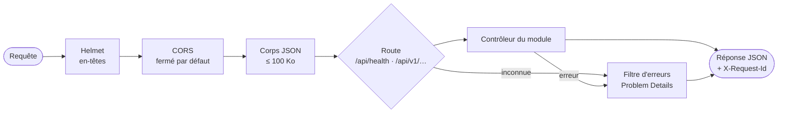

**Organisation d'un module** (hexagonale, vérifiée par `test/architecture.test.ts`) :
`domain/` (règles pures) ← `application/` (cas d'utilisation et ports) ← `infrastructure/` (Prisma…) et `interface/` (HTTP).
Un autre module n'entre que par `index.ts`.

**Configuration** (vérifiée au démarrage ; liste complète dans `apps/api/.env.example`) :

| Variable                        | Défaut                          | Règle en production                                                    |
| ------------------------------- | ------------------------------- | ---------------------------------------------------------------------- |
| `NODE_ENV`                      | `development`                   | `production`                                                           |
| `APP_ENV`                       | `local`                         | `demo`, `staging` ou `production`                                      |
| `APP_VERSION`                   | `dev`                           | **Obligatoire** (fournie par le pipeline)                              |
| `HOST`, `PORT`                  | `0.0.0.0:4000`                  | —                                                                      |
| `LOG_LEVEL`                     | `info`                          | `debug` et `trace` **interdits**                                       |
| `CORS_ORIGINS`                  | vide (fermé)                    | HTTPS uniquement                                                       |
| `TRUST_PROXY`                   | `0`                             | `1` derrière Caddy                                                     |
| `DATABASE_URL`                  | base locale de `docker compose` | **Obligatoire**, adresse de développement refusée ; jamais journalisée |
| `DATABASE_POOL_MAX`             | `10`                            | 1 à 50                                                                 |
| `DATABASE_STATEMENT_TIMEOUT_MS` | `10000`                         | 100 à 60 000                                                           |
| `RATE_LIMIT_PER_MINUTE`         | `120`                           | 10 à 10 000                                                            |
| `API_INTERNAL_KEY`              | aucune                          | Secret du serveur (32 à 128 caractères) ; jamais dans Git              |
| `API_DOCS`                      | `true` (dév.)                   | `false` par défaut                                                     |
| `SMS_ENABLED`                   | `false`                         | `true` seulement quand un fournisseur SMS est branché (ADR-0015)       |
| `EMAIL_TRANSPORT`               | `console` (poste) / `none`      | `brevo` sur la démo ; `console` refusé hors du poste (ADR-0016)        |
| `MAILPIT_URL`                   | `http://localhost:8025`         | — (boîte de test locale ; interdite en production)                     |
| `BREVO_API_KEY`                 | aucune                          | **Secret** ; obligatoire avec `brevo`                                  |
| `EMAIL_FROM`, `EMAIL_FROM_NAME` | `no-reply@kemdia.local`, Kemdia | Avec `brevo` : adresse vérifiée dans Brevo (obligatoire)               |

Une valeur invalide arrête l'API (code de sortie 1) avec la liste des variables en cause, **sans afficher leur valeur**.

### 3.5 Base de données (S3-T02)

Décision : [ADR-0008](adr/0008-postgresql-prisma.md) — guide pratique : [base-de-donnees.md](../guides/base-de-donnees.md).

```mermaid
flowchart LR
    subgraph api[apps/api]
      infra[infrastructure/ d'un module] --> ps[PrismaService<br/>adaptateur pg]
      health[/api/health/] --> dh[DatabaseHealth<br/>SELECT 1 ≤ 2 s]
      dh --> ps
    end
    ps -->|≤ 10 connexions<br/>requête ≤ 10 s| pg
    subgraph pg[(PostgreSQL 18 — base « kemdia »)]
      catalog[schéma catalog]
      identity[schéma identity — S4]
      auditdb[schéma audit — S4-T06<br/>ajout seul]
      futurs[orders · payments<br/>vendors · shipping — S5 à S7]
      pub[public : suivi des migrations]
    end
```

| Règle                                                                                                | Vérifiée par                                   |
| ---------------------------------------------------------------------------------------------------- | ---------------------------------------------- |
| Un fichier Prisma par module ; chaque modèle dans le schéma PostgreSQL du module (`@@schema`)        | `test/prisma-schema.test.ts`                   |
| Aucune relation vers un autre module : on stocke un UUID                                             | `test/prisma-schema.test.ts`                   |
| Seule la couche `infrastructure/` d'un module utilise Prisma                                         | `test/architecture.test.ts`                    |
| Toute modification du schéma a sa migration                                                          | CI : `db:deploy` puis `db:check` sur base vide |
| Une migration fusionnée n'est jamais modifiée ; on en ajoute une nouvelle                            | Revue de code                                  |
| Une migration ne casse pas la version précédente de l'API (« ajouter d'abord, supprimer plus tard ») | Revue de code (retour arrière possible)        |

**Transaction partagée (S4-T06)** : `TransactionContext` (`src/database/transaction-context.ts`) ouvre une transaction et la rend visible
à tous les dépôts appelés pendant le travail (AsyncLocalStorage) ; un appel imbriqué rejoint la transaction en cours.
C'est ce qui permet d'écrire une action (schéma `identity`) et sa trace (schéma `audit`) ensemble ou pas du tout, sans relation entre modules.

**Environnements** : poste → `docker compose up -d db` (accessible seulement depuis le poste) ; CI → base éphémère par exécution ;
démo → **Neon Free** (PostgreSQL 18, Francfort, S3-T07) ; production → serveur (S7). En ligne, les migrations sont appliquées par **l'image de l'API**
(`node dist/database/migrate.js`) avant le démarrage de la nouvelle version (§3.8) ; sur le poste, `pnpm db:deploy` reste disponible.
**Exception de la démo** : sans commande avant déploiement sur Render gratuit, migrations et import de démonstration sont lancés au démarrage
du conteneur (`start-demo.js`, refusé hors `APP_ENV=demo`, [ADR-0013](adr/0013-demo-render-api-neon.md)).

### 3.6 Module `catalog` (S3-T03)

Décision : [ADR-0009](adr/0009-modele-catalogue.md). Premier module métier : il sert de modèle aux suivants.

```
src/modules/catalog/
├── index.ts                    Port public : CatalogModule, CatalogService et types (seule entrée pour les autres modules)
├── catalog.module.ts           Branche les ports sur les dépôts Prisma
├── domain/                     TypeScript pur, sans framework
│   ├── values.ts               UUID (BR-042), adresse, prix FCFA entiers (BR-004), stock, texte de recherche
│   ├── category.ts             Catégorie + CategoryTree (parents, boucles, 3 niveaux (BR-005), descendants, fil d'Ariane)
│   └── product.ts              Product + variantes (FR-013), prix « à partir de », checkOrderable (BR-001)
├── application/
│   ├── ports.ts                CategoryRepository, ProductRepository, critères, pages, compteurs
│   ├── product-search.ts       Validation des recherches (liste blanche, bornes : leçon MED-13)
│   └── catalog.service.ts      Lecture du catalogue + checkAvailability (API REST au S3-T04, orders au S5)
└── infrastructure/
    ├── prisma-*.repository.ts  SQL via Prisma ; produit + variantes enregistrés en une transaction
    └── demo-catalog.ts         Import des données de démonstration (UUID v5 stables, relançable)
```

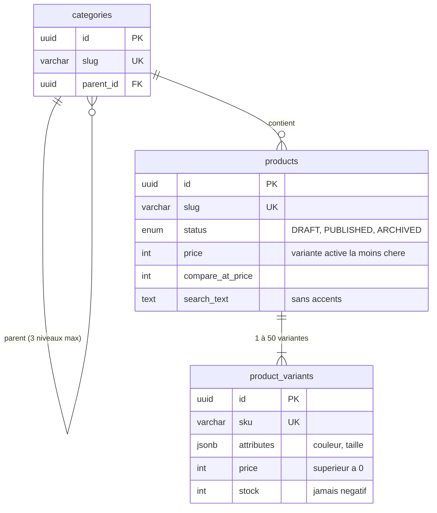

| Opération (`CatalogService`)      | Ce qu'elle fait                                                                                                         |
| --------------------------------- | ----------------------------------------------------------------------------------------------------------------------- |
| `getCategoryRoots`, `getCategory` | Arborescence (gardée 60 s en mémoire), fil d'Ariane, sous-catégories                                                    |
| `getProduct(slug)`                | Fiche produit avec variantes ; brouillons et archives → introuvable                                                     |
| `searchProducts(paramètres)`      | Catégorie **et sous-catégories**, mots sans accents, prix, marques, stock, promotion, note, 5 tris, pages de 48 au plus |
| `getFacets(paramètres, tranches)` | Compteurs des filtres, calculés avant application des filtres (comme le site)                                           |
| `checkAvailability(lignes)`       | BR-001 ligne par ligne : commandable, indisponible, variante inconnue, stock insuffisant (avec la quantité restante)    |

### 3.7 API REST `/api/v1` (S3-T04)

Décision : [ADR-0010](adr/0010-api-rest-openapi.md). Description complète : [`docs/api/openapi.json`](../api/openapi.json)
(OpenAPI 3.1, générée depuis les schémas Zod) ; page interactive `/api/docs` en développement.

| Route                                                  | Rôle                                                                                                   | Cache | Limite     |
| ------------------------------------------------------ | ------------------------------------------------------------------------------------------------------ | ----- | ---------- |
| `GET /api/v1/categories`                               | Arborescence complète (3 niveaux)                                                                      | 60 s  | 120/min/IP |
| `GET /api/v1/categories/{slug}`                        | Catégorie, fil d'Ariane, sous-catégories ; 404 si inconnue                                             | 60 s  | 120/min/IP |
| `GET /api/v1/products`                                 | Liste paginée : `category`, `q`, `sort`, `page`, `pageSize`, filtres, `scope=promotions`               | 60 s  | 120/min/IP |
| `GET /api/v1/products/facets`                          | Compteurs des filtres (mêmes paramètres)                                                               | 60 s  | 120/min/IP |
| `GET /api/v1/products/{slug}`                          | Fiche produit, variantes actives et leur stock ; 404 si brouillon ou archivé                           | 60 s  | 120/min/IP |
| `POST /api/v1/availability`                            | BR-001 ligne par ligne (ne modifie rien)                                                               | aucun | 30/min/IP  |
| `POST /api/v1/auth/signup`                             | Inscription : ticket + code ; **même réponse** si l'adresse a un compte (S4-T02)                       | aucun | 10/min/IP  |
| `POST /api/v1/auth/signup/verify`                      | Ticket + code → compte créé, déjà vérifié, **et session ouverte** (BR-041)                             | aucun | 10/min/IP  |
| `POST /api/v1/auth/signup/resend`                      | Nouveau code (60 s entre deux, 5 par heure)                                                            | aucun | 10/min/IP  |
| `POST /api/v1/auth/login`                              | Connexion ; 3 essais puis 15 min par identifiant, même réponse si l'adresse n'a pas de compte (S4-T03) | aucun | 10/min/IP  |
| `GET /api/v1/auth/session`                             | Session présentée (`Authorization: Bearer`) valable ? La prolonge                                      | aucun | 120/min/IP |
| `POST /api/v1/auth/logout`, `/logout-all`              | Fermer cette session, ou toutes celles du compte                                                       | aucun | 10/min/IP  |
| `POST /api/v1/auth/password/forgot`                    | Mot de passe oublié : ticket + code ; **même réponse, aucun e-mail** sans compte (S4-T04)              | aucun | 10/min/IP  |
| `POST /api/v1/auth/password/resend`                    | Nouveau code (60 s entre deux, 5 par heure)                                                            | aucun | 10/min/IP  |
| `POST /api/v1/auth/password/reset`                     | Ticket + code + nouveau mot de passe → **connecté ici, déconnecté ailleurs**, blocage levé             | aucun | 10/min/IP  |
| `POST /api/v1/admin/accounts/lookup`                   | Retrouver un compte par e-mail ou téléphone (dans le corps) — **admin, connexion < 15 min** (S4-T06)   | aucun | 30/min/IP  |
| `PUT\|DELETE /api/v1/admin/accounts/{id}/roles/{role}` | Accorder / retirer `vendor` ou `moderator` (jamais `admin`, jamais sur soi) — admin, < 15 min          | aucun | 30/min/IP  |
| `GET /api/v1/admin/audit`                              | Journal d'audit, du plus récent au plus ancien (curseur, filtres) — admin, < 15 min                    | aucun | 30/min/IP  |
| `GET /api/health`                                      | État de l'API et de la base                                                                            | aucun | aucune     |
| `GET /api/v1/openapi.json`, `/api/docs`                | Documentation (si `API_DOCS`, désactivée par défaut en production)                                     | 5 min | aucune     |

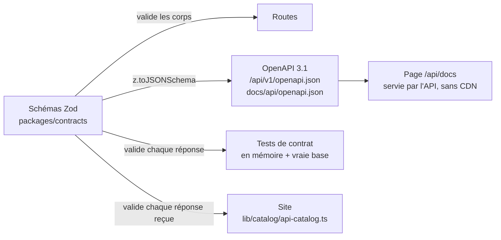

**Contrat partagé (S3-T05)** : les schémas vivent dans le paquet `packages/contracts` (`@kemdia/contracts`), utilisé par l'API **et** le site.
`@kemdia/contracts/constants` (tris, badges, tranches de prix, limites) n'embarque pas Zod : la couche `application` de l'API peut l'utiliser
(le test d'architecture l'autorise, et interdit le reste du paquet au domaine et à l'application). `@kemdia/contracts/demo` contient les données
et les identifiants de démonstration (UUID v5). Le paquet est compilé à l'installation (`prepare`) et par Turborepo (`^build`).
Le paramètre `badge` (`featured`, `new`, `bestseller`) et le tri `ventes` ont été ajoutés pour l'accueil ; chaque produit de liste porte
sa **variante par défaut** (`variantId`, `stock`) et `variantCount` (contrat 1.1.0).

**Erreurs métier (S4-T02)** : champ `code` stable dans les Problem Details (`CODE_INVALIDE`, `CODE_EXPIRE`, `ENVOI_TROP_RAPPROCHE`…,
liste `IDENTITY_ERROR_CODES` du contrat) et en-tête `Retry-After` pour les limites ; contrat 1.2.0.
Connexion et sessions : contrat 1.3.0 (S4-T03) ; mot de passe oublié : contrat 1.4.0 (S4-T04) ;
rôles (`roles` dans `AccountView`), administration et journal : contrat 1.5.0 (S4-T06).

**Limitation de débit** (mise à jour au S4-T07, [ADR-0021](adr/0021-csrf-csp-limites.md)) — compteurs en mémoire de l'API :

| Qui appelle                                                       | Compté par                                                                            | Limites                                       |
| ----------------------------------------------------------------- | ------------------------------------------------------------------------------------- | --------------------------------------------- |
| Un appelant direct                                                | Adresse (`req.ip`, `X-Forwarded-For` seulement derrière `TRUST_PROXY`) ; IPv6 par /64 | Celles du tableau ci-dessus                   |
| Le site **pour un visiteur** (clé interne + `X-Kemdia-Client-IP`) | Adresse du visiteur (illisible → compteur commun « inconnue »)                        | ×3 (CGNAT des opérateurs mobiles)             |
| Le site **sans visiteur** (lecture du catalogue)                  | —                                                                                     | Aucune (le site sert tout le monde)           |
| Toute route connectée (`SessionGuard`)                            | **Compte** et route                                                                   | 120/min ; « tous mes appareils » 5 ; admin 30 |

Dépassement : 429, code `TROP_DE_REQUETES`, en-tête `Retry-After`. Contrat 1.6.0.

### 3.8 Image Docker de l'API (S3-T06)

Décision : [ADR-0012](adr/0012-image-api-migrations.md). Fichier : `apps/api/Dockerfile` (construit depuis la racine du dépôt).

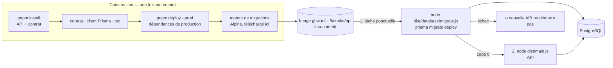

| Élément       | Valeur                                                                                                                            |
| ------------- | --------------------------------------------------------------------------------------------------------------------------------- |
| Base          | `node:22-alpine` mis à jour, sans npm ni corepack                                                                                 |
| Contenu       | `dist/`, dépendances de production, `prisma/schema`, `prisma/migrations`, `prisma.config.ts`, moteur `/app/engines/schema-engine` |
| Exécution     | Utilisateur `kemdia` (1001), fichiers en lecture seule, port 4000, `HEALTHCHECK` sur `/api/health` (base comprise)                |
| Variables     | Celles de l'API (`apps/api/.env.example`) ; l'image fixe `NODE_ENV=production`, `APP_ENV=production` et `APP_VERSION` (sha)       |
| Migrations    | Même image, même configuration ; vérifiée comme au démarrage de l'API ; ne fait rien si la base est à jour ; verrou PostgreSQL    |
| Local         | `docker compose up --build` : `db` → `api-migrate` → `api` (port 4000) → `web` (lit l'API si `API_INTERNAL_KEY` est dans `.env`)  |
| Démo (S3-T07) | `node dist/database/start-demo.js` : migrations → import de démonstration (`demo-import.js`) → API. Refusé si `APP_ENV` ≠ `demo`  |

### 3.9 Module `identity` (S4-T01)

Décision : [ADR-0015](adr/0015-identite-sessions-otp.md). Même organisation que `catalog` (§3.6) ; les routes arrivent au S4-T02 et S4-T03.

```
src/modules/identity/
├── index.ts                         Port public : IdentityModule, SessionGuard, @CurrentSession, SessionService, IdentityError
├── identity.module.ts               Branche les ports ; choisit l'envoi des codes selon l'environnement
├── domain/                          TypeScript pur
│   ├── identifier.ts                E-mail ou mobile gabonais normalisé (+2410[67]…), masquage (FR-004)
│   ├── password-policy.ts           8 à 128 caractères, lettre + chiffre, mots de passe courants ; prénom et nom
│   ├── account.ts                   Compte (créé vérifié, BR-041), vue du titulaire
│   ├── login-guard.ts               BR-040 par identifiant : 3 essais en 15 min puis 15 min de blocage (S4-T03)
│   ├── session.ts                   Session : 30 jours glissants, prolongée au plus une fois par heure (S4-T03)
│   ├── otp.ts                       Code à 6 chiffres : empreinte seulement, 10 min, 5 essais, temps constant
│   ├── role.ts                      Rôles cumulables, hiérarchie, qui peut accorder quoi (CRIT-06), connexion < 15 min (S4-T06)
│   ├── signup-ticket.ts             Ticket d'inscription : 32 octets, empreinte SHA-256, 24 h (S4-T02)
│   └── reset-ticket.ts              Ticket de mot de passe oublié : 32 octets, empreinte SHA-256, 1 h (S4-T04)
├── application/
│   ├── ports.ts                     Dépôts (comptes, codes, tickets), PasswordHasher, OtpSender, Clock
│   ├── otp.service.ts               Envoi (60 s entre deux, 5 par heure, SMS seulement si SMS_ENABLED) : code, alerte ou rien ; vérification
│   ├── signup.service.ts            Inscription sans énumération (leurre + alerte) ; compte créé au bon code ; renvoi (S4-T02, ADR-0016)
│   ├── login.service.ts             Connexion sans énumération : essai réservé avant vérification, hachage factice (S4-T03)
│   ├── session.service.ts           Ouvrir, vérifier, prolonger, fermer une session ; « tous mes appareils » (S4-T03)
│   ├── password-reset.service.ts    Mot de passe oublié sans énumération (leurre, aucun e-mail) ; changement en une transaction (S4-T04, ADR-0018)
│   └── role.service.ts              Accorder / retirer un rôle + ligne d'audit en une transaction ; commande serveur `admin` (S4-T06)
├── interface/
│   ├── identity.controller.ts       /auth/signup…, /login, /session, /logout, /logout-all, /password/forgot, /resend, /reset
│   ├── session.guard.ts             SessionGuard (jeton `Authorization: Bearer`) pour toutes les routes protégées
│   ├── role.guard.ts                @Authorize(rôle, { recentLogin }) = SessionGuard + RoleGuard, fermée par défaut (S4-T06)
│   ├── admin.controller.ts          /admin/accounts/lookup, /admin/accounts/{id}/roles/{role}, /admin/audit (S4-T06)
│   └── identity-http-errors.ts      Erreur métier → statut HTTP + code + Retry-After
└── infrastructure/
    ├── argon2-password-hasher.ts    Argon2id (19 Mio, 2 passes)
    ├── otp-sender.factory.ts        EMAIL_TRANSPORT : console (poste), Mailpit, Brevo, ou aucun envoi
    ├── email/                       Modèles d'e-mails (FR, sans lien) ; API web de Mailpit et de Brevo (délai 10 s)
    ├── identity-maintenance.ts      Ménage horaire : sessions, codes, tickets et compteurs périmés
    ├── prisma-role.repository.ts    Rôles : statut du compte relu sous verrou (FOR SHARE), ajout sans doublon (S4-T06)
    └── prisma-*.repository.ts       Comptes (avec leurs rôles), codes, tickets, sessions ; essais de connexion en une requête atomique
```

Tables du schéma `identity` :

| Table            | Contenu                                                                                                                | Contraintes SQL ajoutées à la main                                                                |
| ---------------- | ---------------------------------------------------------------------------------------------------------------------- | ------------------------------------------------------------------------------------------------- |
| `accounts`       | Prénom, nom, e-mail et/ou téléphone (uniques), hachage Argon2id, version du mot de passe, statut, vérifications        | Au moins un identifiant ; e-mail en minuscules ; téléphone `+2410[67]` ; actif ⇒ vérifié          |
| `otp_challenges` | Usage (inscription / oubli), canal, destination, **empreinte** du code, essais, expiration                             | Empreinte hexadécimale de 64 caractères ; 0 à 5 essais                                            |
| `sessions`       | Compte, **empreinte** du jeton (unique), expiration, dernière activité, révocation, version du mot de passe            | Empreinte hexadécimale ; suppression en cascade avec le compte                                    |
| `reset_tickets`  | **Empreinte** du ticket, destination, compte (vide = leurre), expiration (S4-T04)                                      | Empreinte hexadécimale ; expiration après création ; suppression en cascade avec le compte        |
| `login_guards`   | Identifiant (compte ou pas), essais, fin du blocage, dernière tentative (S4-T03)                                       | Essais ≥ 0 ; écrit seulement par `INSERT … ON CONFLICT DO UPDATE`                                 |
| `signup_tickets` | **Empreinte** du ticket, destination, inscription (prénom, nom, hachage ; vide = leurre), expiration (S4-T02)          | Empreinte hexadécimale ; inscription complète ou vide ; une seule par destination                 |
| `account_roles`  | Compte, rôle (`VENDOR`, `MODERATOR`, `ADMIN`), date, administrateur qui l'a accordé (vide = commande serveur) (S4-T06) | Un rôle par ligne (clé compte + rôle) ; jamais accordé par son titulaire ; cascade avec le compte |

**Rôles (S4-T06, [ADR-0020](adr/0020-roles-journal-audit.md))** : `client` (tout compte actif, jamais stocké), `vendor`, `moderator`, `admin`,
cumulables ; `admin` a les droits de `moderator`. Un administrateur accorde ou retire `vendor` / `moderator` à un autre compte ; `admin`
s'accorde seulement par la commande serveur :

```bash
pnpm --filter @kemdia/api admin:grant  awa@exemple.ga   # le compte doit être inscrit et vérifié
pnpm --filter @kemdia/api admin:revoke awa@exemple.ga
# image Docker : node dist/cli/admin-role.js grant awa@exemple.ga
```

Les rôles sont lus avec le compte à chaque requête : un rôle retiré ne sert plus, tout de suite.

### 3.10 Module `audit` (S4-T06)

Décision : [ADR-0020](adr/0020-roles-journal-audit.md).

```
src/modules/audit/
├── index.ts                         Port public : AuditModule, AuditLog (écrire), AuditReader (lire), auditContextOf(req)
├── domain/audit-event.ts            Actions (liste fermée), acteur, cible, détails courts sans caractère de contrôle ; 365 jours
├── application/audit-log.ts         Écrire (dans la transaction de l'action) ; lire par pages de 100 au plus
├── infrastructure/
│   ├── prisma-audit.repository.ts   Écriture via TransactionContext ; lecture par curseur (date, id) ; purge par lots
│   └── audit-retention.ts           Purge toutes les 6 h des lignes de plus de 365 jours
└── interface/request-context.ts     Adresse IP vue par l'API, identifiant de requête
```

| Action                 | Écrite par                         | Détails          |
| ---------------------- | ---------------------------------- | ---------------- |
| `role.granted`         | Administrateur ou commande serveur | `role`, `source` |
| `role.revoked`         | Administrateur ou commande serveur | `role`, `source` |
| `password.reset`       | Titulaire (mot de passe oublié)    | —                |
| `sessions.revoked_all` | Titulaire (« tous mes appareils ») | `count` (si ≥ 1) |

Table `audit.events` : identifiant, date (**posée par la base**), action, type et UUID de l'acteur, type et UUID de la cible, détails (JSON ≤ 2 Ko),
adresse IP, identifiant de requête. Déclencheurs SQL : **aucune modification**, suppression seulement après 365 jours, `TRUNCATE` interdit.
Pas de clé étrangère vers les comptes : la trace survit au compte.

## 4. Choix technologiques

| Couche    | Choix                                                                  | Version     | Justification                                                                                                                                                     |
| --------- | ---------------------------------------------------------------------- | ----------- | ----------------------------------------------------------------------------------------------------------------------------------------------------------------- |
| Langage   | TypeScript (strict)                                                    | 6.0         | Un seul langage front/back — [ADR-0002](adr/0002-stack-typescript-nextjs.md) ; 6.0 « pont » vers la 7 ([ADR-0014](adr/0014-versions-outils-typescript-eslint.md)) |
| Frontend  | Next.js (App Router) + React                                           | 16.3 / 19.2 | SSR/SSG, SEO, Server Components                                                                                                                                   |
| Style     | Tailwind CSS                                                           | 4           | Design tokens centralisés, CSS final minimal                                                                                                                      |
| Icônes    | lucide-react                                                           | —           | Seules les icônes utilisées sont embarquées                                                                                                                       |
| Polices   | Inter + Montserrat (auto-hébergées, @fontsource)                       | —           | Aucune requête vers Google : vie privée + CSP stricte                                                                                                             |
| Tests     | Vitest + Testing Library                                               | 5           | Rapide, compatible TypeScript                                                                                                                                     |
| Qualité   | ESLint (configuration « à plat »)                                      | 10 / 9      | 10 pour l'API et le contrat, 9 pour le site tant que `eslint-config-next` ne suit pas ([ADR-0014](adr/0014-versions-outils-typescript-eslint.md))                 |
| Monorepo  | pnpm + Turborepo                                                       | 10 / 2      | [ADR-0003](adr/0003-monorepo.md)                                                                                                                                  |
| Conteneur | Docker (Node 22 Alpine, utilisateur non-root)                          | —           | Même artefact en préprod et prod                                                                                                                                  |
| CI/CD     | GitHub Actions                                                         | —           | Intégré au dépôt                                                                                                                                                  |
| Backend   | NestJS (modules ES, Express 5) + Zod + pino                            | 12 / 4 / 10 | S3 — [ADR-0006](adr/0006-monolithe-modulaire-7-modules.md), [ADR-0007](adr/0007-socle-api-nestjs.md)                                                              |
| Base      | PostgreSQL + Prisma (adaptateur `pg`), un schéma par module            | 18 / 7.10   | S3 — [ADR-0008](adr/0008-postgresql-prisma.md)                                                                                                                    |
| API       | OpenAPI 3.1 (depuis Zod), Swagger UI auto-hébergé, `@nestjs/throttler` | 3.1 / 5 / 6 | S3-T04 — [ADR-0010](adr/0010-api-rest-openapi.md)                                                                                                                 |
| Contrat   | Paquet `@kemdia/contracts` (Zod), partagé par l'API et le site         | 4           | S3-T05 — [ADR-0011](adr/0011-site-branche-api.md)                                                                                                                 |

## 5. Architecture du frontend (`apps/web`)

### 5.1 Organisation du code

```
apps/web/src
├── app/                     Routes (1 dossier = 1 URL)
│   ├── page.tsx             Accueil
│   ├── categorie/[slug]/    Liste par catégorie (rendu à la demande : tri/pagination)
│   ├── produit/[slug]/      Fiche produit (variante choisie par ?variante=<sku>)
│   ├── recherche/           Résultats de recherche (non indexés)
│   ├── connexion/  inscription/  mot-de-passe-oublie/   Parcours d'identité (S2)
│   ├── commande/  favoris/  vendre/                     Tunnel de commande, favoris, page vendeur (S2)
│   ├── promotions/  categories/  panier/  compte/  infos/[slug]/
│   ├── sitemap.ts  robots.ts  icon.svg  not-found.tsx  error.tsx  global-error.tsx
│   └── layout.tsx           Gabarit commun : en-tête, pied de page, fournisseurs
├── components/
│   ├── layout/              TopBar, Header, SearchForm, CategoryNav (méga-menu + tiroir), Footer, MobileTabBar
│   ├── home/                Hero + HeroCarousel, CategoryBubbles, FlashSales, CategoryTiles, Countdown, Newsletter
│   ├── catalog/             ProductListing (tri + pagination), Breadcrumbs, SortSelect
│   ├── product/             ProductCard, ProductRail, ProductGallery, BuyBox, StickyBuyBar, AddToCartButton, VariantPicker
│   ├── auth/                Formulaires d'identité, saisie du code OTP, champs accessibles
│   ├── cart/                MiniCart
│   ├── location/            LocationModal (Gabon)
│   ├── providers/           Panier, ville de livraison, notifications
│   └── ui/                  Logo, Price, Rating, CategoryIcon
├── lib/                     Logique pure, testée
│   ├── catalog/             Port du catalogue (server-only) : index.ts (seul point d'entrée des pages),
│   │                        port.ts, api-catalog.ts (HTTP), file-catalog.ts (démo) — §5.9
│   ├── config/              Source du catalogue choisie et vérifiée au démarrage (instrumentation.ts)
│   ├── cart.ts              Réducteur du panier (une ligne = une variante) + validation du stockage
│   ├── product-view.ts      Variante choisie, caractéristiques, ligne de panier de la fiche
│   ├── delivery.ts          Villes, zones, calcul des frais
│   ├── auth/                Validation (téléphone gabonais, e-mail, mot de passe) + port AuthClient
│   ├── search-params.ts     Validation des paramètres d'URL (liste blanche, adresse de retour)
│   └── format.ts  site.ts  types.ts (types du contrat)  cn.ts
└── instrumentation.ts       Vérifie la configuration au démarrage du serveur

packages/contracts/          Schémas Zod et constantes partagés avec l'API ; données de démonstration (/demo)
```

### 5.2 Rendu des pages

| Page                                        | Mode                                                                  | Raison                                                              |
| ------------------------------------------- | --------------------------------------------------------------------- | ------------------------------------------------------------------- |
| **Toutes les pages (S4-T07)**               | **À la demande** (`connection()` dans le layout)                      | CSP à nonce : chaque page porte le nonce de SA requête (ADR-0021)   |
| Compte, favoris, commande, pages d'identité | À la demande (statiques avant le S4-T07)                              | Panier et favoris remplis côté navigateur                           |
| Toute page qui lit le catalogue (S3-T05)    | À la demande (`connection()`)                                         | Aucun appel à l'API pendant `next build` (§5.9) ; cache de 60 s     |
| Accueil, fiche produit                      | À la demande (S2-T05)                                                 | Liens absolus des aperçus WhatsApp tirés de `SITE_URL` au démarrage |
| Accueil — bas de page (S3-T08)              | Zones `<Suspense>` envoyées au fil de l'eau                           | Haut de page envoyé sans attendre ; voir ci-dessous                 |
| Aperçus `opengraph-image`                   | À la demande (S3-T05)                                                 | Image 1200 × 630 ; prix lu dans l'API                               |
| Catégorie, recherche, promotions            | Dynamique                                                             | Dépend de `?tri=`, `?page=` et des filtres                          |
| Infos                                       | Liste fermée (`dynamicParams = false`), à la demande depuis le S4-T07 | Toute autre URL → 404                                               |

Composants **serveur** par défaut ; seuls les éléments interactifs sont des composants **client**
(`"use client"`) : panier, mini-panier, menu, modale de ville, galerie, compte à rebours, tri.

**Accueil allégé (S3-T08)** — ~50 cartes produits sous la ligne de flottaison bloquaient le téléphone au chargement :

| Technique                                                  | Effet                                                                                                                                                       |
| ---------------------------------------------------------- | ----------------------------------------------------------------------------------------------------------------------------------------------------------- |
| Une zone `<Suspense>` par section (`HomeSections.tsx`)     | Le haut de page part sans attendre les rangées du bas                                                                                                       |
| `content-visibility: auto` (sections du bas, pied de page) | Le navigateur ne calcule leur mise en page qu'à l'approche ; hauteur réservée (`contain-intrinsic-size`)                                                    |
| Hydratation à la demande (`HydrateWhenVisible`)            | Le HTML est là dès le début (référencement), React ne le rend interactif qu'à 400 px de l'écran ou au focus clavier ; navigation côté client : rendu direct |
| Un lien de moins par carte                                 | L'image n'a plus son propre lien : celui du titre couvre déjà toute la carte                                                                                |

### 5.3 Correspondance avec l'ancien projet Django

| Django (ancien)                                                 | Kemdia (nouveau)                                              | Gain                                   |
| --------------------------------------------------------------- | ------------------------------------------------------------- | -------------------------------------- |
| `templates/base.html` (700 lignes : HTML + JS + CSS mêlés)      | `app/layout.tsx` + composants                                 | Séparation, typage                     |
| 3 partials `product_card_*.html` (~760 lignes)                  | 1 `ProductCard` + prop `badge`                                | Pas de duplication                     |
| `header.html` + `location_modal.html` + JS inline               | `Header`, `HeaderActions`, `LocationModal` (`<dialog>` natif) | Accessibilité, pas d'`innerHTML`       |
| `navigation.html` + `category_mega_menu.html`                   | `CategoryNav`                                                 | Méga-menu clavier + tiroir mobile      |
| 18 fichiers CSS + Bootstrap + Font Awesome + AOS + Swiper (CDN) | Tailwind + tokens `@theme`, lucide, défilement natif          | Aucun CDN tiers, ~36 Ko HTML compressé |
| Géolocalisation par IP via service externe                      | Choix explicite ville/quartier                                | Pas de fuite d'IP, pas de SSRF         |

### 5.4 Parcours d'identité (S2-T01, branché sur l'API au S4-T05)

Décision : [ADR-0019](adr/0019-site-branche-identite.md). Les formulaires parlent au port `AuthClient` ; depuis le S4-T05,
il est branché sur des **actions serveur** qui appellent l'API avec la clé interne. Le jeton de session et les tickets
restent dans des cookies `HttpOnly` : le navigateur ne les voit jamais.

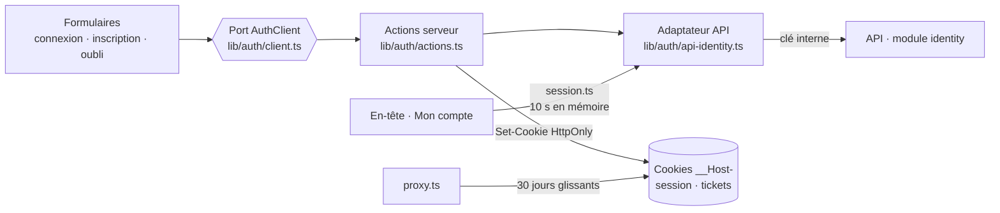

`proxy.ts` (S4-T07, ADR-0021) passe sur **toutes** les adresses sauf `_next/static` et `_next/image`, dans cet ordre :

1. **CSRF** : une requête qui modifie quelque chose doit avoir un `Origin` du site (et `Sec-Fetch-Site: same-origin` si le navigateur l'envoie), sinon 403 ;
2. **CSP à nonce** : nonce neuf, transmis à Next.js et renvoyé dans `Content-Security-Policy` ;
3. **cookie glissant** (S4-T05).

Le site transmet à l'API l'adresse du visiteur (`X-Kemdia-Client-IP`) si `CLIENT_IP_HEADER` est réglé (§5.9).

| Parcours            | Étapes                                                                                                       | Règles / exigences     |
| ------------------- | ------------------------------------------------------------------------------------------------------------ | ---------------------- |
| Inscription         | Prénom, nom, **e-mail** (SMS « bientôt »), mot de passe, CGV → code par e-mail → **compte créé et connecté** | FR-001, BR-041         |
| Connexion           | E-mail + mot de passe ; message neutre ; blocage avec délai ; **retour à la page d'avant** (`?retour=`)      | FR-004, BR-040, MED-01 |
| Mot de passe oublié | E-mail → code → nouveau mot de passe → **connecté ici, déconnecté ailleurs**                                 | FR-012                 |
| En-tête             | « Bonjour, Awa » + menu (Mon compte, Se déconnecter) ; visiteur : « Se connecter » avec retour               | —                      |
| Mon compte          | Identité ; « Se déconnecter » ; « Déconnecter tous mes appareils » ; commandes et adresses « bientôt »       | —                      |

Numéros acceptés : mobiles gabonais à 9 chiffres `06…` (Moov) et `07…` (Airtel), avec ou sans `+241` ;
forme enregistrée `+241077123456`. L'API applique les mêmes règles (§3.9, test `identity-alignment`).
**SMS différé** ([ADR-0015](adr/0015-identite-sessions-otp.md)) : tant que le client n'a pas choisi de fournisseur, `SMS_ENABLED=false`
et l'option téléphone est affichée « bientôt disponible » ; l'inscription et la connexion se font par e-mail.

### 5.5 Charte graphique (tokens `globals.css`)

Direction (S2-T10) : **une place de marché dense**, inspirée des usages des grands sites (Amazon, Jumia) sans reprendre leur identité,
avec une signature propre : le prix affiché comme une **étiquette de marché**.

| Token                     | Valeur                            | Usage                                                                  |
| ------------------------- | --------------------------------- | ---------------------------------------------------------------------- |
| `brand-600`               | `#d61f2c`                         | Rouge Kemdia : actions, bandeau ventes flash, bannière                 |
| `accent-400`              | `#ffc629`                         | Jaune : pastilles de remise (inclinées), bouton « Acheter maintenant » |
| `ink-900`                 | `#14181e`                         | Texte, navigation                                                      |
| `ink-50`                  | `#eef0f3`                         | Fond « marché » : les blocs blancs ressortent                          |
| `forest-600`              | `#0b7a4b`                         | Livraison, stock, espace vendeur                                       |
| `gabon-green/yellow/blue` | `#009e60` / `#fcd116` / `#3a75c4` | Rappels discrets du drapeau                                            |

**Typographie** : une seule famille, **Archivo** à largeur variable (auto-hébergée, aucun CDN) :

| Rôle   | Réglage                                     | Classe                 |
| ------ | ------------------------------------------- | ---------------------- |
| Texte  | largeur 100 %, graisse 400–600              | `font-sans`            |
| Titres | largeur 112 %, graisse 800                  | `h1`–`h3`              |
| Prix   | largeur 78 %, graisse 800, chiffres alignés | `font-price` (`Price`) |

### 5.6 Structure des pages principales

| Page          | Organisation                                                                                                                                                                                                          |
| ------------- | --------------------------------------------------------------------------------------------------------------------------------------------------------------------------------------------------------------------- |
| Accueil       | Catégories à gauche · carrousel de bannières · raccourcis compte / vendeur ; ronds des rayons ; ventes flash (stock restant, compte à rebours) ; tuiles « un rayon, 4 produits » ; rangées de produits                |
| Fiche produit | Galerie · informations et prix (économie en FCFA) · encadré d'achat (date de livraison selon la ville, 2 boutons, garanties) ; sections Description / Caractéristiques / Avis                                         |
| Listes        | Catégorie, recherche, promotions : même gabarit `CatalogView` — filtres à gauche (prix, marque, promotion, stock, note ; panneau qui monte du bas sur mobile), filtres actifs en pastilles, tri, 20 produits par page |
| Panier        | Barre « livraison offerte » (reste à ajouter), lignes détaillées, récapitulatif collé à droite (en bas sur mobile), suggestions                                                                                       |
| Mobile        | Barre d'onglets en bas (Accueil, Rayons, Promos, Panier, Compte) ; sur la fiche produit, remplacée par une barre d'achat                                                                                              |

Accessibilité du carrousel : pause au survol et au focus, aucun défilement automatique si l'utilisateur réduit les animations,
bannières masquées rendues inactives (`inert`).

### 5.7 Tunnel de commande (S2-T02)

Page `/commande`, en 4 étapes sur une seule page (chaque étape terminée se replie en résumé avec « Modifier ») :

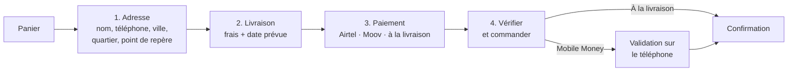

| Choix                           | Raison                                                                                                      |
| ------------------------------- | ----------------------------------------------------------------------------------------------------------- |
| **Point de repère** obligatoire | Au Gabon, on se repère plus souvent ainsi que par numéro de rue ; c'est ce qui permet au livreur de trouver |
| Numéro de paiement pré-rempli   | Celui de l'adresse ; l'opérateur est déduit (07 → Airtel, 06 → Moov) et vérifié                             |
| Paiement à la livraison         | Grisé avec la raison si la ville ou le montant ne le permettent pas (BR-011, valeurs provisoires)           |
| Port `OrderClient`              | Adaptateur de démonstration en S2 ; API `orders` + `payments` en S5, sans changer l'interface               |

**Données envoyées au serveur** (`buildOrderRequest`) : `{ variantId, quantity }` pour chaque article (S3-T05), adresse, moyen et numéro de paiement.
**Jamais de prix, de total ni de frais** : le serveur les recalcule (BR-004, faille CRIT-01 de l'ancien site).

### 5.8 Favoris, partage et page vendeur (S2-T04 à T06)

| Fonction            | Fonctionnement                                                                                                                                  |
| ------------------- | ----------------------------------------------------------------------------------------------------------------------------------------------- |
| Favoris (FR-014)    | `FavoritesProvider` + `lib/favorites.ts` : stockés dans le navigateur, revalidés au chargement, 100 au plus ; synchronisés avec le compte au S4 |
| Partage WhatsApp    | Lien `wa.me` (texte encodé, `utm_source=whatsapp`), partage natif du téléphone ou copie du lien                                                 |
| Aperçus (OpenGraph) | `opengraph-image.tsx` : image 1200 × 630 par produit (photo, prix, remise) et pour le site, **générées à la construction**                      |
| Page vendeur        | `/vendre` : offre marketplace, étapes, conditions (KYC, BR-024), FAQ, demande d'ouverture (démo ; module `vendors` au S6)                       |

**Adresse publique lue au démarrage** : les aperçus WhatsApp exigent des liens absolus. La même image Docker sert la démo,
le staging et la production : l'adresse vient donc de la variable `SITE_URL` du serveur (`siteUrl()`), et les pages partagées
(accueil, fiches produit, `sitemap.xml`, `robots.txt`) sont rendues à la demande. Le catalogue étant gardé 60 s en mémoire (§5.9),
cela coûte quelques millisecondes par page.

### 5.9 Lecture du catalogue dans l'API (S3-T05)

Décision : [ADR-0011](adr/0011-site-branche-api.md).

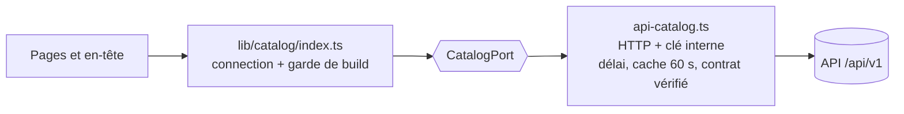

| Configuration (au démarrage)                          | Comportement                                                                                  |
| ----------------------------------------------------- | --------------------------------------------------------------------------------------------- |
| `API_URL` + `API_INTERNAL_KEY`                        | Catalogue lu dans l'API ; API muette, en retard ou réponse hors contrat → page d'erreur (500) |
| `API_URL` ou clé absente (tout environnement, S3-T08) | **Le serveur refuse de démarrer** (code 1, message en français nommant la variable)           |
| Adresse ou clé invalides                              | Refus de démarrer                                                                             |

- **Un seul adaptateur** depuis le S3-T08 (le mode fichier est retiré). Jamais de données de secours : une panne doit se voir, pas afficher de faux prix.
  Les tests du site utilisent une fausse API en mémoire (`lib/catalog/test-fake-api.ts`).
- **Construction** : `lib/catalog` appelle `connection()` (la page devient dynamique) puis refuse toute lecture si `NEXT_PHASE` est la construction.
  Une page qui tenterait de lire le catalogue au build fait donc échouer `next build` avec un message renvoyant à l'ADR-0011.
- **En-tête** : rendu sur toutes les pages, il affiche un menu des catégories vide si l'API est indisponible (et seulement dans ce cas) ;
  la page elle-même affiche l'erreur.
- **Panier** (`kemdia.cart.v2`) : une ligne = une variante ; les paniers `v1` sont effacés au chargement. Les **favoris** restent par produit (UUID).
- Variables : `API_URL`, `API_INTERNAL_KEY` (secret), `CATALOG_TIMEOUT_MS` (5000 par défaut, 90 000 au plus),
  `CLIENT_IP_HEADER` (S4-T07, vide par défaut : en-tête de l'hébergeur qui porte l'adresse du visiteur ; `x-forwarded-for` → dernière adresse ;
  nom invalide → refus de démarrer) — voir `apps/web/.env.example`.
- **Démo Render (S3-T07)** : au démarrage, le site réveille l'API en arrière-plan (`lib/config/wake-api.ts`, seulement avec `APP_ENV=demo`) ;
  `CATALOG_TIMEOUT_MS=90000` (le maximum, depuis la clôture du S3) laisse au premier visiteur le temps du réveil. `/api/health` du site indique `"catalog": "api"` (toujours, depuis le S3-T08 ; gardé pour le contrôle de la démo).

## 6. Sécurité

### 6.1 Principes

1. **Ne jamais faire confiance au client** : URL, formulaires, `localStorage`, en-têtes sont validés.
2. **Le serveur calcule tous les montants.**
3. **Aucun secret, aucune donnée réelle dans Git.**
4. **Moindre privilège** : conteneur non-root, système de fichiers en lecture seule, rôles stricts (S4-T06 : client, vendeur, modérateur, administrateur).
5. **Défense en profondeur** : validation + échappement + CSP + en-têtes.

### 6.2 Mesures en place (S1)

| Mesure                                                                                                                                         | Où                                       | Faille(s) de l'ancien projet évitée(s)    |
| ---------------------------------------------------------------------------------------------------------------------------------------------- | ---------------------------------------- | ----------------------------------------- |
| Content-Security-Policy, X-Frame-Options, HSTS, Referrer-Policy, Permissions-Policy, nosniff                                                   | `next.config.ts`                         | LOW-03                                    |
| CSP à nonce (S4-T07) : `script-src 'nonce-…' 'strict-dynamic'`, nonce neuf à chaque requête, plus de `'unsafe-inline'` pour les scripts        | `proxy.ts`, `lib/security/csp.ts`        | LOW-03, CRIT-04 (XSS)                     |
| CSRF (S4-T07) : toute requête qui modifie quelque chose doit venir du site (`Origin`, `Sec-Fetch-Site`), même sans `Origin`, sur toute adresse | `proxy.ts`, `lib/security/origin.ts`     | HIGH-16                                   |
| Adresse du visiteur transmise à l'API seulement selon `CLIENT_IP_HEADER` ; `X-Forwarded-For` : dernière adresse ; valeur validée (S4-T07)      | `lib/security/client-ip.ts`              | MED-05, usurpation d'adresse              |
| En-tête `X-Powered-By` supprimé                                                                                                                | `next.config.ts`                         | Empreinte technologique                   |
| React échappe tout texte ; aucun `innerHTML` sur des données                                                                                   | Tous les composants                      | CRIT-04 (XSS)                             |
| Tri/page/recherche validés par liste blanche et bornes                                                                                         | `lib/search-params.ts`                   | MED-13                                    |
| Filtres (prix, marque, stock, promo, note) : valeurs connues uniquement, marques comparées au catalogue                                        | `lib/filters.ts`                         | MED-13                                    |
| Commande : seuls identifiants + quantités envoyés (aucun montant) ; numéro de paiement vérifié selon l'opérateur                               | `lib/checkout.ts`                        | CRIT-01, HIGH-05                          |
| Optimiseur d'images limité à `/images/**` (URL externes refusées : 400)                                                                        | `next.config.ts`                         | HIGH-03 (SSRF)                            |
| `localStorage` validé champ par champ                                                                                                          | `lib/cart.ts`, `LocationProvider`        | Altération du panier                      |
| Ville choisie dans une liste fermée, aucune redirection construite depuis l'URL                                                                | `LocationModal`                          | MED-01, MED-06, MED-14                    |
| Code catalogue `server-only`                                                                                                                   | `lib/catalog/`                           | Fuite de logique côté client              |
| Catalogue (S3-T05) : réponses de l'API validées par le contrat, délai maximal, slug vérifié avant l'appel, jamais de repli silencieux          | `lib/catalog/api-catalog.ts`             | Données altérées, SSRF, faux prix         |
| Configuration du site vérifiée au démarrage : production sans API refusée, clé interne obligatoire, adresse sans identifiants (S3-T05)         | `lib/config/`, `instrumentation`         | CRIT-02, mauvais réglage                  |
| `.gitignore` : `.env*`, `*.sqlite3`, dumps                                                                                                     | racine                                   | CRIT-02, CRIT-03, CRIT-05, LOW-02         |
| Gitleaks (historique complet), pnpm audit, CodeQL, Dependabot, Trivy                                                                           | CI                                       | CRIT-02, HIGH-07                          |
| Pages d'erreur sans détail technique                                                                                                           | `error.tsx`                              | Fuite d'informations                      |
| Adresse de retour après connexion limitée aux chemins internes (`parseReturnTo`)                                                               | `lib/search-params.ts`                   | MED-01 (redirection ouverte)              |
| Messages identiques que le compte existe ou non (connexion, mot de passe oublié)                                                               | `components/auth/`                       | Énumération des comptes                   |
| Mot de passe : 8 caractères min., lettre + chiffre, liste des plus courants refusée ; jamais stocké dans le navigateur, effacé après envoi     | `lib/auth/validation.ts`                 | Mots de passe faibles                     |
| Code OTP : 5 essais max. puis nouveau code obligatoire, renvoi après 60 s — appliqués par l'API (S4-T02)                                       | API `identity`                           | MED-05, MED-10                            |
| Jeton de session et tickets dans des cookies `__Host-` `HttpOnly` `Secure` `SameSite=Lax`, jamais dans la page ni l'adresse (S4-T05)           | `lib/auth/cookies.ts`, `actions.ts`      | Vol de session (XSS), fixation de session |
| Actions serveur : arguments revérifiés (type, longueur, format), origine contrôlée par Next.js ; aucun secret renvoyé ni journalisé (S4-T05)   | `lib/auth/actions.ts`, `api-identity.ts` | Requêtes forgées, fuite de jeton          |
| Adresse de retour résolue comme le navigateur (`.`/`..`), jamais vers une page d'identité (S4-T05)                                             | `lib/search-params.ts`                   | MED-01                                    |
| Attributs `autocomplete` corrects (gestionnaires de mots de passe, code SMS auto-rempli)                                                       | Formulaires                              | Mots de passe réutilisés                  |

Le suivi détaillé des 45 failles est dans [`docs/securite/heritage-audit-django.md`](../securite/heritage-audit-django.md).

### 6.3 Sécurité de l'API (S3-T01)

| Mesure                                                                                                                                                                                                                                              | Où                                                                       | Faille(s) de l'ancien projet évitée(s)                         |
| --------------------------------------------------------------------------------------------------------------------------------------------------------------------------------------------------------------------------------------------------- | ------------------------------------------------------------------------ | -------------------------------------------------------------- |
| Configuration validée au démarrage ; valeurs jamais affichées ; `debug` interdit en production                                                                                                                                                      | `config/env.ts`                                                          | CRIT-02 (secrets), mauvaise config                             |
| CSP `default-src 'none'; frame-ancestors 'none'`, HSTS, `nosniff`, `X-Frame-Options: DENY`, sans `X-Powered-By`                                                                                                                                     | `http/configure-app.ts`                                                  | LOW-03, empreinte technologique                                |
| CORS fermé par défaut ; origines explicites, HTTPS en production                                                                                                                                                                                    | `http/configure-app.ts`                                                  | Appels depuis un site tiers                                    |
| Corps JSON limité à 100 Ko                                                                                                                                                                                                                          | `http/configure-app.ts`                                                  | Déni de service                                                |
| Erreurs imprévues : message générique (détail dans les journaux) ; 404 sans recopier l'adresse                                                                                                                                                      | `http/problem-details.filter.ts`                                         | Fuite d'informations, XSS réfléchie                            |
| Journaux sans paramètres d'URL, sans corps ni en-têtes ; champs sensibles masqués ; identifiant de requête                                                                                                                                          | `http/logging.ts`                                                        | Données personnelles dans les journaux                         |
| Couches et modules isolés (test d'architecture)                                                                                                                                                                                                     | `test/architecture.test.ts`                                              | Couplage, contournement des règles                             |
| `DATABASE_URL` jamais journalisée ; mot de passe masqué dans les messages du pilote ; adresse de développement refusée en production (S3-T02)                                                                                                       | `config/env.ts`, `database/`                                             | CRIT-02 (identifiants exposés)                                 |
| Requêtes SQL paramétrées (Prisma), testé avec une valeur hostile ; requête limitée à 10 s ; ≤ 10 connexions (S3-T02)                                                                                                                                | `database/prisma.service.ts`, test d'intégration                         | CRIT-04 (injection), déni de service                           |
| Recherche : mots réduits à `[a-z0-9]`, 8 mots et 100 caractères au plus ; pages de 48 au plus ; 10 marques au plus (S3-T03)                                                                                                                         | `catalog/application/product-search.ts`                                  | MED-13, déni de service                                        |
| Contraintes SQL : prix > 0, prix barré > prix, stock ≥ 0 ; catégorie non supprimable si elle contient des produits ; déclencheur : 3 niveaux au plus et aucune boucle (BR-005) (S3-T03)                                                             | migration `catalogue`                                                    | Montants et stocks incohérents                                 |
| Images de produits : chemins `/images/…` uniquement, jamais d'adresse externe (S3-T03)                                                                                                                                                              | `catalog/domain/category.ts`                                             | HIGH-03 (SSRF)                                                 |
| Tests d'intégration limités aux bases `*_test` (ils vident des tables) (S3-T03)                                                                                                                                                                     | `test/integration-db.ts`                                                 | Perte de données de développement                              |
| Limitation de débit par IP (120/min, 30/min pour la disponibilité), 429 en français + `Retry-After` ; clé interne du site comparée en temps constant (S3-T04)                                                                                       | `http/rate-limit.ts`                                                     | Déni de service, force brute                                   |
| Limites par visiteur (adresse transmise par le site, crue seulement avec la clé ; IPv6 par /64) et par compte sur chaque route connectée ; code `TROP_DE_REQUETES` (S4-T07)                                                                         | `http/client.ts`, `rate-limit.ts`, `identity/interface/session.guard.ts` | MED-05 (pas de limitation), force brute distribuée             |
| Image de l'API : non-root, lecture seule, sans npm ; moteur de migrations téléchargé à la construction ; scannée par Trivy ; migrations refusées si la configuration est fausse (S3-T06)                                                            | `apps/api/Dockerfile`, `database/migrate.ts`                             | Image vulnérable, base de développement en production          |
| Corps de requête validés par schéma, champs inconnus refusés (S3-T04)                                                                                                                                                                               | `packages/contracts/src/schemas.ts`                                      | Injection de champs (ex. un prix envoyé par le client)         |
| Page de documentation : fichiers servis par l'API (liste fermée), CSP propre, désactivée par défaut en production ; télémétrie `@scarf/scarf` bloquée (S3-T04)                                                                                      | `docs/`                                                                  | Script tiers, fuite d'informations                             |
| Base locale accessible seulement depuis le poste (`127.0.0.1`), authentification SCRAM-SHA-256 (S3-T02)                                                                                                                                             | `docker-compose.yml`                                                     | Base exposée sur le réseau                                     |
| Mots de passe hachés en Argon2id (OWASP) ; règles vérifiées par le serveur (S4-T01)                                                                                                                                                                 | `identity/infrastructure`, `identity/domain`                             | Mots de passe faibles ou mal stockés                           |
| Codes à usage unique : tirage cryptographique, empreinte seulement, 10 min, 5 essais, dernier code seul valable, 60 s et 5 par heure (S4-T01)                                                                                                       | `identity/domain/otp.ts`, `otp.service.ts`                               | HIGH-11 (vérification contournable), force brute               |
| Connexion sans énumération : blocage BR-040 compté par identifiant (compte ou pas), hachage factice, même message ; essai réservé avant la vérification (S4-T03)                                                                                    | `identity/application/login.service.ts`, `login_guards`                  | MED-10 (pas de verrouillage), force brute, énumération         |
| Sessions : jeton de 256 bits, empreinte seulement, 30 jours glissants, révocation immédiate, comptes désactivés exclus (S4-T03)                                                                                                                     | `identity/application/session.service.ts`                                | Sessions volées ou impossibles à fermer                        |
| Mot de passe oublié sans énumération (même réponse, aucun e-mail sans compte) ; ticket + code ; changement en une transaction : toutes les sessions fermées, blocage levé, avis au titulaire ; version du mot de passe dans chaque session (S4-T04) | `identity/application/password-reset.service.ts`, `reset_tickets`        | Prise de compte, sessions survivant au changement, énumération |
| Inscription sans énumération : même réponse, mêmes limites, même durée (hachage systématique) si l'adresse a un compte ; alerte au titulaire (S4-T02)                                                                                               | `identity/application/signup.service.ts`                                 | Énumération des comptes                                        |
| Essais de code comptés en une requête, limites d'envoi sous verrou par adresse : des demandes simultanées ne les contournent pas (S4-T02)                                                                                                           | `identity/infrastructure/prisma-otp-challenge.repository.ts`             | Force brute en parallèle, bombardement d'e-mails               |
| Ticket d'inscription (empreinte seulement) portant l'inscription ; compte créé au bon code : une deuxième inscription ne peut pas faire valider son mot de passe par le titulaire (S4-T02)                                                          | `identity/domain/signup-ticket.ts`                                       | Détournement d'inscription                                     |
| E-mails sans lien ni image, sans donnée saisie ; clé Brevo jamais journalisée, erreurs réduites au statut HTTP (S4-T02)                                                                                                                             | `identity/infrastructure/email/`                                         | Hameçonnage, injection, fuite de secret                        |
| Jamais de code écrit dans les journaux hors du poste de développement ; SMS refusé tant que `SMS_ENABLED=false` (S4-T01)                                                                                                                            | `identity/infrastructure/otp-sender.factory.ts`                          | Fuite de codes, coûts imprévus                                 |
| Rôles : seul un administrateur accorde `vendor` / `moderator` ; `admin` jamais par l'API ; jamais sur soi (aussi en SQL) ; UUID comparés sans casse ; statut du compte relu sous verrou (S4-T06)                                                    | `identity/domain/role.ts`, `role.service.ts`, migration                  | CRIT-06 (élévation), MED-07 (pas de hiérarchie)                |
| `@Authorize` fermée par défaut ; règles du contrôleur et de la méthode toutes exigées ; rôles relus à chaque requête ; administration : connexion de moins de 15 minutes (S4-T06)                                                                   | `identity/interface/role.guard.ts`                                       | Routes oubliées, rôle retiré encore utilisable, session volée  |
| Journal d'audit en ajout seul (déclencheurs SQL), date posée par la base, écrit dans la transaction de l'action, sans secret ; conservé 365 jours (S4-T06)                                                                                          | `modules/audit`, migration `roles_journal_audit`                         | Actions sans trace, effacement de traces, MED-18               |
| Premier administrateur par commande serveur sur un compte vérifié ; aucun mot de passe par défaut ; erreurs sans détail technique (S4-T06)                                                                                                          | `src/cli/admin-role.ts`                                                  | CRIT-02 (secrets), compte par défaut                           |

### 6.4 Prévu 🔜

- Démo : régler `CLIENT_IP_HEADER` une fois l'en-tête fiable de Render vérifié ; collecte des violations de CSP (`report-to`).
- S5 : signature des webhooks Mobile Money, idempotence des paiements, transactions SQL pour stock et coupons.
- S6 : écrans d'administration avec double authentification (MED-15) ; nouvelles actions au journal (KYC, modération).
- S7 : deux rôles PostgreSQL (migrations / application sans droit de modifier les tables **ni de désactiver les déclencheurs du journal d'audit**), connexion chiffrée selon l'hébergement, sauvegardes chiffrées testées.

## 7. DevOps — CI/CD

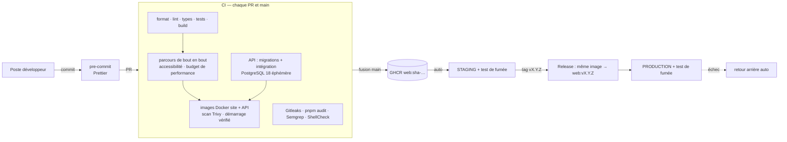

| Fichier                           | Rôle                                                                                                                                                                 |
| --------------------------------- | -------------------------------------------------------------------------------------------------------------------------------------------------------------------- |
| `.github/workflows/ci.yml`        | Qualité → bout en bout → image → scan → publication GHCR + Docker Hub (main) → staging + démo                                                                        |
| `.github/workflows/release.yml`   | Tag `vX.Y.Z` → promotion de l'image testée → Release GitHub → production                                                                                             |
| `.github/workflows/_deploy.yml`   | Déploiement réutilisable : SSH restreint, test de fumée, retour arrière                                                                                              |
| `.github/workflows/security.yml`  | Gitleaks, pnpm audit, Semgrep, ShellCheck ; CodeQL si dépôt public ; chaque lundi                                                                                    |
| `.github/dependabot.yml`          | Mises à jour hebdomadaires (npm, actions épinglées par SHA, image Docker)                                                                                            |
| `apps/web/Dockerfile`             | Multi-étapes, `standalone`, non-root, sans npm, healthcheck `/api/health`                                                                                            |
| `apps/api/`                       | Lint, types, tests (avec couverture) et build dans la même étape « qualité » que le site (S3-T01)                                                                    |
| Job « migrations et intégration » | Base PostgreSQL 18 éphémère : `db:deploy`, `db:check` (migrations = schéma), `test:int` (S3-T02)                                                                     |
| Job « bout en bout » (S3-T05)     | Site construit avec une API **injoignable**, puis parcours et performance contre la vraie API (PostgreSQL 18, clé éphémère) ; aucune réponse 429 tolérée             |
| `apps/api/Dockerfile` (S3-T06)    | Image de l'API : multi-étapes, dépendances de production seules, non-root, moteur de migrations embarqué                                                             |
| Job « image de l'API » (S3-T06)   | Construction, Trivy, migrations sur une base **vide** puis relance, refus d'une configuration fausse, API en lecture seule → `database: ok`, publication GHCR (main) |
| Job « image de l'API » (S3-T07)   | Démarrage de démo sur une base **vide** (migrations + 50 produits + API), redémarrage sans doublon, refus hors démo ; publication Docker Hub publique (main)         |
| Job « démo » (S3-T07)             | Render : API d'abord (version + `database: ok`), puis site (version, en-têtes, fiche produit, `catalog: "api"`) ; chaque partie ignorée sans son deploy hook         |
| Job « image » (S3-T05, S3-T08)    | Sans API, l'image refuse de démarrer (production comme démo) ; API muette → page d'erreur (500), jamais de catalogue de secours                                      |
| `deploy/`                         | Scripts et configuration serveur (voir §8)                                                                                                                           |
| `.husky/pre-commit`               | Formatage automatique avant chaque commit                                                                                                                            |

**Principes** : _build once, deploy many_ · déploiement par digest immuable · actions épinglées par SHA ·
aucun secret dans Git · tout changement passe par une PR.
**Stratégie de branches** : `main` toujours déployable ← PR depuis `feature/Sx-Tyy-description`.
Voir [`workflow-git.md`](../guides/workflow-git.md) et [`deploiement.md`](../guides/deploiement.md).

## 8. Déploiement

Décision : [ADR-0005](adr/0005-strategie-deploiement.md).

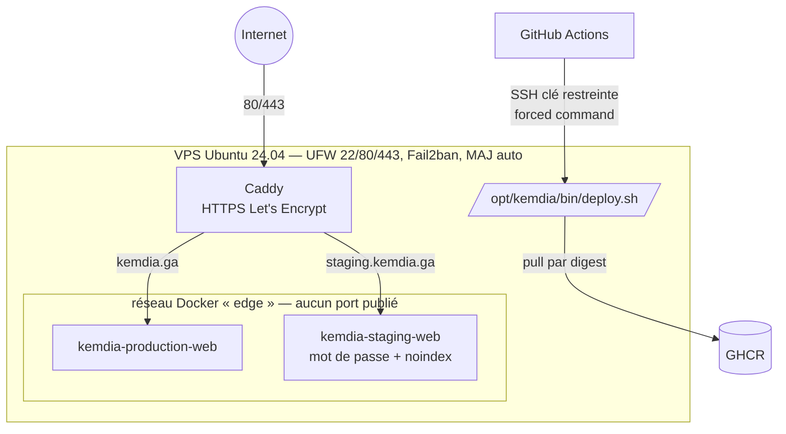

| Élément              | Choix                                                                                                                  |
| -------------------- | ---------------------------------------------------------------------------------------------------------------------- |
| Hébergement          | VPS Ubuntu 24.04 (2 vCPU / 4 Go), Europe de l'Ouest — à réévaluer avec l'APDPVP pour les données personnelles (S7)     |
| Conteneur applicatif | Lecture seule, `cap_drop: ALL`, `no-new-privileges`, 512 Mo max, logs bornés                                           |
| Environnements       | `demo` (Render Free, public, auto à chaque fusion) · `staging` (auto, protégé) · `production` (tag de version)         |
| Fiabilité            | Healthcheck, `compose up --wait`, test de fumée, retour arrière automatique, verrou anti-déploiements concurrents      |
| Traçabilité          | Release GitHub par version, résumé de chaque déploiement dans Actions, `/opt/kemdia/deploy.log`                        |
| Base de données      | PostgreSQL 18 ([§3.5](#35-base-de-données-s3-t02)) : démo sur **Neon Free** (S3-T07), serveur de production au S7      |
| API                  | Image sur GHCR et Docker Hub (public) à chaque fusion (§3.8) ; **démo en ligne** (S3-T07, Render Free) ; serveur au S7 |
| À venir              | Sauvegardes chiffrées et testées (S7), surveillance et alertes (S7), _blue/green_ sans coupure (S7)                    |

### Démo publique (S3-T07)

Décision : [ADR-0013](adr/0013-demo-render-api-neon.md). Guide pas à pas : [demo-gratuite.md](../guides/demo-gratuite.md).

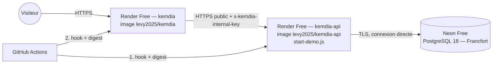

| Élément            | Valeur                                                                                                                               |
| ------------------ | ------------------------------------------------------------------------------------------------------------------------------------ |
| Démarrage de l'API | Docker Command `node dist/database/start-demo.js` : migrations → import de démonstration (~1 s) → API ; échec → l'API ne démarre pas |
| Secrets            | `DATABASE_URL`, `API_INTERNAL_KEY` : variables des services Render ; GitHub ne connaît que les deploy hooks                          |
| Veille             | Site et API s'endorment après 15 min ; le site réveille l'API à son démarrage ; délai du catalogue 60 s sur la démo                  |
| Limites            | Première visite après une pause : 1 à 2 min ; API publique (pas de réseau privé en gratuit) ; `TRUST_PROXY=0`                        |

## 9. Qualité et tests

| Niveau              | Outil                                                 | État S1                                                                                                                                                                                                                                                                                                                                                                                                                                                                                                            |
| ------------------- | ----------------------------------------------------- | ------------------------------------------------------------------------------------------------------------------------------------------------------------------------------------------------------------------------------------------------------------------------------------------------------------------------------------------------------------------------------------------------------------------------------------------------------------------------------------------------------------------ |
| Unitaires (logique) | Vitest                                                | 78 tests : formatage, livraison (dont dates), panier, catalogue, paramètres d'URL, identité (S2)                                                                                                                                                                                                                                                                                                                                                                                                                   |
| Composants          | Testing Library                                       | 16 tests : carte produit, saisie OTP, parcours d'identité, carrousel, barre d'onglets (S2)                                                                                                                                                                                                                                                                                                                                                                                                                         |
| Bout en bout        | Playwright + axe-core                                 | 16 scénarios × 2 appareils (téléphone Pixel 7, ordinateur) : achat complet, filtres, favoris, partage, vendeur, en-têtes de sécurité, XSS, accessibilité WCAG AA de 7 pages (S2) ; **contre la vraie API** depuis le S3-T05                                                                                                                                                                                                                                                                                        |
| Performance         | Playwright + Web Vitals (Chrome DevTools)             | 5 pages, médiane de 3 chargements à froid en 3G : premier affichage, plus grand élément, décalages, blocage, poids ; tableau dans le résumé de la CI et annotations (S2-T08) ; **S3-T08** : budget commun pour l'accueil (blocage ≤ 300 ms, indicatif), mesure sans trace Playwright (elle gonflait le blocage)                                                                                                                                                                                                    |
| Site — catalogue    | Vitest                                                | S3-T08 : 143 tests du site ; lecture du catalogue testée contre une **fausse API en mémoire** (sélections de l'accueil, ronds, tuiles, produits similaires, plan du site) ; configuration (refus sans API dans tout environnement) ; adaptateur HTTP (délai, 404, réponse hors contrat, cache, clé interne), garde de construction ; hydratation à la demande ; panier par variante (`kemdia.cart.v2`)                                                                                                             |
| Contrat partagé     | Vitest                                                | 8 tests (S3-T05) : schémas, OpenAPI, identifiants de démonstration stables ; l'API vérifie que ses règles (quantité maximale) sont celles du contrat                                                                                                                                                                                                                                                                                                                                                               |
| API (S3)            | Vitest + Supertest                                    | 134 tests (S3-T06 : script de migration — configuration vérifiée, aucune valeur affichée, échec et délai ; S3-T05 : paramètre `badge`, tri `ventes`, alignement sur le contrat ; S3-T04 : routes HTTP, contrat, limitation de débit, documentation OpenAPI ; dont 46 sur le catalogue : domaine, BR-001, recherche, import — S3-T03) : configuration, journaux, en-têtes de sécurité, CORS, format des erreurs, versionnement des routes, santé de la base, architecture du code et du schéma Prisma (S3-T01, T02) |
| API — intégration   | Vitest + vraie base PostgreSQL 18                     | 35 tests (S3-T05 : badges, tri `ventes`, variante par défaut d'une liste), dont 6 de contrat HTTP sur la vraie base (S3-T04 : chaque catégorie, chaque produit, chaque page validés par leur schéma) et 21 sur le catalogue : listes, recherche, filtres, tri, compteurs **comparés à la logique du site**, BR-001, contraintes SQL, 3 niveaux de catégories (S3-T03) ; et : santé, schémas créés, requête trop longue interrompue, injection SQL, base injoignable → 503 sans fuite (S3-T02)                      |
| Démo (S3-T07)       | Vitest + CI (image réelle, base vide)                 | 9 tests unitaires de l'API (démarrage de démo : ordre, refus hors démo, arrêt sur échec ; import : environnements permis, aucune valeur affichée) et 3 du site (réveil de l'API) ; en CI, l'image démarre en mode démo sur une base **vide** (50 produits servis), redémarre sans doublon et refuse `APP_ENV=staging` ; après chaque fusion, la démo en ligne est vérifiée (versions, `database: ok`, `catalog: "api"`)                                                                                            |
| Statique            | ESLint (règles Next + React Hooks), TypeScript strict | ✅                                                                                                                                                                                                                                                                                                                                                                                                                                                                                                                 |

## 10. Glossaire

Explications détaillées, avec des exemples Kemdia : [concepts.md](concepts.md).

- **SSR / SSG** : rendu des pages sur le serveur, à la demande / à l'avance.
- **Server / Client Component** : composant React exécuté uniquement sur le serveur / aussi dans le navigateur.
- **CSP** : en-tête qui indique au navigateur quelles sources de scripts, styles, images sont autorisées.
- **CI/CD** : intégration continue (vérifications automatiques) / déploiement continu.
- **ADR** : _Architecture Decision Record_, fiche qui trace une décision et sa justification.
