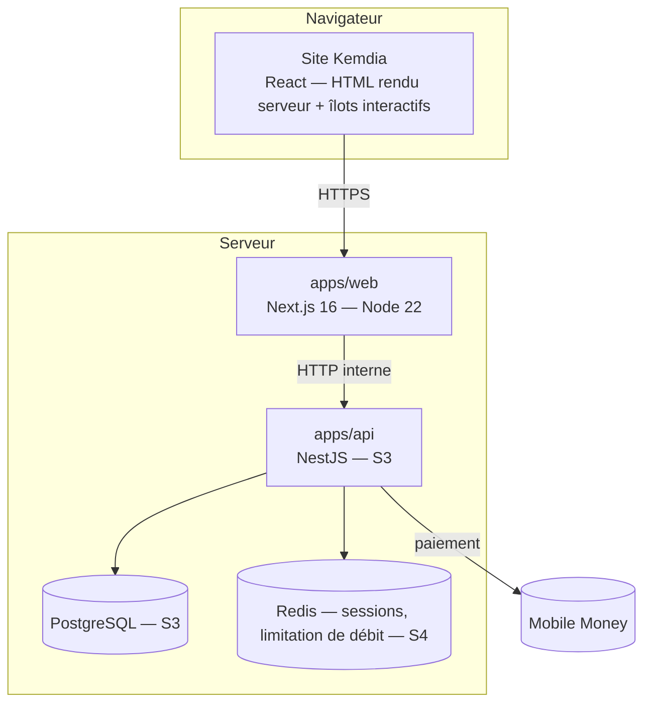
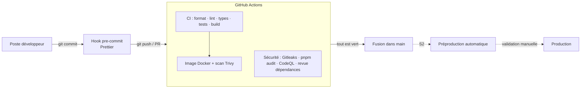

# Cahier d'architecture — Kemdia

| Version | Date       | Sprint | Changements                                                                    |
| ------- | ---------- | ------ | ------------------------------------------------------------------------------ |
| **0.1** | 2026-10-05 | S1     | Création : contexte, exigences, stack, architecture frontend, sécurité, DevOps |

> Document vivant : chaque rapport de sprint (`docs/rapports/`) indique quelles sections il a modifiées.
> Les sections marquées 🔜 seront rédigées au sprint indiqué.

---

## 1. Contexte et objectifs

**Kemdia** est une plateforme de commerce en ligne destinée au marché africain, lancée d'abord au **Gabon**.

| Objectif                                            | Indicateur                                                  |
| --------------------------------------------------- | ----------------------------------------------------------- |
| Vendre en ligne au Gabon avec paiement Mobile Money | Commandes payées / jour                                     |
| Site rapide sur mobile en 3G/4G                     | Page d'accueil < 50 Ko compressée hors images ; LCP < 2,5 s |
| Sécurité de niveau production                       | 0 faille critique/haute ouverte avant mise en ligne         |
| Livraison fiable par ville et quartier              | Délai respecté ≥ 95 %                                       |

**Zone de couverture phase 1** : 13 villes du Gabon réparties en 4 zones tarifaires
(Libreville, Port-Gentil, Franceville, Lambaréné, Oyem, Moanda, Mouila, Tchibanga, Koulamoutou, Bitam, Mitzic, Lastourville, Makokou).

## 2. Exigences

### 2.1 Fonctionnelles (phase 1)

| #   | Exigence                                                             | Sprint                            |
| --- | -------------------------------------------------------------------- | --------------------------------- |
| F1  | Parcourir le catalogue par catégories (3 niveaux)                    | S1 ✅                             |
| F2  | Rechercher (insensible aux accents), trier, paginer                  | S1 ✅                             |
| F3  | Consulter une fiche produit (photos, prix, stock, livraison estimée) | S1 ✅                             |
| F4  | Gérer un panier                                                      | S1 ✅ (navigateur) · S5 (serveur) |
| F5  | Choisir sa ville / son quartier de livraison au Gabon                | S1 ✅                             |
| F6  | Créer un compte, se connecter                                        | S4                                |
| F7  | Commander et payer (Airtel Money, Moov Money, à la livraison)        | S5                                |
| F8  | Suivre sa commande                                                   | S5                                |
| F9  | Administrer produits, stocks, commandes, livraisons                  | S6                                |
| F10 | Vendeurs tiers (marketplace)                                         | Phase 2                           |

### 2.2 Non fonctionnelles

| Domaine        | Exigence                                                                                                  |
| -------------- | --------------------------------------------------------------------------------------------------------- |
| Performance    | Rendu serveur, pages statiques quand possible, images WebP/AVIF redimensionnées, aucun CDN tiers bloquant |
| Accessibilité  | Navigation clavier, libellés ARIA, contraste, lien d'évitement, `prefers-reduced-motion`                  |
| SEO            | URL lisibles en français, métadonnées par page, sitemap, données structurées `Product`                    |
| Sécurité       | Voir §6 — OWASP Top 10, en-têtes, validation stricte, secrets hors Git                                    |
| Qualité        | Lint + types + tests obligatoires en CI ; revue de code par PR                                            |
| Exploitabilité | Image Docker, configuration par variables d'environnement, logs sans données personnelles                 |
| Conformité     | Loi gabonaise n°001/2011 sur la protection des données personnelles (APDPVP)                              |

## 3. Vue d'ensemble

### 3.1 Contexte (C4 niveau 1)


### 3.2 Conteneurs (C4 niveau 2) — cible



**État au Sprint 1** : seul `apps/web` existe ; le catalogue provient d'un fichier de démonstration
lu côté serveur par `src/lib/catalog.ts`, qui sera remplacé par des appels à l'API sans modifier les composants.

## 4. Choix technologiques

| Couche     | Choix                                            | Version     | Justification                                                                |
| ---------- | ------------------------------------------------ | ----------- | ---------------------------------------------------------------------------- |
| Langage    | TypeScript (strict)                              | 5.9         | Un seul langage front/back — [ADR-0002](adr/0002-stack-typescript-nextjs.md) |
| Frontend   | Next.js (App Router) + React                     | 16.3 / 19.2 | SSR/SSG, SEO, Server Components                                              |
| Style      | Tailwind CSS                                     | 4           | Design tokens centralisés, CSS final minimal                                 |
| Icônes     | lucide-react                                     | —           | Seules les icônes utilisées sont embarquées                                  |
| Polices    | Inter + Montserrat (auto-hébergées, @fontsource) | —           | Aucune requête vers Google : vie privée + CSP stricte                        |
| Tests      | Vitest + Testing Library                         | 5           | Rapide, compatible TypeScript                                                |
| Monorepo   | pnpm + Turborepo                                 | 10 / 2      | [ADR-0003](adr/0003-monorepo.md)                                             |
| Conteneur  | Docker (Node 22 Alpine, utilisateur non-root)    | —           | Même artefact en préprod et prod                                             |
| CI/CD      | GitHub Actions                                   | —           | Intégré au dépôt                                                             |
| Backend 🔜 | NestJS + Prisma + PostgreSQL                     | —           | S3                                                                           |

## 5. Architecture du frontend (`apps/web`)

### 5.1 Organisation du code

```
apps/web/src
├── app/                     Routes (1 dossier = 1 URL)
│   ├── page.tsx             Accueil
│   ├── categorie/[slug]/    Liste par catégorie (rendu à la demande : tri/pagination)
│   ├── produit/[slug]/      Fiche produit (pré-générée au build)
│   ├── recherche/           Résultats de recherche (non indexés)
│   ├── promotions/  categories/  panier/  compte/  infos/[slug]/
│   ├── sitemap.ts  robots.ts  icon.svg  not-found.tsx  error.tsx
│   └── layout.tsx           Gabarit commun : en-tête, pied de page, fournisseurs
├── components/
│   ├── layout/              TopBar, Header, SearchForm, CategoryNav (méga-menu + tiroir), Footer
│   ├── home/                Hero, PromoTiles, Countdown, CategoryShowcase, Newsletter
│   ├── catalog/             ProductListing (tri + pagination), Breadcrumbs, SortSelect
│   ├── product/             ProductCard, ProductRail, ProductGallery, BuyBox, AddToCartButton
│   ├── cart/                MiniCart
│   ├── location/            LocationModal (Gabon)
│   ├── providers/           Panier, ville de livraison, notifications
│   └── ui/                  Logo, Price, Rating, CategoryIcon
├── lib/                     Logique pure, testée
│   ├── catalog.ts           Accès catalogue (server-only) — futur client API
│   ├── cart.ts              Réducteur du panier + validation du stockage
│   ├── delivery.ts          Villes, zones, calcul des frais
│   ├── search-params.ts     Validation des paramètres d'URL (liste blanche)
│   └── format.ts  site.ts  types.ts  cn.ts
└── data/catalog.seed.json   Données de démonstration (S1 → remplacé par l'API en S3)
```

### 5.2 Rendu des pages

| Page                                | Mode                                             | Raison                                                             |
| ----------------------------------- | ------------------------------------------------ | ------------------------------------------------------------------ |
| Accueil, catégories, compte, panier | Statique (build)                                 | Contenu identique pour tous ; le panier est rempli côté navigateur |
| Fiche produit                       | Statique pré-générée (`generateStaticParams`)    | Rapide + SEO                                                       |
| Catégorie, recherche, promotions    | Dynamique                                        | Dépend de `?tri=` et `?page=`                                      |
| Infos                               | Statique, liste fermée (`dynamicParams = false`) | Toute autre URL → 404                                              |

Composants **serveur** par défaut ; seuls les éléments interactifs sont des composants **client**
(`"use client"`) : panier, mini-panier, menu, modale de ville, galerie, compte à rebours, tri.

### 5.3 Correspondance avec l'ancien projet Django

| Django (ancien)                                                 | Kemdia (nouveau)                                              | Gain                                   |
| --------------------------------------------------------------- | ------------------------------------------------------------- | -------------------------------------- |
| `templates/base.html` (700 lignes : HTML + JS + CSS mêlés)      | `app/layout.tsx` + composants                                 | Séparation, typage                     |
| 3 partials `product_card_*.html` (~760 lignes)                  | 1 `ProductCard` + prop `badge`                                | Pas de duplication                     |
| `header.html` + `location_modal.html` + JS inline               | `Header`, `HeaderActions`, `LocationModal` (`<dialog>` natif) | Accessibilité, pas d'`innerHTML`       |
| `navigation.html` + `category_mega_menu.html`                   | `CategoryNav`                                                 | Méga-menu clavier + tiroir mobile      |
| 18 fichiers CSS + Bootstrap + Font Awesome + AOS + Swiper (CDN) | Tailwind + tokens `@theme`, lucide, défilement natif          | Aucun CDN tiers, ~36 Ko HTML compressé |
| Géolocalisation par IP via service externe                      | Choix explicite ville/quartier                                | Pas de fuite d'IP, pas de SSRF         |

### 5.4 Charte graphique (tokens `globals.css`)

| Token                     | Valeur                             | Usage                        |
| ------------------------- | ---------------------------------- | ---------------------------- |
| `brand-600`               | `#d61f2c`                          | Rouge Kemdia : actions, prix |
| `accent-400`              | `#ffc629`                          | Jaune : remises, badges      |
| `ink-900`                 | `#14181e`                          | Texte, navigation            |
| `gabon-green/yellow/blue` | `#009e60` / `#fcd116` / `#3a75c4`  | Rappels discrets du drapeau  |
| Polices                   | Montserrat (titres), Inter (texte) |                              |

## 6. Sécurité

### 6.1 Principes

1. **Ne jamais faire confiance au client** : URL, formulaires, `localStorage`, en-têtes sont validés.
2. **Le serveur calcule tous les montants.**
3. **Aucun secret, aucune donnée réelle dans Git.**
4. **Moindre privilège** : conteneur non-root, système de fichiers en lecture seule, rôles stricts (S6).
5. **Défense en profondeur** : validation + échappement + CSP + en-têtes.

### 6.2 Mesures en place (S1)

| Mesure                                                                                       | Où                                | Faille(s) de l'ancien projet évitée(s) |
| -------------------------------------------------------------------------------------------- | --------------------------------- | -------------------------------------- |
| Content-Security-Policy, X-Frame-Options, HSTS, Referrer-Policy, Permissions-Policy, nosniff | `next.config.ts`                  | LOW-03                                 |
| En-tête `X-Powered-By` supprimé                                                              | `next.config.ts`                  | Empreinte technologique                |
| React échappe tout texte ; aucun `innerHTML` sur des données                                 | Tous les composants               | CRIT-04 (XSS)                          |
| Tri/page/recherche validés par liste blanche et bornes                                       | `lib/search-params.ts`            | MED-13                                 |
| Optimiseur d'images limité à `/images/**` (URL externes refusées : 400)                      | `next.config.ts`                  | HIGH-03 (SSRF)                         |
| `localStorage` validé champ par champ                                                        | `lib/cart.ts`, `LocationProvider` | Altération du panier                   |
| Ville choisie dans une liste fermée, aucune redirection construite depuis l'URL              | `LocationModal`                   | MED-01, MED-06, MED-14                 |
| Code catalogue `server-only`                                                                 | `lib/catalog.ts`                  | Fuite de logique côté client           |
| `.gitignore` : `.env*`, `*.sqlite3`, dumps                                                   | racine                            | CRIT-02, CRIT-03, CRIT-05, LOW-02      |
| Gitleaks (historique complet), pnpm audit, CodeQL, Dependabot, Trivy                         | CI                                | CRIT-02, HIGH-07                       |
| Pages d'erreur sans détail technique                                                         | `error.tsx`                       | Fuite d'informations                   |

Le suivi détaillé des 45 failles est dans [`docs/securite/heritage-audit-django.md`](../securite/heritage-audit-django.md).

### 6.3 Prévu 🔜

- S4 : CSP à _nonce_ via `proxy.ts`, cookies de session `HttpOnly; Secure; SameSite=Lax`, protection CSRF, limitation de débit.
- S5 : signature des webhooks Mobile Money, idempotence des paiements, transactions SQL pour stock et coupons.

## 7. DevOps — CI/CD



| Fichier                            | Rôle                                                                    |
| ---------------------------------- | ----------------------------------------------------------------------- |
| `.github/workflows/ci.yml`         | Qualité + build + image Docker scannée                                  |
| `.github/workflows/security.yml`   | Secrets, dépendances, analyse statique ; aussi chaque lundi             |
| `.github/dependabot.yml`           | Mises à jour hebdomadaires (npm, Actions, Docker)                       |
| `.github/pull_request_template.md` | Liste de contrôle de revue                                              |
| `apps/web/Dockerfile`              | Image multi-étapes, `output: standalone`, non-root, healthcheck         |
| `docker-compose.yml`               | Exécution locale « comme en prod » (lecture seule, `no-new-privileges`) |
| `.husky/pre-commit`                | Formatage automatique avant chaque commit                               |

**Stratégie de branches** : `main` (protégée, toujours déployable) ← PR depuis `feature/Sx-Tyy-description`.
Voir [`docs/guides/workflow-git.md`](../guides/workflow-git.md).

## 8. Déploiement 🔜 (S7)

Options à arbitrer (latence vers Libreville, coût, conformité) :

- VPS / cloud en Europe ou en Afrique du Sud + CDN ;
- hébergeur local gabonais pour les données personnelles si exigé par l'APDPVP.

Exigences fixées dès maintenant : HTTPS uniquement, image Docker identique préprod/prod,
secrets injectés par l'hébergeur, sauvegardes PostgreSQL chiffrées et testées.

## 9. Qualité et tests

| Niveau              | Outil                                                 | État S1                                                                     |
| ------------------- | ----------------------------------------------------- | --------------------------------------------------------------------------- |
| Unitaires (logique) | Vitest                                                | 34 tests : formatage, livraison, panier, catalogue, paramètres d'URL        |
| Composants          | Testing Library                                       | 3 tests : carte produit (affichage, échappement XSS, ajout panier, rupture) |
| Bout en bout        | Playwright                                            | 🔜 S2                                                                       |
| Statique            | ESLint (règles Next + React Hooks), TypeScript strict | ✅                                                                          |

## 10. Glossaire

- **SSR / SSG** : rendu des pages sur le serveur, à la demande / à l'avance.
- **Server / Client Component** : composant React exécuté uniquement sur le serveur / aussi dans le navigateur.
- **CSP** : en-tête qui indique au navigateur quelles sources de scripts, styles, images sont autorisées.
- **CI/CD** : intégration continue (vérifications automatiques) / déploiement continu.
- **ADR** : _Architecture Decision Record_, fiche qui trace une décision et sa justification.
