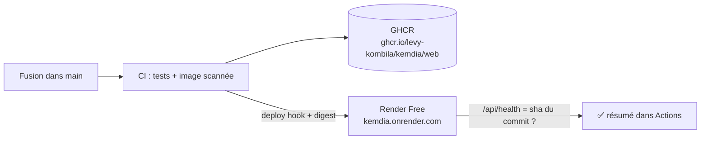

# Démo publique gratuite — Render

Objectif : un lien public (ex. `https://kemdia.onrender.com`) pour montrer le site à n'importe qui,
**sans serveur payant**, mis à jour **automatiquement** à chaque fusion dans `main`.

C'est le même principe DevOps que pour staging/production : la CI construit, scanne et publie l'image Docker sur GHCR,
puis la démo reçoit **exactement cette image** (par digest), et un test vérifie que la bonne version répond.

## Limites de l'offre gratuite (à connaître avant de partager le lien)

- Le service **s'endort après 15 min sans visite** : la première visite suivante prend **environ 1 minute**.
  Prévenez vos interlocuteurs, ou ouvrez le lien vous-même juste avant une présentation.
- 750 heures d'instance par mois et par espace de travail (suffisant pour un service de démo).
- Données de démonstration uniquement : **aucune vraie donnée client** sur cet environnement.
- Source : [documentation Render — Free instances](https://render.com/docs/free).

## Où est l'image Docker ?

L'image n'est **pas** sur Docker Hub : elle est publiée sur **GitHub Container Registry (GHCR)**, à côté du code.
Vous la voyez sur <https://github.com/levy-kombila?tab=packages> (paquet `kemdia/web`), ou sur la page du dépôt,
colonne de droite, rubrique **Packages**. Elle est **privée** : il faut un jeton pour la télécharger.

## Mise en place (≈ 15 minutes, une seule fois)

### 1. Créer un jeton GitHub en lecture seule pour Render

GitHub → photo de profil → **Settings → Developer settings → Personal access tokens → Tokens (classic) → Generate new token (classic)**

- Note : `render-ghcr-lecture`
- Expiration : 90 jours (mettez un rappel pour le renouveler)
- Cochez **uniquement** `read:packages`
- **Generate token**, puis copiez-le (il ne s'affiche qu'une fois). Ne le mettez nulle part ailleurs que dans Render.

> Le registre GHCR n'accepte que les jetons _classic_. `read:packages` seul ne donne accès à aucun code ni réglage du dépôt.

### 2. Créer le service sur Render

1. Créez un compte sur <https://render.com> (gratuit, sans carte bancaire pour l'offre Free).
2. **New → Web Service → Existing Image**.
3. Image URL : `ghcr.io/levy-kombila/kemdia/web:main`
4. **Credential → Add credential** : registre `GitHub`, utilisateur `levy-kombila`, mot de passe = le jeton de l'étape 1.
5. Nom : `kemdia` (l'adresse sera `https://kemdia.onrender.com`, ou proche si le nom est pris). Région : **Frankfurt** (la plus proche du Gabon).
6. Instance type : **Free**.
7. **Environment variables** : `PORT` = `3000` et `APP_ENV` = `demo`.
8. **Advanced → Health Check Path** : `/api/health`
9. **Deploy Web Service**. Au bout de 2–3 minutes, le site répond sur l'adresse affichée en haut de la page.

### 3. Relier Render au pipeline GitHub

Sur Render, dans le service → **Settings → Deploy Hook** → copiez l'URL (elle contient une clé secrète).

Sur GitHub → dépôt `kemdia` → **Settings → Secrets and variables → Actions** :

| Type     | Nom                      | Valeur                                                                   |
| -------- | ------------------------ | ------------------------------------------------------------------------ |
| Secret   | `RENDER_DEPLOY_HOOK_URL` | l'URL du deploy hook                                                     |
| Variable | `DEMO_URL`               | l'adresse du service, ex. `https://kemdia.onrender.com` (sans `/` final) |

Désactivez le redéploiement automatique de Render (**Settings → Auto-Deploy : No**) : c'est le pipeline qui décide quand déployer.

### 4. Vérifier

Fusionnez n'importe quelle PR dans `main` (ou _Actions → CI/CD → Run workflow_ sur `main`).
Le job **Déploiement DÉMO (Render)** déclenche Render avec le digest de l'image, attend que `/api/health`
renvoie la version du commit, puis contrôle la page d'accueil et les en-têtes de sécurité.

## Sécurité

| Point               | Mesure                                                                                            |
| ------------------- | ------------------------------------------------------------------------------------------------- |
| Jeton Render → GHCR | Lecture seule (`read:packages`), expiration 90 jours, stocké uniquement chez Render               |
| URL du deploy hook  | Secret GitHub, jamais affichée dans les journaux                                                  |
| Image               | Même image que staging/production : scannée par Trivy, utilisateur non-root, en-têtes de sécurité |
| Données             | Démonstration uniquement ; ne jamais brancher la future base de production sur cet environnement  |

## Et ensuite ?

La démo Render sert à montrer le site. Pour la vraie production (pas de mise en veille, domaine `kemdia.ga`,
données réelles), suivez [deploiement.md](deploiement.md) avec un VPS.
