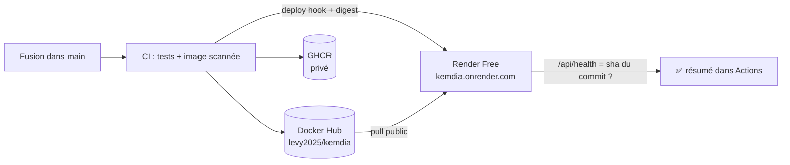

# Démo publique gratuite — Render

Objectif : un lien public (ex. `https://kemdia.onrender.com`) pour montrer le site à n'importe qui,
**sans serveur payant**, mis à jour **automatiquement** à chaque fusion dans `main`.

C'est le même principe DevOps que pour staging/production : la CI construit, scanne et publie l'image Docker sur GHCR,
puis la démo reçoit **exactement cette image** (par digest), et un test vérifie que la bonne version répond.

## Limites de l'offre gratuite (à connaître avant de partager le lien)

- Le service **s'endort après 15 min sans visite** : la première visite suivante prend **environ 1 minute**.
  Prévenez vos interlocuteurs, ou ouvrez le lien vous-même juste avant une présentation.
- 750 heures d'instance par mois et par espace de travail (suffisant pour un service de démo).
- Données de démonstration uniquement : **aucune vraie donnée client** sur cet environnement.
- Source : [documentation Render — Free instances](https://render.com/docs/free).

## Où est l'image Docker ?

Le pipeline publie **la même image** (même digest) à deux endroits :

| Registre                  | Adresse                                                                  | Visibilité                                                                     |
| ------------------------- | ------------------------------------------------------------------------ | ------------------------------------------------------------------------------ |
| **Docker Hub**            | `levy2025/kemdia` — <https://hub.docker.com/r/levy2025/kemdia>           | **Publique** : Render (et n'importe qui) peut la télécharger sans mot de passe |
| GitHub Container Registry | `ghcr.io/levy-kombila/kemdia/web` — onglet **Packages** du profil GitHub | Privée, utilisée pour staging/production                                       |

Étiquettes : `latest` et `main` (dernière version de `main`), `sha-<commit>` (une par version, pour revenir en arrière).

> L'image ne contient aucun secret (configuration par variables d'environnement) ni donnée réelle :
> la rendre publique sur Docker Hub ne pose pas de problème de sécurité. Le code source, lui, reste privé.

## Mise en place (≈ 15 minutes, une seule fois)

### 1. Publier l'image sur Docker Hub

1. Sur <https://hub.docker.com>, connecté avec `levy2025` : avatar → **Account settings → Personal access tokens → Generate new token**.
   Nom : `github-actions-kemdia`, permissions **Read & Write**, expiration 90 jours. **Copiez le jeton** (affiché une seule fois).
2. Sur GitHub → dépôt `kemdia` → **Settings → Secrets and variables → Actions** :

| Onglet        | Nom                  | Valeur              |
| ------------- | -------------------- | ------------------- |
| **Variables** | `DOCKERHUB_USERNAME` | `levy2025`          |
| **Secrets**   | `DOCKERHUB_TOKEN`    | le jeton Docker Hub |

> Le nom d'utilisateur va dans **Variables** (il n'est pas secret) : s'il était en _Secret_, GitHub masquerait
> le nom de l'image et le job de démo ne pourrait pas le recevoir. Le **jeton**, lui, est toujours un _Secret_.

3. _Actions → CI/CD → Run workflow_ sur `main`. Quand le job **Image Docker** est vert, son résumé affiche le lien Docker Hub
   et l'image apparaît sur <https://hub.docker.com/repositories/levy2025>.

### 2. Créer le service sur Render

1. Créez un compte sur <https://render.com> (gratuit, sans carte bancaire pour l'offre Free).
2. **New → Web Service → Existing Image**.
3. Image URL : `docker.io/levy2025/kemdia:latest` — **Credential : No credential** (l'image est publique).
4. Nom : `kemdia` (l'adresse sera `https://kemdia.onrender.com`, ou proche si le nom est pris). Région : **Frankfurt** (la plus proche du Gabon).
5. Instance type : **Free**.
6. **Environment variables** : `PORT` = `3000` et `APP_ENV` = `demo`.
7. **Advanced → Health Check Path** : `/api/health`
8. **Deploy Web Service**. Au bout de 2–3 minutes, le site répond sur l'adresse affichée en haut de la page.

### 3. Relier Render au pipeline GitHub

Sur Render, dans le service → **Settings → Deploy Hook** → copiez l'URL (elle contient une clé secrète).

Sur GitHub → dépôt `kemdia` → **Settings → Secrets and variables → Actions** :

| Type     | Nom                      | Valeur                                                                   |
| -------- | ------------------------ | ------------------------------------------------------------------------ |
| Secret   | `RENDER_DEPLOY_HOOK_URL` | l'URL du deploy hook                                                     |
| Variable | `DEMO_URL`               | l'adresse du service, ex. `https://kemdia.onrender.com` (sans `/` final) |

Désactivez le redéploiement automatique de Render (**Settings → Auto-Deploy : No**) : c'est le pipeline qui décide quand déployer.

### 4. Vérifier

Fusionnez n'importe quelle PR dans `main` (ou _Actions → CI/CD → Run workflow_ sur `main`).
Le job **Déploiement DÉMO (Render)** déclenche Render avec le digest de l'image, attend que `/api/health`
renvoie la version du commit, puis contrôle la page d'accueil et les en-têtes de sécurité.

## Sécurité

| Point              | Mesure                                                                                                                |
| ------------------ | --------------------------------------------------------------------------------------------------------------------- |
| Jeton Docker Hub   | Utilisé uniquement par la CI (secret GitHub, masqué dans les journaux), expiration 90 jours, révocable sur Docker Hub |
| URL du deploy hook | Secret GitHub, jamais affichée dans les journaux                                                                      |
| Image              | Même image que staging/production : scannée par Trivy, utilisateur non-root, en-têtes de sécurité                     |
| Données            | Démonstration uniquement ; ne jamais brancher la future base de production sur cet environnement                      |

## Et ensuite ?

La démo Render sert à montrer le site. Pour la vraie production (pas de mise en veille, domaine `kemdia.ga`,
données réelles), suivez [deploiement.md](deploiement.md) avec un VPS.
