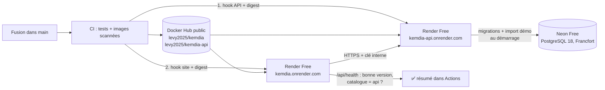

# Démo publique gratuite — Render + Neon

Objectif : un lien public (ex. `https://kemdia.onrender.com`) pour montrer **le vrai système** à n'importe qui —
le site, l'API et une base PostgreSQL — **sans serveur payant**, mis à jour **automatiquement** à chaque fusion dans `main`.

C'est le même principe DevOps que pour staging/production : la CI construit, scanne et publie les images Docker,
puis la démo reçoit **exactement ces images** (par digest), et des tests vérifient que la bonne version répond.
Décisions : [ADR-0013](../architecture/adr/0013-demo-render-api-neon.md) (démo avec API, S3-T07).



## Limites de l'offre gratuite (à connaître avant de partager le lien)

- Chaque service **s'endort après 15 min sans visite**. La première visite suivante réveille le site, qui réveille l'API :
  compter **1 à 2 minutes**. Ouvrez le lien vous-même juste avant une présentation.
- 750 heures d'instance par mois pour tout le compte Render : suffisant car les deux services dorment la plupart du temps.
- Base Neon gratuite : 1 Go, 100 heures de calcul par mois, s'endort après 5 min (réveil en moins d'une seconde).
- Données de démonstration uniquement : **aucune vraie donnée client** sur cet environnement.
- Sources : [Render — Free instances](https://render.com/docs/free), [Neon — Pricing](https://neon.com/pricing).

## Où sont les images Docker ?

Le pipeline publie **la même image** (même digest) à deux endroits :

| Image | Docker Hub (**public**, utilisé par Render)                            | GHCR (privé, staging/production)  |
| ----- | ---------------------------------------------------------------------- | --------------------------------- |
| Site  | `levy2025/kemdia` — <https://hub.docker.com/r/levy2025/kemdia>         | `ghcr.io/levy-kombila/kemdia/web` |
| API   | `levy2025/kemdia-api` — <https://hub.docker.com/r/levy2025/kemdia-api> | `ghcr.io/levy-kombila/kemdia/api` |

Étiquettes : `latest` et `main` (dernière version de `main`), `sha-<commit>` (une par version, pour revenir en arrière).

> Les images ne contiennent aucun secret (configuration par variables d'environnement) ni donnée réelle :
> les rendre publiques sur Docker Hub ne pose pas de problème de sécurité. Le code source, lui, reste privé.

## Mise en place

Les étapes 1 et 2 (site seul) ont été faites au S1. Pour une installation neuve, tout faire dans l'ordre.
**Pour passer la démo existante sur l'API (S3-T07) : étapes 3 à 6.**

### 1. Publier les images sur Docker Hub

1. Sur <https://hub.docker.com>, connecté avec `levy2025` : avatar → **Account settings → Personal access tokens → Generate new token**.
   Nom : `github-actions-kemdia`, permissions **Read & Write**, expiration 90 jours. **Copiez le jeton** (affiché une seule fois).
2. Sur GitHub → dépôt `kemdia` → **Settings → Secrets and variables → Actions** :

| Onglet        | Nom                  | Valeur              |
| ------------- | -------------------- | ------------------- |
| **Variables** | `DOCKERHUB_USERNAME` | `levy2025`          |
| **Secrets**   | `DOCKERHUB_TOKEN`    | le jeton Docker Hub |

> Le nom d'utilisateur peut aller dans **Variables** (conseillé : il n'est pas secret et reste lisible dans les résumés)
> ou dans **Secrets** (il apparaîtra alors masqué `***`). Le **jeton**, lui, est toujours un _Secret_.

3. _Actions → CI/CD → Run workflow_ sur `main`. Quand les jobs **Image Docker** et **Image Docker de l'API** sont verts,
   leurs résumés affichent les liens Docker Hub.
4. **Vérifiez que `levy2025/kemdia-api` est public** : <https://hub.docker.com/repositories/levy2025> → `kemdia-api` →
   **Settings → Visibility settings → Make public** (Docker Hub peut créer les nouveaux dépôts en privé, selon le réglage du compte).

### 2. Créer le service du site sur Render

1. Créez un compte sur <https://render.com> (gratuit, sans carte bancaire pour l'offre Free).
2. **New → Web Service → Existing Image**.
3. Image URL : `docker.io/levy2025/kemdia:latest` — **Credential : No credential** (l'image est publique).
4. Nom : `kemdia` (l'adresse sera `https://kemdia.onrender.com`, ou proche si le nom est pris). Région : **Frankfurt** (la plus proche du Gabon).
5. Instance type : **Free**.
6. **Environment variables** : `PORT` = `3000`, `APP_ENV` = `demo` et `SITE_URL` = l'adresse du service (ex. `https://kemdia.onrender.com`).
   `SITE_URL` sert aux aperçus WhatsApp / Facebook (liens absolus) ; elle est lue au démarrage, sans reconstruire l'image.
7. **Advanced → Health Check Path** : `/api/health`
8. **Deploy Web Service**. Au bout de 2–3 minutes, le site répond sur l'adresse affichée en haut de la page.
9. **Settings → Deploy Hook** : copiez l'URL (elle contient une clé secrète), et **Auto-Deploy : No** (c'est le pipeline qui décide).

### 3. Créer la base sur Neon (≈ 5 minutes)

1. Créez un compte sur <https://neon.com> (offre **Free**, sans carte bancaire).
2. **New project** : nom `kemdia-demo`, **Postgres version 18**, région **AWS Europe Central 1 (Frankfurt)** — la même que Render.
3. Sur la page du projet → **Connect** : désactivez **Connection pooling** (on veut la connexion **directe**, sans `-pooler` dans l'adresse),
   puis copiez l'adresse. Elle ressemble à :

   ```
   postgresql://neondb_owner:<mot de passe>@ep-xxxx-xxxx.eu-central-1.aws.neon.tech/neondb?sslmode=require&channel_binding=require
   ```

4. **Retirez `&channel_binding=require`** à la fin (gardez `?sslmode=require`) : tous les outils de l'API ne le comprennent pas.
5. Gardez cette adresse pour l'étape 4 **seulement** : elle contient un mot de passe. Jamais dans Git, un message, un ticket ou une capture.

> Pas besoin de créer les tables : l'API le fait elle-même au démarrage (migrations), puis importe le catalogue de démonstration.

### 4. Créer le service de l'API sur Render

1. Générez la **clé interne** partagée entre le site et l'API (PowerShell ou n'importe quel terminal) :

   ```bash
   node -e "console.log(require('crypto').randomBytes(32).toString('base64url'))"
   ```

2. Render → **New → Web Service → Existing Image** : `docker.io/levy2025/kemdia-api:latest`, **No credential**.
3. Nom : `kemdia-api` (adresse `https://kemdia-api.onrender.com`, ou proche). Région **Frankfurt**, instance **Free**.
4. **Environment variables** :

| Nom                 | Valeur                                       | Remarque                                                          |
| ------------------- | -------------------------------------------- | ----------------------------------------------------------------- |
| `APP_ENV`           | `demo`                                       | **Obligatoire** : sans lui, le démarrage de démo est refusé       |
| `PORT`              | `4000`                                       |                                                                   |
| `DATABASE_URL`      | l'adresse Neon de l'étape 3                  | **Secret**                                                        |
| `DATABASE_POOL_MAX` | `5`                                          | Peu de connexions suffisent pour une démo                         |
| `API_INTERNAL_KEY`  | la clé générée au point 1                    | **Secret** — la même valeur ira dans le service du site           |
| `API_DOCS`          | `false` (ou `true` pour montrer `/api/docs`) | Facultatif ; désactivée par défaut, comme en production           |
| `EMAIL_TRANSPORT`   | `brevo`                                      | Envoi des codes par e-mail (S4-T02) — voir [emails.md](emails.md) |
| `BREVO_API_KEY`     | la clé d'API Brevo                           | **Secret**                                                        |
| `EMAIL_FROM`        | l'adresse d'expédition vérifiée dans Brevo   |                                                                   |

5. **Advanced** :
   - **Docker Command** : `node dist/database/start-demo.js`
     (migrations → import du catalogue de démonstration → API ; ne fonctionne qu'avec `APP_ENV=demo`) ;
   - **Health Check Path** : `/api/health`.
6. **Deploy Web Service**. Dans **Logs**, vous devez voir dans l'ordre :

   ```
   Migrations de la base : terminées, la base est à jour.
   Catalogue de démonstration importé : 112 catégories, 50 produits (… s).
   API Kemdia sha-… prête sur le port 4000 (demo)
   ```

   Puis `https://kemdia-api.onrender.com/api/health` répond `"database":"ok"`.

7. **Settings → Deploy Hook** : copiez l'URL ; **Auto-Deploy : No**.

### 5. Brancher le site sur l'API

Render → service **`kemdia`** (le site) → **Environment** → ajoutez :

| Nom                  | Valeur                                                                                             |
| -------------------- | -------------------------------------------------------------------------------------------------- |
| `API_URL`            | `https://kemdia-api.onrender.com` (sans `/` final)                                                 |
| `API_INTERNAL_KEY`   | **la même clé** que dans le service de l'API (secret)                                              |
| `CATALOG_TIMEOUT_MS` | `90000` (le maximum : l'API peut mettre plus d'1 min à se réveiller, migrations et import compris) |

Enregistrez : Render redémarre le site. Dans ses **Logs** : `Kemdia — catalogue : API https://kemdia-api.onrender.com (délai 90000 ms)`
puis `Kemdia — réveil de l'API : prête en … s`. Et `https://kemdia.onrender.com/api/health` contient `"catalog":"api"`.

### 6. Relier Render au pipeline GitHub

Sur GitHub → dépôt `kemdia` → **Settings → Secrets and variables → Actions** :

| Type     | Nom                          | Valeur                                                                     |
| -------- | ---------------------------- | -------------------------------------------------------------------------- |
| Secret   | `RENDER_DEPLOY_HOOK_URL`     | le deploy hook du **site** (déjà présent depuis le S1)                     |
| Secret   | `RENDER_API_DEPLOY_HOOK_URL` | le deploy hook de **l'API** (étape 4)                                      |
| Variable | `DEMO_URL`                   | l'adresse du site, ex. `https://kemdia.onrender.com` (sans `/` final)      |
| Variable | `DEMO_API_URL`               | l'adresse de l'API, ex. `https://kemdia-api.onrender.com` (sans `/` final) |

### 7. Vérifier

Fusionnez n'importe quelle PR dans `main` (ou _Actions → CI/CD → Run workflow_ sur `main`). Le job **Déploiement DÉMO (Render)** :

1. déclenche l'**API** avec le digest de son image, attend que `/api/health` renvoie la version du commit et `database: ok` ;
2. déclenche **le site**, attend sa version ;
3. contrôle la page d'accueil, les en-têtes de sécurité, une fiche produit, et que le site lit bien l'API (`catalog: "api"`).

Le résumé du job affiche l'adresse et la source du catalogue.

### 8. Créer le premier administrateur (S4-T06)

Aucun compte administrateur n'existe au départ, et aucun mot de passe par défaut : on **promeut un compte déjà inscrit**.

1. Inscris-toi normalement sur le site de démo (code reçu par e-mail).
2. Sur **ton poste**, dans un terminal, avec l'adresse de connexion Neon (tableau de bord Neon → _Connection string_) :

   ```bash
   DATABASE_URL="postgresql://…neon.tech/neondb?sslmode=require" pnpm --filter @kemdia/api admin:grant ton-adresse@exemple.ga
   ```

   La commande affiche seulement l'UUID du compte. Elle n'écrit rien dans Git ni dans Render ; l'adresse Neon reste dans ton terminal
   (ne la colle pas dans un fichier suivi par Git).

3. Pour retirer le rôle : `admin:revoke` avec la même adresse. Chaque changement est inscrit au journal d'audit.

Les routes d'administration (`/api/v1/admin/…`) demandent une connexion de **moins de 15 minutes** ; il n'y a pas encore d'écran (S6).

### 9. Adresse des visiteurs (S4-T07) — réglage facultatif, à faire avec ton accord

Par défaut, le site **ne transmet pas** l'adresse IP des visiteurs à l'API (`CLIENT_IP_HEADER` vide) : les limites par compte
et par identifiant protègent déjà la connexion, et le journal d'audit enregistre l'adresse du serveur du site.

**En-tête retenu pour la démo : `CF-Connecting-IP`** (Render passe par Cloudflare, qui pose cet en-tête et écrase une valeur
envoyée par le visiteur). **Jamais la première adresse de `X-Forwarded-For`** : un visiteur peut l'inventer.

**Vérification avant d'activer** (diagnostic temporaire `/api/diagnostic-ip`, protégé par la clé interne, supprimé au S4-T08).
Ce test prouve que **Cloudflare écrase** un `CF-Connecting-IP` envoyé par le visiteur ; il repose sur le fait que Render
n'expose pas le site hors de Cloudflare (ce qu'aucun test ne peut prouver).

1. Dans un terminal bash (Git Bash ou WSL sous Windows), **sans coller la clé dans un message ni un fichier suivi par Git**.
   La clé passe par `printf` (intégré au shell) puis par l'entrée de `curl` : elle n'apparaît ni dans l'historique, ni dans la liste
   des processus.

   ```bash
   read -rs KEMDIA_KEY   # coller la valeur de API_INTERNAL_KEY du service site sur Render, puis Entrée
   URL=https://kemdia-1.onrender.com/api/diagnostic-ip
   diag() { printf 'X-Kemdia-Internal-Key: %s\n' "$KEMDIA_KEY" | curl -s "$@" -H @- "$URL"; echo; }

   # IPv4 — ma vraie adresse, puis le diagnostic normal, puis avec une fausse adresse
   curl -s -4 https://ifconfig.me; echo
   diag -4
   diag -4 -H "CF-Connecting-IP: 1.2.3.4"

   # IPv6 (si ta connexion en a une) — même chose, avec une fausse adresse IPv6
   curl -s -6 https://ifconfig.me; echo
   diag -6
   diag -6 -H "CF-Connecting-IP: 2001:db8::1"

   unset KEMDIA_KEY
   ```

2. Refaire les mêmes commandes en **4G** : partager la connexion du téléphone (point d'accès) avec l'ordinateur, couper le Wi-Fi
   habituel, puis relancer le bloc ci-dessus. L'adresse doit changer et suivre l'adresse 4G.
3. Résultat attendu à **chaque** ligne `diag` : `valeurRecue` = l'adresse affichée par `ifconfig.me` juste au-dessus (même famille,
   `-4` ou `-6`), **jamais** `1.2.3.4` ni `2001:db8::1`, et `adresseRetenue` = la même. Sans clé, la route répond 404.

**Si toutes les vérifications sont bonnes** (Wi-Fi et 4G), ajouter sur Render, service **site** (`kemdia-1`), _Environment_ :

| Nom                | Valeur             |
| ------------------ | ------------------ |
| `CLIENT_IP_HEADER` | `cf-connecting-ip` |

Le site redémarre et affiche dans ses journaux « adresse des visiteurs transmise à l'API : oui (cf-connecting-ip) ».
Si une vérification échoue (valeur vide, fausse adresse recopiée, adresse identique en Wi-Fi et en 4G), **ne rien ajouter**.

## En cas de problème

| Symptôme                                                                           | Cause probable et solution                                                                                                        |
| ---------------------------------------------------------------------------------- | --------------------------------------------------------------------------------------------------------------------------------- |
| Logs de l'API : `Démarrage de démonstration refusé : APP_ENV doit valoir « demo »` | Ajouter `APP_ENV=demo` dans les variables du service de l'API                                                                     |
| Logs de l'API : `DATABASE_URL : obligatoire en production`                         | Variable `DATABASE_URL` absente ou vide                                                                                           |
| Logs de l'API : `Migrations de la base : ÉCHEC`                                    | Adresse Neon fausse, `-pooler` dans l'adresse, ou projet Neon supprimé. Recopier l'adresse directe (étape 3)                      |
| Render : _image pull failed_ sur l'API                                             | Le dépôt Docker Hub `kemdia-api` est privé : le rendre public (étape 1.4)                                                         |
| Site : « Une erreur est survenue » à la première visite                            | L'API se réveillait encore : cliquer **Réessayer** au bout d'une minute. Vérifier `CATALOG_TIMEOUT_MS=90000` sur le site          |
| Site : erreur sur toutes les pages, logs `[catalogue] … API injoignable`           | `API_URL` fausse, ou clés différentes entre le site et l'API                                                                      |
| CI : `Le site de démo ne lit pas l'API (catalogue : file)`                         | `API_URL` / `API_INTERNAL_KEY` absentes dans le service du site (étape 5)                                                         |
| CI : `The requested URL returned error: 502` juste après le déploiement            | Bascule de Render vers la nouvelle version : la CI retente 5 fois (15 s d'écart). Si ça persiste, voir les **Logs** du service    |
| Adresse `https://kemdia.onrender.com` → « Not Found »                              | Le nom était pris : Render a donné une autre adresse (ex. `kemdia-1.onrender.com`). Mettre la bonne dans `SITE_URL` et `DEMO_URL` |

**Changer la clé interne** : générer une nouvelle valeur, la mettre **dans les deux services** (API puis site). **Changer le mot de passe Neon** :
Neon → **Roles → Reset password**, puis mettre la nouvelle adresse dans `DATABASE_URL` de l'API.

## Sécurité

| Point                | Mesure                                                                                                                |
| -------------------- | --------------------------------------------------------------------------------------------------------------------- |
| Jeton Docker Hub     | Utilisé uniquement par la CI (secret GitHub, masqué dans les journaux), expiration 90 jours, révocable sur Docker Hub |
| URL des deploy hooks | Secrets GitHub, jamais affichées dans les journaux                                                                    |
| Adresse de la base   | Uniquement dans Render (variable du service API) ; jamais affichée par l'API (ni par Prisma : `<REDACTED>`)           |
| Clé interne          | Uniquement dans Render (deux services) ; le site l'envoie en en-tête, jamais au navigateur                            |
| Images               | Mêmes images que staging/production : scannées par Trivy, utilisateur non-root, en-têtes de sécurité                  |
| Démarrage de démo    | Refusé si `APP_ENV` ≠ `demo` : impossible d'importer les données de démo ou de migrer au démarrage ailleurs           |
| Données              | Démonstration uniquement ; ne jamais brancher la future base de production sur cet environnement                      |

## Et ensuite ?

La démo sert à montrer le site. Pour la vraie production (pas de mise en veille, domaine `kemdia.ga`,
données réelles, migrations lancées **avant** l'API), suivez [deploiement.md](deploiement.md) avec un VPS (S7).
