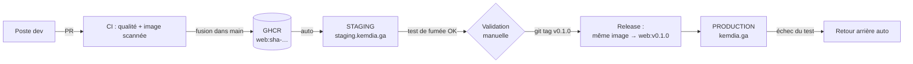

# Guide de déploiement — CI/CD Kemdia

Ce guide met en ligne Kemdia selon les pratiques DevOps standard :

- **une seule image Docker** construite et scannée une fois, puis promue d'environnement en environnement (_build once, deploy many_) ;
- **staging automatique** à chaque fusion dans `main` ;
- **production déclenchée par un tag de version** (`v0.1.0`), jamais par un push direct ;
- **test de fumée + retour arrière automatique** si la nouvelle version ne répond pas ;
- **aucun secret dans Git**, accès serveur par clé SSH restreinte, HTTPS automatique.

> 💡 Pas encore de serveur ? Une **démo publique gratuite** est possible tout de suite : voir [demo-gratuite.md](demo-gratuite.md).

## 1. Vue d'ensemble



| Fichier                          | Rôle                                                                  |
| -------------------------------- | --------------------------------------------------------------------- |
| `.github/workflows/ci.yml`       | Qualité → image → scan Trivy → publication GHCR → déploiement staging |
| `.github/workflows/release.yml`  | Tag `vX.Y.Z` → promotion de l'image → Release GitHub → production     |
| `.github/workflows/_deploy.yml`  | Déploiement réutilisable : SSH, test de fumée, retour arrière         |
| `.github/workflows/security.yml` | Gitleaks, pnpm audit, Semgrep, ShellCheck (+ CodeQL si dépôt public)  |
| `deploy/bin/setup-server.sh`     | Prépare et durcit un serveur neuf (une fois)                          |
| `deploy/bin/deploy.sh`           | Seule commande que la CI peut lancer sur le serveur                   |
| `deploy/app/compose.yml`         | Conteneur Kemdia (lecture seule, sans privilèges)                     |
| `deploy/proxy/`                  | Caddy : HTTPS Let's Encrypt, staging protégé par mot de passe         |

> **API (S3-T06)** : son image (`ghcr.io/<compte>/kemdia/api`) est construite, vérifiée et publiée par la même CI,
> puis re-étiquetée avec le site à chaque release. Elle **n'est pas encore déployée** sur le serveur (base de production au S7) :
> le serveur ne fait tourner que le site. Voir [§3.8 du cahier](../architecture/cahier-architecture.md#38-image-docker-de-lapi-s3-t06).

## 2. Ce qu'il vous faut

| Élément        | Recommandation                                                                                                                                                                                                                                                            |
| -------------- | ------------------------------------------------------------------------------------------------------------------------------------------------------------------------------------------------------------------------------------------------------------------------- |
| Serveur        | VPS **Ubuntu 24.04**, 2 vCPU, 4 Go RAM, 40 Go SSD — suffisant pour staging + production au début. Région Europe de l'Ouest (Paris, Marseille, Francfort…) : bonne latence vers le Gabon via les câbles sous-marins. Exemples : OVHcloud, Scaleway, Hetzner, DigitalOcean. |
| Nom de domaine | `kemdia.ga` (auprès d'un registraire qui propose le `.ga`) ou `kemdia.com`                                                                                                                                                                                                |
| DNS            | 3 enregistrements **A** vers l'IP du serveur : `kemdia.ga`, `www.kemdia.ga`, `staging.kemdia.ga`                                                                                                                                                                          |
| GitHub         | Votre dépôt `levy-kombila/kemdia` (privé)                                                                                                                                                                                                                                 |

> Dans ce guide, remplacez `kemdia.ga` par votre domaine réel et `IP` par l'adresse du serveur.

## 3. Créer les deux clés SSH (sur votre PC Windows, PowerShell)

```powershell
# Clé personnelle d'administration (protégez-la par une phrase de passe quand elle est demandée)
ssh-keygen -t ed25519 -C "levy-admin" -f $HOME\.ssh\kemdia_admin

# Clé dédiée à GitHub Actions (sans phrase de passe, elle ne pourra QUE lancer deploy.sh)
ssh-keygen -t ed25519 -C "github-actions-kemdia" -f $HOME\.ssh\kemdia_ci -N '""'
```

Deux clés distinctes : si la clé de la CI fuyait, elle ne permettrait que de redéployer une image signée par digest, sans shell.

## 4. Préparer le serveur (une seule fois)

Depuis le dossier du projet sur votre PC :

```powershell
scp -r deploy root@IP:/root/kemdia-deploy
ssh root@IP
```

Puis, **sur le serveur** (remplacez les clés par le contenu de `kemdia_admin.pub` et `kemdia_ci.pub`) :

```bash
ADMIN_USER=levy \
ADMIN_PUBKEY="ssh-ed25519 AAAA... levy-admin" \
CI_PUBKEY="ssh-ed25519 AAAA... github-actions-kemdia" \
  bash /root/kemdia-deploy/bin/setup-server.sh
passwd levy   # mot de passe pour sudo
```

Le script : met à jour le système (et active les mises à jour de sécurité automatiques), installe Docker,
crée l'administrateur `levy` et l'utilisateur `deploy` (clé CI restreinte à `deploy.sh`),
interdit la connexion root et par mot de passe, ouvre uniquement les ports 22/80/443, active Fail2ban.

⚠️ **Avant de fermer la session root**, vérifiez dans un autre terminal : `ssh -i $HOME\.ssh\kemdia_admin levy@IP`.

## 5. Démarrer le reverse proxy (HTTPS)

Sur le serveur, connecté en `levy` :

```bash
# Mot de passe de la préproduction (à communiquer à l'équipe)
sudo docker run --rm caddy:2-alpine caddy hash-password --plaintext 'UnMotDePasseLongEtUnique'
sudo nano /opt/kemdia/proxy/.env
```

```ini
ACME_EMAIL=votre-email@exemple.com
PROD_DOMAIN=kemdia.ga
STAGING_DOMAIN=staging.kemdia.ga
STAGING_USER=equipe
STAGING_PASSWORD_HASH='$2a$14$...collez le hash entre apostrophes...'
```

```bash
cd /opt/kemdia/proxy && sudo docker compose up -d
sudo docker logs kemdia-caddy --tail 20     # certificats obtenus une fois les DNS propagés
```

(Tant qu'aucune version n'est déployée, les domaines répondent « 502 » : c'est normal.)

## 6. Configurer GitHub

**Settings → Secrets and variables → Actions → onglet _Secrets_ → New repository secret**

| Secret                   | Valeur                                                                                          |
| ------------------------ | ----------------------------------------------------------------------------------------------- |
| `DEPLOY_SSH_HOST`        | IP (ou nom) du serveur                                                                          |
| `DEPLOY_SSH_KEY`         | Contenu **complet** de `kemdia_ci` (la clé privée, lignes BEGIN/END comprises)                  |
| `DEPLOY_SSH_KNOWN_HOSTS` | Résultat de `ssh-keyscan -t ed25519 IP` (épingle l'identité du serveur, empêche l'interception) |
| `STAGING_BASIC_AUTH`     | `equipe:UnMotDePasseLongEtUnique` (pour le test de fumée du staging)                            |

**Onglet _Variables_ → New repository variable**

| Variable   | Valeur              |
| ---------- | ------------------- |
| `SITE_URL` | `https://kemdia.ga` |

> `SITE_URL` (variable GitHub) est l'adresse inscrite à la construction de l'image. Chaque serveur peut la remplacer
> au démarrage par sa propre variable d'environnement `SITE_URL` (utilisée pour les aperçus WhatsApp, le sitemap et robots.txt).
> | `STAGING_URL` | `https://staging.kemdia.ga` |
> | `PRODUCTION_URL` | `https://kemdia.ga` |

Tant que `DEPLOY_SSH_HOST` n'est pas défini, l'étape de déploiement est simplement ignorée (la CI reste verte).

## 7. Premier déploiement en staging

Fusionnez une PR dans `main` (ou _Actions → CI/CD → Run workflow_ sur `main`). Le pipeline :

1. vérifie le code (format, lint, types, 37 tests, build) ;
2. construit l'image, la scanne avec Trivy, la publie sur `ghcr.io/levy-kombila/kemdia/web:sha-<commit>` ;
3. se connecte au serveur avec la clé restreinte, déploie **par digest** ;
4. attend que le conteneur soit sain, vérifie `/api/health` (bonne version), la page d'accueil et les en-têtes de sécurité ;
5. en cas d'échec : revient automatiquement à la version précédente.

Ouvrez <https://staging.kemdia.ga> (identifiants de l'étape 5) et testez.

## 8. Mise en production

Quand le staging est validé :

```powershell
git switch main
git pull
git tag -a v0.1.0 -m "Kemdia v0.1.0 — Sprint 1 : frontend"
git push origin v0.1.0
```

Le workflow **Release** vérifie que le tag est sur `main`, réutilise **exactement les images testées par la CI**
(site et API, re-étiquetées `v0.1.0`, sans reconstruction), crée la Release GitHub avec les notes de version,
déploie en production et lance le test de fumée.

> ⚠️ Depuis le S3-T05, le site refuse de démarrer en production sans `API_URL`. **Ne pas publier de version**
> tant que l'API n'est pas installée sur le serveur (S7) : le retour arrière automatique remettrait l'ancienne version.

> Seul le propriétaire du dépôt peut déclencher la production.
> Avec GitHub Pro/Team, on peut en plus exiger une approbation manuelle via un _Environment_ « production » (voir §11).

## 9. Revenir à une version précédente

- **Automatique** : si le conteneur n'est pas sain ou si le test de fumée échoue.
- **Manuel** : _Actions → Release → Run workflow_ → version `v0.1.0` (une version déjà publiée).
- **En urgence sur le serveur** : `sudo -u deploy /opt/kemdia/bin/deploy.sh production rollback - </dev/null`

Historique des déploiements : `/opt/kemdia/deploy.log`.

## 10. Exploitation

| Besoin           | Commande / action                                                                                                                   |
| ---------------- | ----------------------------------------------------------------------------------------------------------------------------------- |
| Voir l'état      | `docker ps` · `curl -s https://kemdia.ga/api/health`                                                                                |
| Logs applicatifs | `docker logs kemdia-production-web --since 1h`                                                                                      |
| Logs HTTP        | `docker logs kemdia-caddy --since 1h`                                                                                               |
| Surveillance     | Service externe gratuit (ex. UptimeRobot) qui appelle `https://kemdia.ga/api/health` toutes les 5 min et vous alerte par e-mail/SMS |
| Mises à jour OS  | Automatiques (unattended-upgrades) ; redémarrage mensuel planifié conseillé                                                         |
| Sauvegardes (S1) | `/opt/kemdia/proxy/.env` uniquement. À partir du S3 : sauvegarde chiffrée quotidienne de PostgreSQL, testée                         |

### Adresse des visiteurs en production (S4-T07, ADR-0021)

Sur le VPS, le relais de confiance est **Caddy**, pas Cloudflare : le réglage de la démo (`CLIENT_IP_HEADER=cf-connecting-ip`)
**ne doit pas** être repris tel quel. Sans Cloudflare devant le serveur, n'importe qui pourrait envoyer un faux `CF-Connecting-IP`.

| Situation                                   | Réglage du site                                                                                                                                                |
| ------------------------------------------- | -------------------------------------------------------------------------------------------------------------------------------------------------------------- |
| Caddy seul devant le site (cas prévu)       | `CLIENT_IP_HEADER=x-forwarded-for` : le site prend la **dernière** adresse, posée par Caddy (adresse réelle de la connexion)                                   |
| Cloudflare devant Caddy (si ajouté un jour) | Déclarer les adresses de Cloudflare dans `trusted_proxies` de Caddy, n'accepter que Cloudflare sur les ports 80/443, puis seulement ensuite `cf-connecting-ip` |

Points d'attention :

- **IPv6 et Docker** : Caddy tourne dans Docker. Si l'IPv6 n'est pas activé dans Docker, les visiteurs IPv6 (souvent en 4G)
  arrivent avec l'adresse de la passerelle Docker (`172.x.0.1`) et partagent une seule limite. Vérifier avec `curl -6` ; si
  l'adresse vue commence par `172.`, activer `"ipv6": true` et `"ip6tables": true` dans `/etc/docker/daemon.json`
  (ou ne pas publier d'enregistrement DNS AAAA).
- **Pare-feu** : `ufw` ne filtre pas les ports publiés par Docker. Pour n'accepter que Cloudflare (cas Cloudflare devant Caddy),
  filtrer dans la chaîne `DOCKER-USER` d'iptables.
- Avant l'ouverture, refaire sur la production la vérification de la démo (adresse réelle puis fausse valeur, en `-4` **et** en `-6`,
  en Wi-Fi et en 4G), avec un diagnostic temporaire équivalent.

## 11. Limites du plan GitHub gratuit (dépôt privé)

| Fonction                                                   | Gratuit (privé)          | GitHub Pro / Team                                   |
| ---------------------------------------------------------- | ------------------------ | --------------------------------------------------- |
| Actions, GHCR, secrets du dépôt                            | ✅                       | ✅                                                  |
| Protection de la branche `main` (PR obligatoire, CI verte) | ❌                       | ✅                                                  |
| Environments avec approbation manuelle                     | ❌                       | ✅ (Pro : environnements ; approbateurs selon plan) |
| CodeQL / revue des dépendances                             | ❌ (Semgrep le remplace) | Avec GitHub Advanced Security                       |

Sans protection de branche, la règle d'équipe est : **jamais de push direct sur `main`**, toujours une PR avec CI verte.

## 12. Liste de contrôle avant la vraie ouverture au public

- [ ] Secrets de l'ancien projet Django changés, ancien dépôt archivé
- [ ] Domaine, DNS et HTTPS opérationnels (note A sur <https://www.ssllabs.com/ssltest/>)
- [ ] Surveillance externe de `/api/health` active
- [ ] Mentions légales et politique de confidentialité complétées
- [ ] Vrai catalogue et photos HD (les données actuelles sont des données de démonstration)
