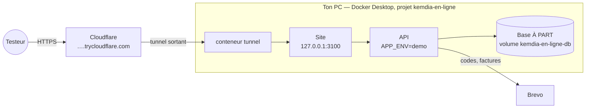

# Mettre Kemdia en ligne depuis ton PC (Docker Desktop + tunnel Cloudflare)

> S6-T00 — [ADR-0031](../architecture/adr/0031-en-ligne-docker-tunnel.md). Pour des **tests à distance**, sans hébergeur et sans
> GitHub Actions : ton PC fait tourner Kemdia, et Cloudflare donne une adresse `https://….trycloudflare.com` à partager.



C'est **comme la démo Render** : catalogue de démonstration, code promo `DEMO10`, Mobile Money **simulé**, aucun vrai paiement.
Seul le site passe par le tunnel ; l'API et la base ne sont joignables que dans Docker. Ta base de travail (port 5433) n'est pas touchée.

## Avant la première fois

1. **Docker Desktop** lancé (« Engine running »).
2. Dans `D:\React\kemdia\.env` (jamais dans Git), ajoute **toi-même** les réglages e-mail. Le script les lit sans jamais écrire
   ce fichier :

   ```dotenv
   # Conseillé : une clé Brevo réservée à ces tests (révocable sans toucher la démo Render)
   EN_LIGNE_BREVO_API_KEY=xkeysib-…
   # Sinon, la clé de la démo Render est utilisée
   BREVO_API_KEY=xkeysib-…
   # Adresse d'expéditeur vérifiée dans Brevo
   EMAIL_FROM=…@…
   ```

3. Empêche la mise en veille du PC pendant les tests (Paramètres → Système → Alimentation).

## Mettre en ligne

```powershell
cd D:\React\kemdia
git pull
powershell -ExecutionPolicy Bypass -File deploy\windows\en-ligne.ps1
```

La première fois, la construction des images prend plusieurs minutes. À la fin :

```
Kemdia est en ligne : https://mots-au-hasard.trycloudflare.com
(adresse copiée dans le presse-papiers)
Mode d'emploi pour tes testeurs : https://mots-au-hasard.trycloudflare.com/demo
```

Envoie cette adresse **en privé** à tes testeurs, avec `/demo` (le parcours du premier achat). L'adresse **change à chaque
lancement**. Sur ton PC : <http://localhost:3100>.

**Premier test conseillé** : connecte-toi toi-même par l'adresse du tunnel. Cela vérifie que les formulaires passent bien le
contrôle d'origine (CSRF) derrière Cloudflare.

## Couper l'accès public

```powershell
powershell -ExecutionPolicy Bypass -File deploy\windows\hors-ligne.ps1
```

Le tunnel est fermé **en premier**, puis le site, l'API et la base s'arrêtent. Les comptes et commandes des testeurs sont
**gardés** pour la prochaine fois. Pour tout effacer à la fin d'une campagne de tests :

```powershell
powershell -ExecutionPolicy Bypass -File deploy\windows\hors-ligne.ps1 -Effacer
```

Si le PC ou Docker redémarre, le tunnel **ne revient pas tout seul** : le site n'est plus joignable depuis Internet tant que tu
ne relances pas `en-ligne.ps1`.

## Bon à savoir

| Sujet             | Ce qu'il faut savoir                                                                                                                 |
| ----------------- | ------------------------------------------------------------------------------------------------------------------------------------ |
| Comptes testeurs  | Chacun crée son compte sur le site (code reçu par e-mail). **Ne donne jamais ton compte administrateur.**                            |
| Données           | Les e-mails, adresses et téléphones des testeurs sont stockés sur ton PC : préviens-les, et lance `-Effacer` à la fin des tests.     |
| E-mails           | Même quota Brevo que la démo Render si tu n'as pas de clé dédiée (300 par jour en offre gratuite).                                   |
| Adresse publique  | Quiconque a l'adresse peut entrer et créer un compte. Coupe le tunnel dès la fin des tests.                                          |
| Tunnel rapide     | Service gratuit de Cloudflare, prévu pour les tests, sans garantie : parfait pour une séance, pas pour une démo permanente (Render). |
| Mot de passe base | Tiré au hasard, gardé dans `%LOCALAPPDATA%\Kemdia\en-ligne\` (hors du dépôt).                                                        |

## En cas de problème

| Message                                                 | Que faire                                                                                                               |
| ------------------------------------------------------- | ----------------------------------------------------------------------------------------------------------------------- |
| « Docker Desktop ne répond pas »                        | Lancer Docker Desktop, attendre « Engine running », relancer.                                                           |
| « BREVO_API_KEY et EMAIL_FROM sont nécessaires »        | Les ajouter dans `.env` (voir plus haut).                                                                               |
| « le tunnel s'est arrêté »                              | Connexion Internet ou Cloudflare indisponible : `docker compose -f deploy\en-ligne\compose.yml logs tunnel`, réessayer. |
| « le site ou l'API ne démarre pas »                     | `docker compose -f deploy\en-ligne\compose.yml logs api web` (ex. clé Brevo refusée, port 3100 déjà pris).              |
| « le tunnel ne répond pas encore »                      | Normal juste après l'ouverture : réessayer l'adresse une minute plus tard.                                              |
| Formulaires refusés (« Requête refusée ») par le tunnel | Contrôle d'origine : me prévenir avec le message exact.                                                                 |
