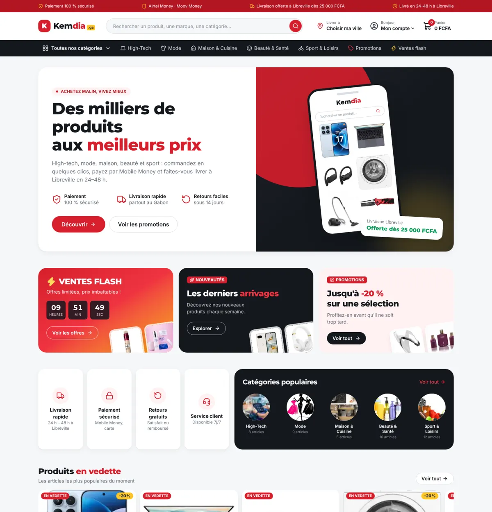
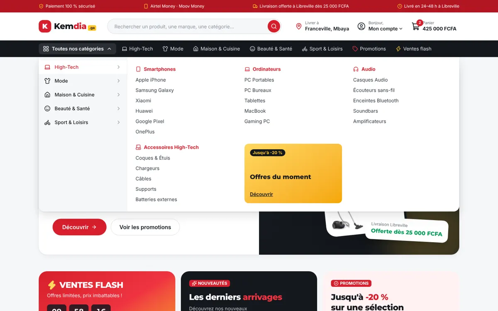
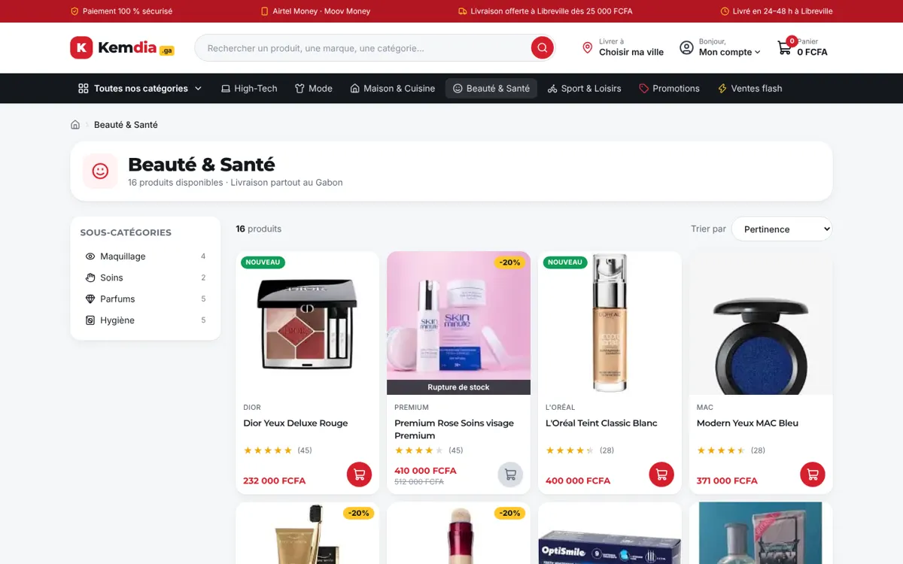
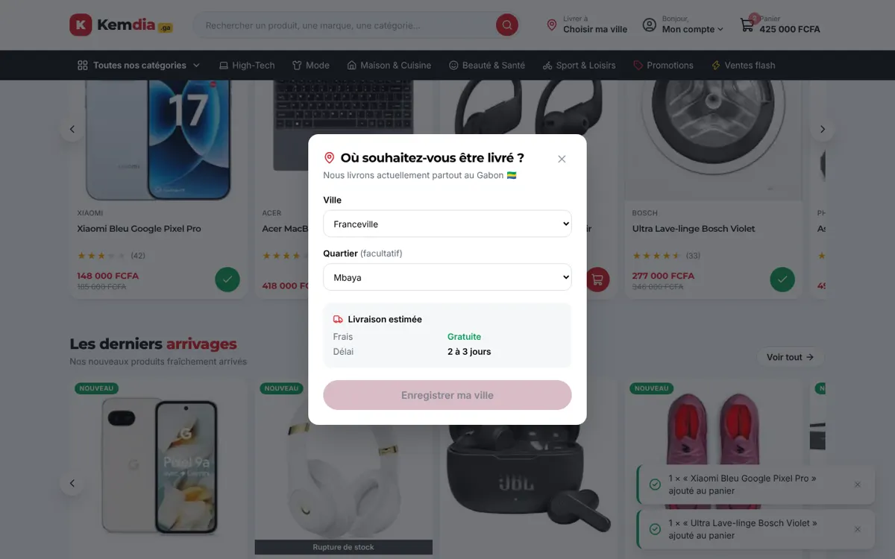
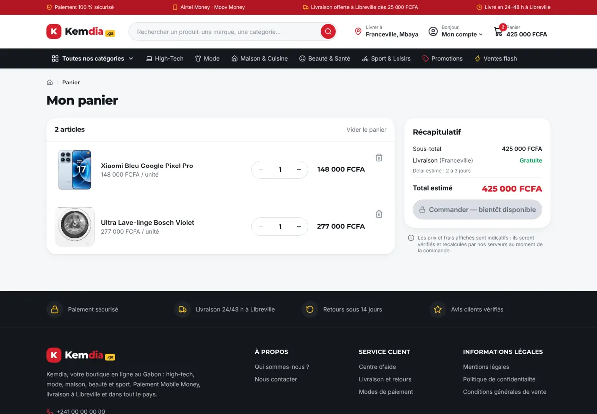

# Rapport — Sprint 1 : fondations du frontend et chaîne DevOps

|                                              |                                |
| -------------------------------------------- | ------------------------------ |
| **Date**                                     | 2026-10-05                     |
| **Sprint / tâches**                          | S0 (cadrage) + S1-T01 à S1-T16 |
| **Version**                                  | v0.1.0                         |
| **Sections du cahier d'architecture créées** | §1 à §10 (version 0.1)         |

## 1. Résumé

Le projet repart sur une base neuve (TypeScript, Next.js 16) après l'analyse des 45 failles de la version Django
([ADR-0001](../architecture/adr/0001-reecriture-complete.md)). Ce sprint livre **toute la partie visible du site**
(accueil, catégories, recherche, promotions, fiche produit, panier, choix de la ville de livraison au Gabon),
alimentée par des données de démonstration, ainsi qu'une **chaîne CI/CD et de sécurité complète** qui s'exécute à chaque modification.

## 2. Fonctionnalités livrées

| Tâche  | Description                                                                                                                                                                                                       | Fichiers principaux                                                               |
| ------ | ----------------------------------------------------------------------------------------------------------------------------------------------------------------------------------------------------------------- | --------------------------------------------------------------------------------- |
| S1-T01 | Monorepo pnpm/Turborepo, Prettier (+ tri des classes Tailwind), EditorConfig, hook pre-commit                                                                                                                     | `package.json`, `turbo.json`, `.husky/`                                           |
| S1-T02 | App Next.js 16 + Tailwind 4 ; charte Kemdia en _design tokens_ ; polices auto-hébergées                                                                                                                           | `apps/web/src/app/globals.css`, `layout.tsx`                                      |
| S1-T03 | Reprise de 112 catégories (3 niveaux) et 50 produits avec photos converties en WebP (452 Ko au total). **Aucune donnée client reprise.**                                                                          | `src/data/catalog.seed.json`, `public/images/`                                    |
| S1-T04 | En-tête : bandeau d'engagements, logo, recherche (formulaire natif), « Livrer à », compte, mini-panier au survol                                                                                                  | `components/layout/*`, `components/cart/MiniCart.tsx`                             |
| S1-T05 | Méga-menu 3 niveaux (clavier, Échap, clic extérieur) ; tiroir mobile en accordéon                                                                                                                                 | `components/layout/CategoryNav.tsx`                                               |
| S1-T06 | Accueil transcrit de la maquette « Bannière e-commerce » : hero avec visuel téléphone, tuiles Ventes flash (compte à rebours) / Nouveautés / Promotions, engagements, catégories populaires, 3 carrousels, grille | `app/page.tsx`, `components/home/*`                                               |
| S1-T07 | Catégorie (sous-catégories, fil d'Ariane), recherche sans accents, promotions, toutes les catégories ; tri et pagination                                                                                          | `app/categorie/[slug]`, `app/recherche`, `app/promotions`, `components/catalog/*` |
| S1-T08 | Fiche produit : galerie, stock, quantité, estimation livraison selon la ville, produits similaires, données structurées Google                                                                                    | `app/produit/[slug]`, `components/product/*`                                      |
| S1-T09 | Panier (ajout, quantité, suppression, vider, synchro entre onglets) ; modale ville/quartier — 13 villes, 4 zones                                                                                                  | `lib/cart.ts`, `providers/*`, `location/LocationModal.tsx`, `lib/delivery.ts`     |
| S1-T10 | Pages d'information (tableau des tarifs de livraison généré depuis les données), 404, page d'erreur, sitemap, robots                                                                                              | `app/infos/[slug]`, `app/not-found.tsx`, `app/error.tsx`                          |
| S1-T11 | En-têtes de sécurité HTTP                                                                                                                                                                                         | `next.config.ts`                                                                  |
| S1-T12 | 37 tests automatisés                                                                                                                                                                                              | `src/**/*.test.ts(x)`                                                             |
| S1-T13 | Workflow CI                                                                                                                                                                                                       | `.github/workflows/ci.yml`                                                        |
| S1-T14 | Workflow Sécurité, Dependabot, modèles d'issues/PR, `SECURITY.md`                                                                                                                                                 | `.github/`, `.gitleaks.toml`                                                      |
| S1-T15 | Image Docker multi-étapes non-root + docker-compose durci                                                                                                                                                         | `apps/web/Dockerfile`, `docker-compose.yml`                                       |
| S1-T16 | Planning, ce rapport, cahier d'architecture v0.1, 4 ADR, guides                                                                                                                                                   | `docs/`                                                                           |

### Composants Django transcrits

| Ancien (Django)                                                                                | Nouveau                                             | Remarque                                    |
| ---------------------------------------------------------------------------------------------- | --------------------------------------------------- | ------------------------------------------- |
| `base.html`, `header.html`, `navigation.html`, `footer.html`                                   | `layout.tsx`, `Header`, `CategoryNav`, `Footer`     | JS inline remplacé par des composants typés |
| `category_mega_menu.html`                                                                      | `CategoryNav`                                       | + version mobile                            |
| `product_card_featured/new/bestseller.html`                                                    | `ProductCard` (prop `badge`)                        | 3 fichiers → 1                              |
| `core/index.html` + maquette PNG                                                               | `app/page.tsx` + `components/home/*`                | Fidèle à la maquette, marque Kemdia         |
| `location_modal.html` + `location.js`                                                          | `LocationModal`                                     | Gabon uniquement, plus d'appel IP externe   |
| Mini-panier (`base.html`)                                                                      | `MiniCart`                                          | Construit sans `innerHTML`                  |
| `store/category_detail.html`, `search_results.html`, `product_detail.html`, `cart_detail.html` | pages `categorie`, `recherche`, `produit`, `panier` |                                             |

Non repris volontairement à ce stade : aperçu rapide (modale), liste d'envies, avis, espace vendeur, back-office (sprints suivants).

## 3. Décisions techniques

- [ADR-0001](../architecture/adr/0001-reecriture-complete.md) — Réécriture complète
- [ADR-0002](../architecture/adr/0002-stack-typescript-nextjs.md) — TypeScript : Next.js + NestJS
- [ADR-0003](../architecture/adr/0003-monorepo.md) — Monorepo pnpm + Turborepo
- [ADR-0004](../architecture/adr/0004-panier-cote-client.md) — Panier invité dans le navigateur, montants recalculés par le serveur

Autres choix : suppression de Bootstrap, Font Awesome, AOS et Swiper (CDN) au profit de Tailwind, lucide et du défilement natif ;
notes en étoiles rendues en texte (gain ~300 Ko par page d'accueil).

## 4. Sécurité

| Contrôle                                                       | Résultat                                                                               |
| -------------------------------------------------------------- | -------------------------------------------------------------------------------------- |
| En-têtes HTTP (vérifiés par `curl -I`)                         | CSP, HSTS, X-Frame-Options DENY, nosniff, Referrer-Policy, Permissions-Policy, COOP ✅ |
| Image distante via l'optimiseur (`/_next/image?url=https://…`) | Refusée (HTTP 400) ✅                                                                  |
| Paramètre de tri malveillant (`?tri=__proto__&page=-3`)        | Valeur par défaut, HTTP 200 ✅                                                         |
| Titre produit contenant ``                        | Affiché comme texte (test automatisé) ✅                                               |
| `pnpm audit --prod`                                            | 0 vulnérabilité connue ✅                                                              |
| Panier modifié à la main dans le navigateur                    | Lignes invalides ignorées, quantités bornées, images externes rejetées (tests) ✅      |

Suivi des 45 failles : [heritage-audit-django.md](../securite/heritage-audit-django.md) — 12 neutralisées par conception, 4 partiellement, 29 planifiées.

> ⚠️ **Action requise** : changer tous les secrets de l'ancien projet (mot de passe PostgreSQL écrit en clair dans `settings.py`,
> `SECRET_KEY`, SMTP, clés de paiement) et rendre privé l'ancien dépôt, qui contient des sauvegardes de base de données.

## 5. Qualité

| Vérification                                                     | Résultat                                              |
| ---------------------------------------------------------------- | ----------------------------------------------------- |
| Prettier                                                         | ✅                                                    |
| ESLint (Next + React Hooks)                                      | 0 erreur, 0 avertissement                             |
| TypeScript strict                                                | 0 erreur                                              |
| Tests Vitest                                                     | **37 / 37** (6 fichiers)                              |
| Build de production                                              | ✅ 69 pages générées (50 fiches produits pré-rendues) |
| Serveur `standalone` (utilisé par Docker)                        | ✅ démarre et sert pages + images                     |
| Débordement horizontal mobile (390 px)                           | Aucun, sur 5 pages types                              |
| Erreurs console navigateur (parcours ajout panier + choix ville) | 0                                                     |
| Poids page d'accueil                                             | 36 Ko HTML compressé (gzip) hors images               |

## 6. Captures d'écran

| Accueil (ordinateur)                       | Accueil (mobile)                                 |
| ------------------------------------------ | ------------------------------------------------ |
|  |  |

| Méga-menu                              | Fiche produit                                  |
| -------------------------------------- | ---------------------------------------------- |
|  |  |

| Catégorie                              | Choix de la ville                    | Panier                                   |
| -------------------------------------- | ------------------------------------ | ---------------------------------------- |
|  |  |  |

## 7. Limites connues / dette technique

- **Données de démonstration** : titres de produits générés automatiquement dans l'ancien projet (ex. « Xiaomi Bleu Google Pixel Pro »),
  promotions et nouveautés attribuées artificiellement pour la démo. À remplacer par le vrai catalogue.
- **Photos en 225 px** : nettes en vignette, floues en grand sur la fiche produit → photos HD nécessaires (S2-T01).
- CSP avec `'unsafe-inline'` pour les scripts (exigé par Next.js sans nonce) → CSP à nonce prévue en S4.
- L'image Docker n'a pas pu être construite dans l'environnement de développement (pas de démon Docker) :
  elle sera construite et scannée par Trivy dès le premier passage de la CI GitHub.
- Boutons « Commander », compte client et newsletter : interface présente, fonctionnement réel aux sprints S4–S5.
- Liens réseaux sociaux non ajoutés (comptes à créer).

## 8. Prochaines étapes (Sprint 2)

Voir [planning.md](../planning.md#s2--finitions-frontend-proposition) : photos HD, pages connexion/inscription, favoris, avis,
maquette du tunnel de commande Mobile Money, filtres, tests Playwright en CI, Lighthouse CI, préproduction automatique.
