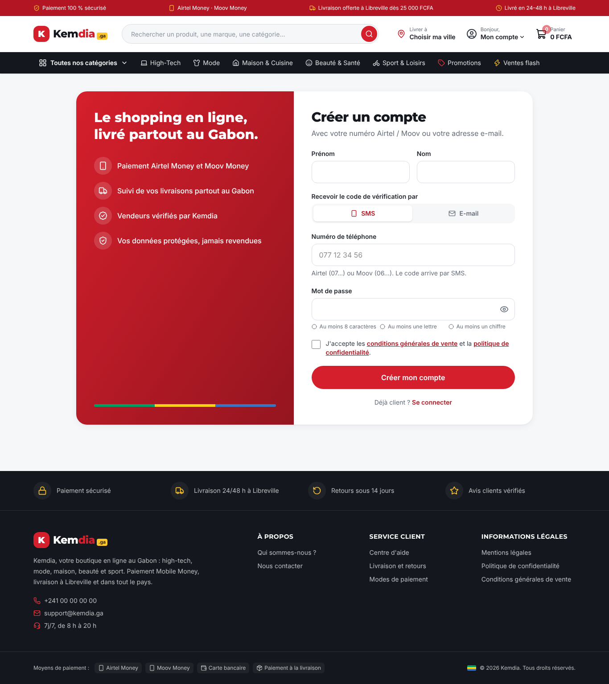
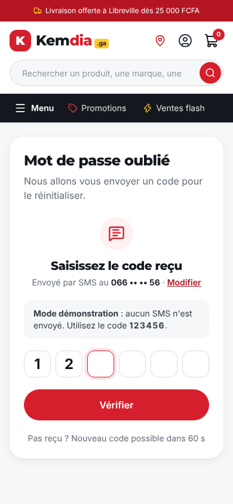

# Rapport — Connexion, inscription et code de vérification (interface)

|                                                 |                                        |
| ----------------------------------------------- | -------------------------------------- |
| **Date**                                        | 2026-10-05                             |
| **Sprint / tâches**                             | S2 — S2-T01                            |
| **Version**                                     | v0.2.0 (en cours)                      |
| **Sections du cahier d'architecture modifiées** | §5.1, §5.4 (nouvelle), §6.2, §9 (v0.5) |

## 1. Résumé

Les pages **Connexion**, **Créer un compte** et **Mot de passe oublié** sont en ligne, avec l'écran de **code à 6 chiffres** reçu par SMS ou e-mail.
Tout le parcours est utilisable sur la démo, mais **en mode démonstration** : aucun compte n'est créé, aucun SMS n'est envoyé (le code est toujours `123456`).
Le vrai serveur sera branché au Sprint 4 **sans réécrire ces pages**, grâce au « port » `AuthClient`.

## 2. Fonctionnalités livrées

| Fonction                      | Description                                                                                              | Fichiers principaux                              |
| ----------------------------- | -------------------------------------------------------------------------------------------------------- | ------------------------------------------------ |
| Inscription (FR-001)          | Prénom, nom, choix **SMS / e-mail**, mot de passe avec règles affichées en direct, acceptation des CGV   | `components/auth/SignupForm.tsx`, `/inscription` |
| Code de vérification (BR-041) | 6 cases, collage du code entier, remplissage automatique depuis le SMS, renvoi après 60 s, 5 essais max. | `OtpInput.tsx`, `OtpStep.tsx`                    |
| Connexion (FR-004)            | **Un seul champ** « e-mail ou numéro », mot de passe affichable, retour à la page d'origine (`?retour=`) | `LoginForm.tsx`, `/connexion`                    |
| Mot de passe oublié (FR-012)  | Identifiant → code → nouveau mot de passe                                                                | `ForgotPasswordForm.tsx`, `/mot-de-passe-oublie` |
| Numéros gabonais              | `077 12 34 56`, `+241 77 12 34 56`, `00241…` reconnus ; opérateur déduit (06 = Moov, 07 = Airtel)        | `lib/auth/validation.ts`                         |
| Espace client                 | Boutons « Se connecter » / « Créer un compte »                                                           | `app/compte/page.tsx`                            |

## 3. Décisions techniques

- **Port + adaptateur** (architecture hexagonale, [concepts §3](../architecture/concepts.md#3-architecture-hexagonale-ports-et-adaptateurs)) :
  les formulaires appellent `AuthClient` ; aujourd'hui `createDemoAuthClient()`, au Sprint 4 un adaptateur vers l'API NestJS.
- **Inscription : on choisit le canal** (SMS ou e-mail) plutôt qu'un champ unique : clavier numérique sur mobile, bon remplissage automatique.
  **Connexion : un champ unique** (FR-004), le type est reconnu automatiquement.
- Pas de champ « confirmer le mot de passe » : un bouton 👁 permet de vérifier ce qu'on a tapé (pratique recommandée aujourd'hui, moins d'abandons sur mobile).
- Aucune nouvelle dépendance.

## 4. Sécurité

| Mesure                                                                                                                          | Faille de l'ancien site     |
| ------------------------------------------------------------------------------------------------------------------------------- | --------------------------- |
| `?retour=` limité aux chemins internes : `//pirate.com`, `https://…`, `/\…` → `/compte`                                         | MED-01 ✅                   |
| Même message que le compte existe ou non (connexion, mot de passe oublié)                                                       | Énumération des comptes     |
| Mot de passe : 8 caractères, lettre + chiffre, mots de passe courants refusés ; effacé du formulaire après envoi, jamais stocké | Mots de passe faibles       |
| Code : 5 essais maximum, puis nouveau code obligatoire                                                                          | Préparation MED-05 / MED-10 |
| Pages d'identité exclues des moteurs de recherche (`noindex` + `robots.txt`)                                                    | —                           |

⚠️ **Rappel** : tous ces contrôles côté navigateur sont du **confort**. La vraie protection (hachage Argon2, limitation de débit, verrouillage BR-040,
codes à usage unique hachés en base, cookies `HttpOnly`) sera faite **par le serveur** au Sprint 4.

## 5. Qualité

- **+51 tests** (37 → 88) : validation des numéros, e-mails, noms, mots de passe ; redirection ouverte ; limite d'essais du code ;
  parcours complets inscription / connexion / oubli avec Testing Library (clavier, collage, messages accessibles).
- Lint, types, build : ✅. Pas de débordement horizontal sur mobile (390 px).
- Accessibilité : chaque champ a son libellé, les erreurs sont reliées au champ (`aria-describedby`) et annoncées ; le curseur va au premier champ en erreur.

## 6. Captures d'écran

| Inscription (ordinateur)                                | Code de vérification (mobile)                    |
| ------------------------------------------------------- | ------------------------------------------------ |
|  |  |

## 7. Limites connues / dette technique

- Mode démonstration : la connexion affiche « active au Sprint 4 » ; aucun compte n'est réellement créé.
- Format international exact des numéros (`+241 0…` ou `+241 …`) à confirmer avec le fournisseur SMS choisi.
- L'en-tête affiche toujours « Mon compte » (pas encore d'état « connecté »).

## 8. Prochaines étapes

S2-T02 : tunnel de commande en maquette (adresse → livraison → paiement Moov / Airtel / à la livraison → confirmation).
