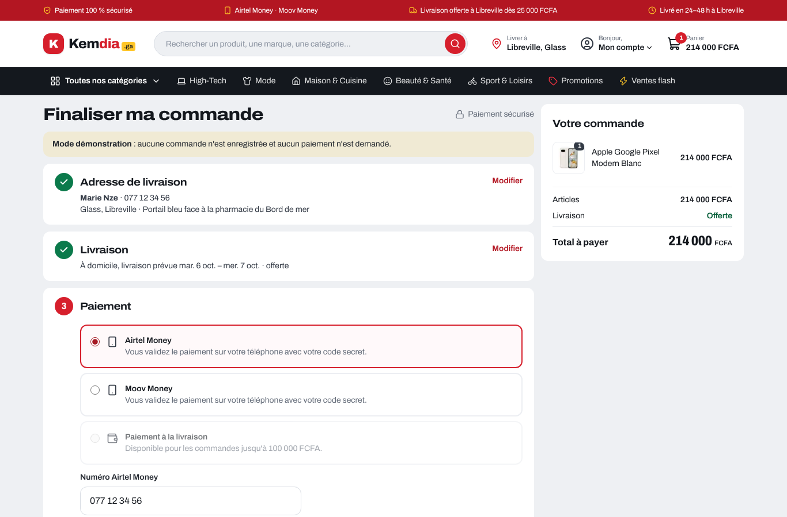
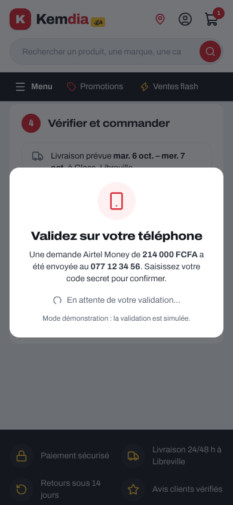
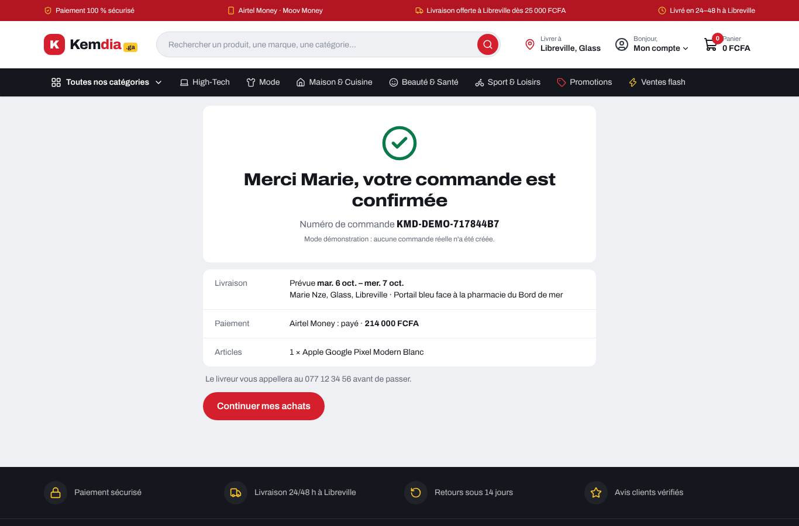

# Rapport — Tunnel de commande (maquette)

|                                                 |                              |
| ----------------------------------------------- | ---------------------------- |
| **Date**                                        | 2026-10-05                   |
| **Sprint / tâches**                             | S2 — S2-T02                  |
| **Version**                                     | v0.2.0 (en cours)            |
| **Sections du cahier d'architecture modifiées** | §5.7 (nouvelle), §6.2 (v0.8) |

## 1. Résumé

Le bouton **Commander** du panier mène maintenant à la page `/commande` : adresse → livraison → paiement → vérification → confirmation.
Tout le parcours fonctionne sur la démo, **en mode démonstration** : aucune commande enregistrée, aucun paiement demandé.
Au Sprint 5, l'API (modules `orders` et `payments`) remplacera l'adaptateur de démonstration sans changer cette page.

## 2. Captures

| Paiement (ordinateur)                   | Vérifier et commander (mobile)          |
| --------------------------------------- | --------------------------------------- |
|  |  |

| Validation Mobile Money (mobile)             | Confirmation                                 |
| -------------------------------------------- | -------------------------------------------- |
|  |  |

## 3. Parcours

| Étape        | Contenu                                                                                                                                     |
| ------------ | ------------------------------------------------------------------------------------------------------------------------------------------- |
| 1. Adresse   | Prénom et nom, téléphone, ville (pré-remplie si déjà choisie), quartier (liste de la ville ou « Autre quartier »), **point de repère**      |
| 2. Livraison | Livraison à domicile, frais selon la zone, **date prévue** (dimanche exclu), rappel « livraison offerte dès … »                             |
| 3. Paiement  | Airtel Money, Moov Money (numéro pré-rempli et vérifié selon l'opérateur), paiement à la livraison (grisé avec la raison si non disponible) |
| 4. Vérifier  | Résumé, bouton jaune « Commander et payer · 214 000 FCFA »                                                                                  |
| Validation   | Mobile Money : écran « Validez sur votre téléphone » (code secret), simulé                                                                  |
| Confirmation | Numéro de commande, date prévue, adresse, paiement ; le panier est vidé                                                                     |

Récapitulatif de la commande : colonne collée à droite sur ordinateur, bloc repliable en haut sur mobile.
Chaque étape terminée se replie en résumé avec un lien « Modifier ».

## 4. Décisions techniques

- **Port `OrderClient`** (`lib/orders/client.ts`), comme pour l'identité : adaptateur de démonstration aujourd'hui, API au Sprint 5.
- **Règles dans `lib/checkout.ts`** (logique pure, testée) : validation de l'adresse, opérateur du numéro, disponibilité du paiement à la livraison, construction de la requête.
- **Paiement à la livraison** : valeurs **provisoires** (Grand Libreville, 100 000 FCFA maximum) en attendant la réponse à la
  [question ouverte n° 1](../architecture/regles-metier.md#questions-ouvertes). Elles sont à un seul endroit du code.
- Le composant `Field` passe de `components/auth/` à `components/ui/` (partagé par l'identité et la commande) ; ajout de `SelectField`.

## 5. Sécurité

| Mesure                                                                                                                 | Faille de l'ancien site |
| ---------------------------------------------------------------------------------------------------------------------- | ----------------------- |
| La requête de commande ne contient **que** identifiants + quantités : aucun prix, total ni frais (vérifié par un test) | CRIT-01, HIGH-05        |
| Numéro Mobile Money vérifié selon l'opérateur choisi (07 → Airtel, 06 → Moov)                                          | —                       |
| Numéro de commande de démonstration tiré au hasard (`crypto.getRandomValues`), jamais un compteur                      | HIGH-01 (préparation)   |
| `/commande` exclue des moteurs de recherche                                                                            | —                       |

Au Sprint 5, côté serveur : prix relus en base (BR-004), stock réservé dans la même transaction (BR-012), webhooks Mobile Money signés, idempotence.

## 6. Qualité

- **+10 tests** (99 → 109) : règles du tunnel (adresse, opérateur, paiement à la livraison, requête sans prix) et 3 parcours complets avec Testing Library.
- Lint, types, build : ✅. Parcours vérifié dans un vrai navigateur, sur ordinateur et sur mobile.

## 7. Limites connues

- Aucune commande n'est enregistrée : la page « Mes commandes » arrivera avec les comptes (S4) et l'API commandes (S5).
- Pas encore de choix de créneau horaire ni de point relais (à définir avec le transporteur, question ouverte n° 5).

## 8. Prochaines étapes

Suite du Sprint 2 : S2-T04 (favoris), S2-T05 (partage WhatsApp soigné), S2-T06 (page « Devenir vendeur »), S2-T07 (tests de bout en bout Playwright).
