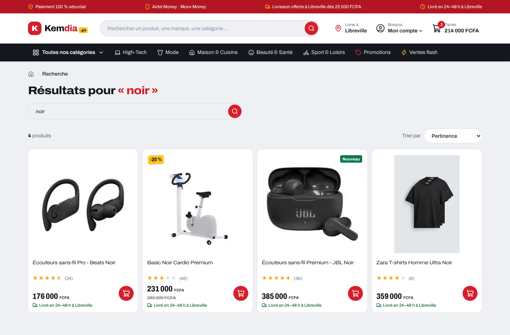
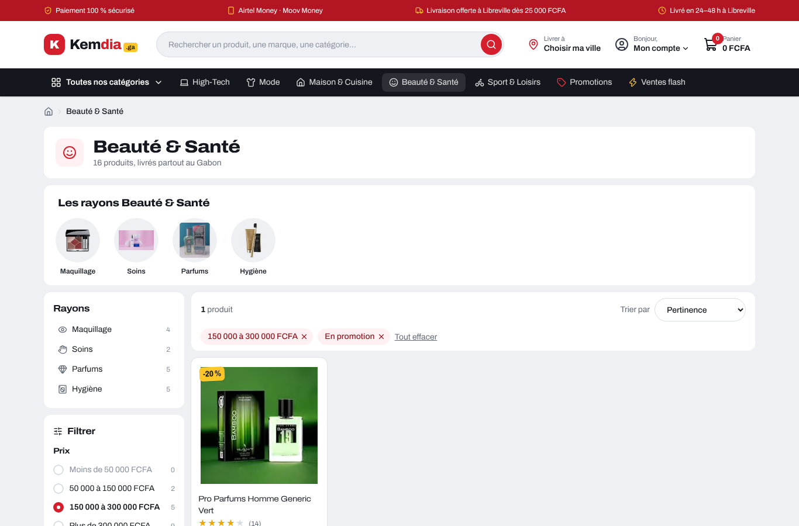
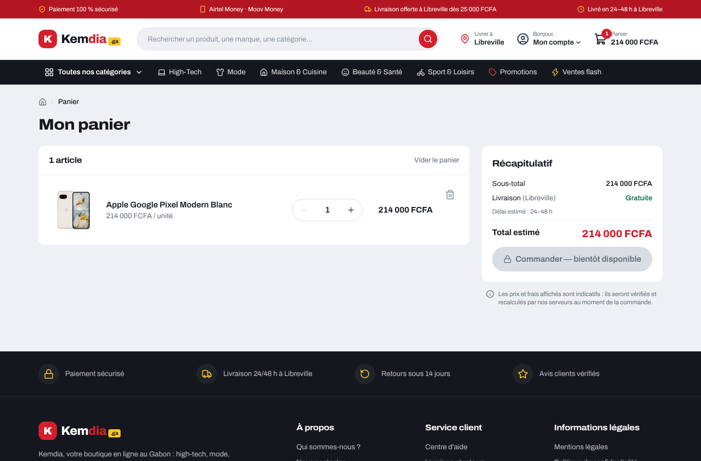
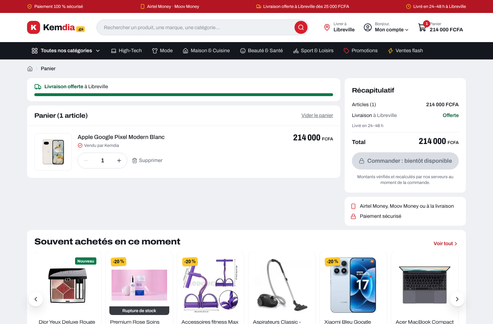
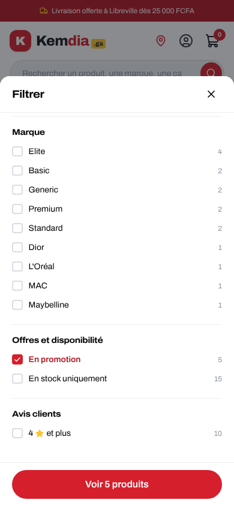
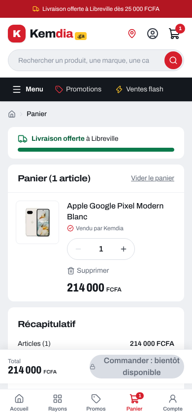

# Rapport — Pages de liste avec filtres, et panier

|                                                 |                                                 |
| ----------------------------------------------- | ----------------------------------------------- |
| **Date**                                        | 2026-10-05                                      |
| **Sprint / tâches**                             | S2 — S2-T03 (filtres) + suite de S2-T10 (style) |
| **Version**                                     | v0.2.0 (en cours)                               |
| **Sections du cahier d'architecture modifiées** | §5.6, §6.2 (v0.7)                               |

## 1. Résumé

Retour de Levy après S2-T10 : les pages **recherche**, **catégorie** et **panier** n'avaient pas suivi le nouveau style.
Elles sont refaites dans le style « place de marché », et les pages de liste reçoivent les **filtres** prévus en S2-T03.

## 2. Avant / après

| Avant                                                     | Après                                                     |
| --------------------------------------------------------- | --------------------------------------------------------- |
|  |  |
|        |        |

| Filtres sur mobile                                     | Panier sur mobile                                    |
| ------------------------------------------------------ | ---------------------------------------------------- |
|  |  |

## 3. Livré

| Page                 | Contenu                                                                                                                                                                                                        |
| -------------------- | -------------------------------------------------------------------------------------------------------------------------------------------------------------------------------------------------------------- |
| Catégorie            | En-tête, ronds des sous-rayons, rayons + filtres à gauche, grille de 20 produits                                                                                                                               |
| Recherche            | Même gabarit ; **aucun résultat** → conseils, ronds des rayons et produits les plus vendus (plus de page vide)                                                                                                 |
| Promotions           | Bandeau rouge avec compte à rebours, même gabarit                                                                                                                                                              |
| **Filtres (FR-005)** | Prix (4 tranches), marque, en promotion, en stock, 4 étoiles et plus ; compteur à côté de chaque choix ; pastilles « filtre actif » à retirer d'un clic ; « Tout effacer »                                     |
| Filtres sur mobile   | Bouton « Filtres (2) » → panneau qui monte du bas ; il reste ouvert pendant qu'on coche, bouton « Voir 5 produits »                                                                                            |
| Panier               | Barre « Plus que X FCFA pour la livraison offerte », lignes avec « Vendu par Kemdia » et stock faible, récapitulatif collé, total en étiquette, suggestions ; **sur mobile, total + bouton toujours visibles** |

## 4. Décisions techniques

- **Un seul gabarit `CatalogView`** pour les 3 pages de liste : un changement de style ou de filtre s'applique partout.
- Les filtres sont de **simples liens** : ils marchent sans JavaScript, l'URL se partage telle quelle sur WhatsApp
  (ex. `/categorie/beaute-sante?promo=1&prix=150000-300000`), et le bouton « retour » du téléphone fonctionne.
- Les compteurs (« Beats 3 ») sont calculés sur la liste **avant** filtres : un choix à 0 est grisé au lieu de mener à une page vide.
- Au Sprint 3, ces mêmes paramètres seront envoyés à l'API (recherche côté serveur).

## 5. Sécurité

- Filtres en **liste blanche** (même règle que le tri, faille MED-13 de l'ancien site) : tranche de prix parmi 4 valeurs connues,
  marques comparées à celles du catalogue (10 au maximum), drapeaux `1` uniquement. Toute autre valeur est ignorée, jamais d'erreur.
- Le mot recherché est toujours affiché par React (échappé) : pas de XSS réfléchie.

## 6. Qualité

- **+5 tests** (94 → 99) : lecture des filtres (valeurs malveillantes ignorées), application de chaque critère, compteurs = résultats.
- Lint, types, build : ✅.

## 7. Prochaines étapes

S2-T02 : tunnel de commande ; le bouton « Commander » du panier y mènera.
