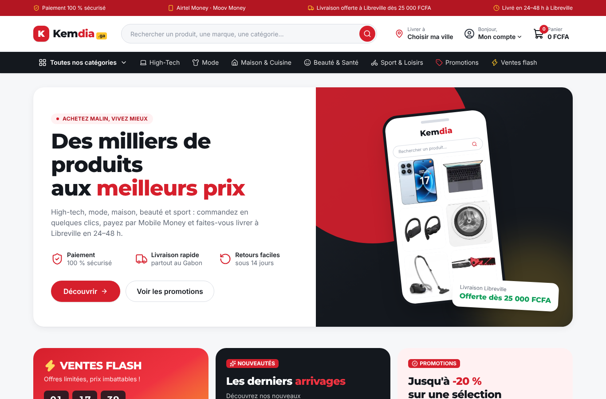
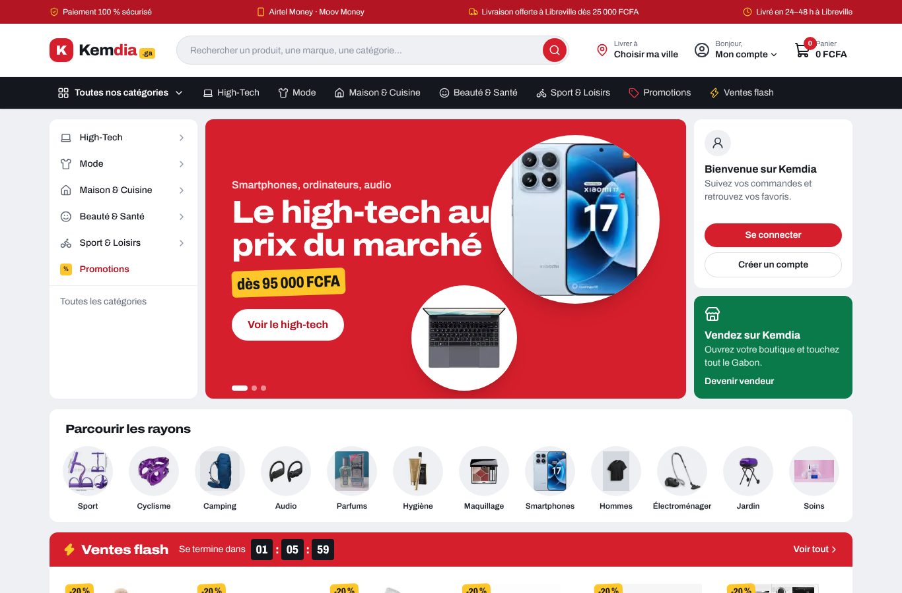
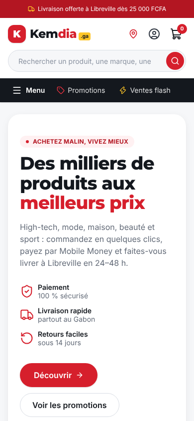
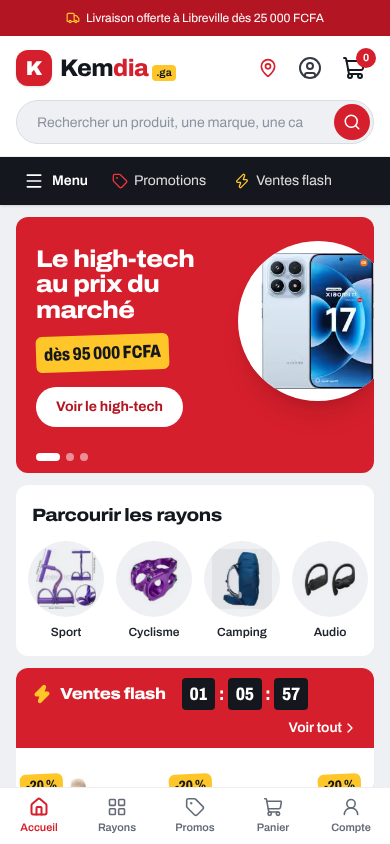
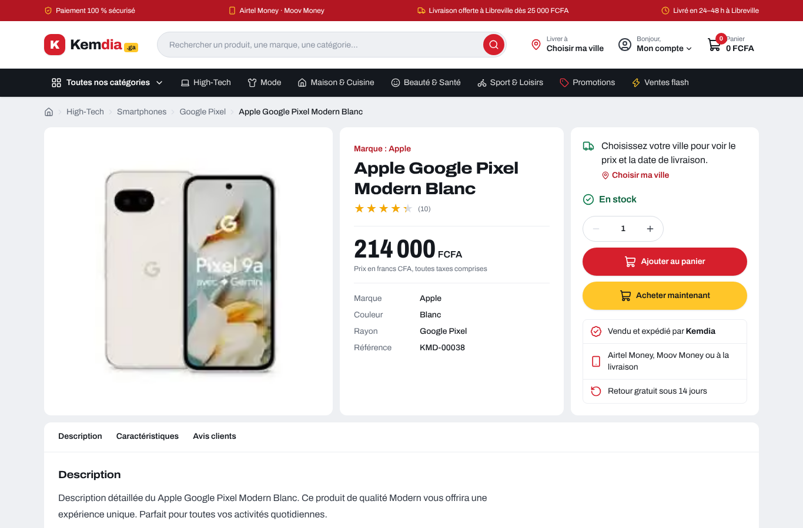
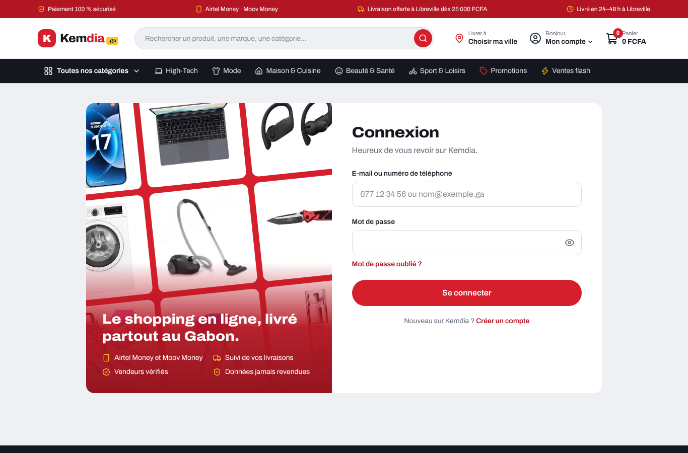

# Rapport — Refonte visuelle « place de marché »

|                                                 |                                        |
| ----------------------------------------------- | -------------------------------------- |
| **Date**                                        | 2026-10-05                             |
| **Sprint / tâches**                             | S2 — S2-T10                            |
| **Version**                                     | v0.2.0 (en cours)                      |
| **Sections du cahier d'architecture modifiées** | §5.1, §5.5, §5.6 (nouvelle), §9 (v0.6) |

## 1. Résumé

Retour de Levy : le site était propre mais **trop simple** à côté d'Amazon ou Jumia.
Le design a été repensé en **place de marché** : plus d'informations utiles par écran, des repères d'achat partout
(remise, stock restant, date de livraison) et une **identité propre à Kemdia**. On s'inspire de la façon dont ces sites
présentent les produits, mais on ne reprend ni leurs logos, ni leurs couleurs, ni leurs noms.

## 2. Avant / après

| Avant                                                     | Après                                                     |
| --------------------------------------------------------- | --------------------------------------------------------- |
|                |                |
|  |  |

| Fiche produit                                             | Connexion                                         |
| --------------------------------------------------------- | ------------------------------------------------- |
|  |  |

## 3. Ce qui a changé

| Zone              | Avant                                       | Après                                                                                                                                                                                |
| ----------------- | ------------------------------------------- | ------------------------------------------------------------------------------------------------------------------------------------------------------------------------------------ |
| Haut de l'accueil | Une bannière fixe avec un téléphone dessiné | **Catégories à gauche + carrousel de 3 bannières** (high-tech, paiement mobile, livraison) + raccourcis compte et « Vendez sur Kemdia »                                              |
| Rayons            | 5 ronds sur fond noir                       | **12 ronds de sous-rayons** illustrés par leur produit phare                                                                                                                         |
| Ventes flash      | Une tuile avec compte à rebours             | **Bandeau rouge + rangée d'offres** avec stock restant (« Plus que 7 en stock ») et barre de progression                                                                             |
| Univers           | —                                           | **Tuiles « un rayon, 4 produits »** : un aperçu de chaque univers                                                                                                                    |
| Carte produit     | Photo recadrée, ombre, majuscules           | Photo entière sur fond blanc, **prix en étiquette**, pastille de remise, ligne de livraison ou de stock                                                                              |
| Fiche produit     | 2 colonnes                                  | **3 colonnes** : galerie · infos et prix (« Vous économisez… ») · encadré d'achat avec **date de livraison** selon la ville, « Acheter maintenant », « Vendu et expédié par Kemdia » |
| Mobile            | —                                           | **Barre d'onglets en bas** (comme une appli) ; sur la fiche produit, **barre d'achat collée en bas**                                                                                 |
| Connexion         | Aplat rouge + liste                         | **Mur de produits** incliné + avantages                                                                                                                                              |

## 4. Choix de design

- **Signature Kemdia : l'étiquette de marché.** Les prix sont en chiffres **étroits et très gras**, avec « FCFA » en petit,
  et les remises sont des **pastilles jaunes légèrement inclinées**, comme un autocollant posé à la main. C'est le seul effet appuyé ; le reste reste sobre.
- **Une seule police : Archivo**, dont on fait varier la largeur : normale pour le texte, élargie pour les titres, condensée pour les prix.
  Elle remplace Inter + Montserrat ; elle est hébergée sur notre serveur (aucun service tiers, conforme à la CSP).
- **Fond gris « marché »** (`#eef0f3`) : les blocs blancs ressortent nettement, comme sur les grands sites.
- **Vert forêt** pour tout ce qui rassure : livraison, stock, devenir vendeur.
- Plus de mots mis en couleur dans les titres ni de libellés en majuscules : titres simples, en phrases.

## 5. Sécurité et qualité

- Aucune nouvelle dépendance hormis la police (`@fontsource-variable/archivo`) ; les polices Inter et Montserrat sont retirées.
- Le carrousel respecte l'accessibilité : pause au survol et au focus, pas de défilement automatique si « réduire les animations » est activé, bannières cachées inactives.
- **+6 tests** (88 → 94) : calcul de la date de livraison (le dimanche est sauté), carrousel, barre d'onglets.
- Lint, types, build : ✅. Pas de débordement horizontal en 390 px.
- Poids de la page d'accueil : **49 Ko compressés** (36 Ko avant) : plus de produits affichés, toujours léger pour la 3G.

## 6. Limites connues

- Les bannières sont écrites dans le code ; un module d'administration pour les gérer viendra avec le back-office.
- Le bloc « Avis clients » affiche la note moyenne ; les avis détaillés arriveront avec les comptes clients (S6, avis réservés aux acheteurs).
- « Devenir vendeur » mène pour l'instant à la page contact (page dédiée : S2-T06).

## 7. Prochaines étapes

S2-T02 : tunnel de commande en maquette, dans ce nouveau style.
