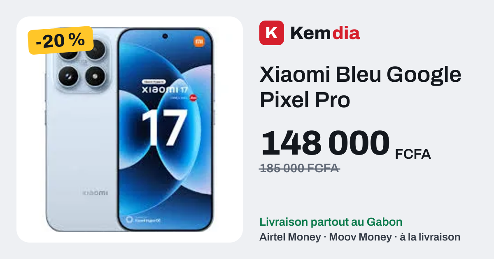
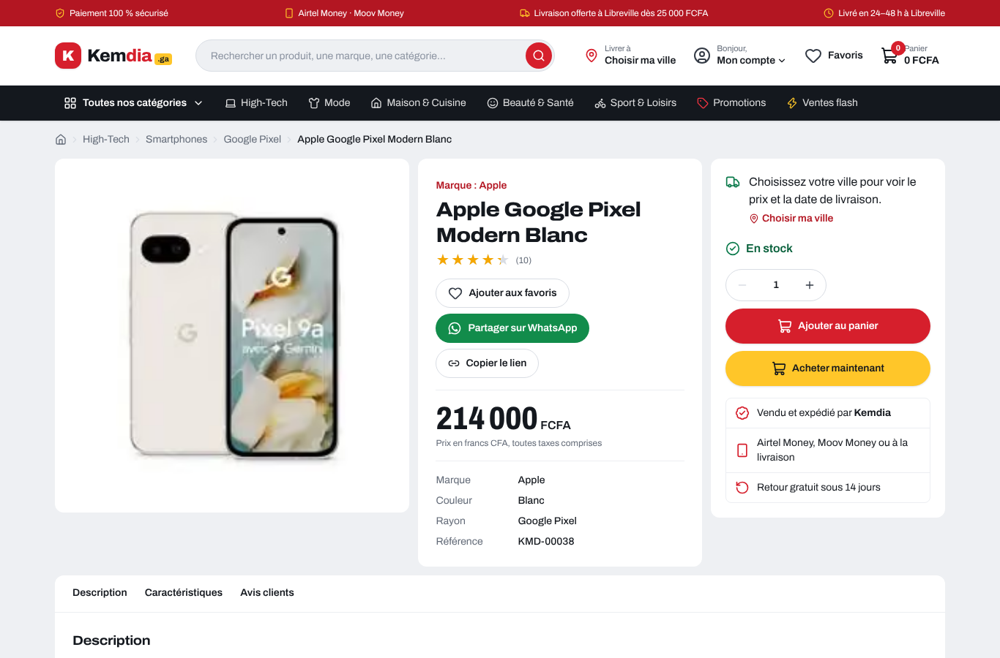
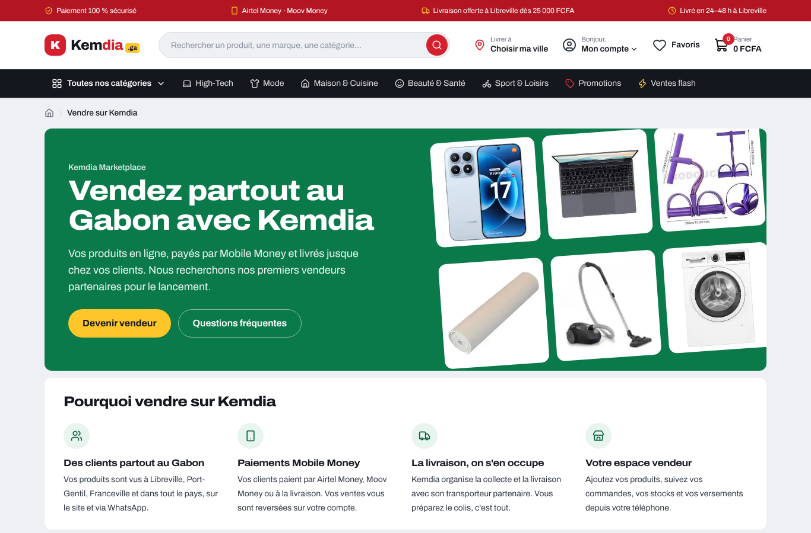
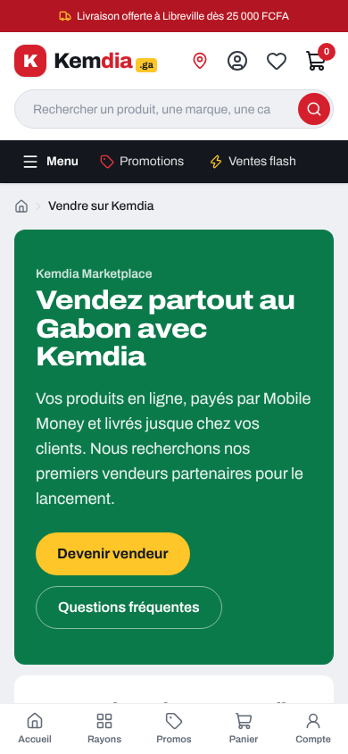

# Rapport — Favoris, partage WhatsApp, page vendeur et tests de bout en bout

|                                                 |                                            |
| ----------------------------------------------- | ------------------------------------------ |
| **Date**                                        | 2026-10-06                                 |
| **Sprint / tâches**                             | S2 — S2-T04, S2-T05, S2-T06, S2-T07        |
| **Version**                                     | v0.2.0 (en cours)                          |
| **Sections du cahier d'architecture modifiées** | §5.1, §5.2, §5.8 (nouvelle), §7, §9 (v0.9) |

## 1. Résumé

Quatre tâches du Sprint 2 livrées ensemble :

- **Favoris** : un cœur sur chaque produit, une page « Mes favoris », un compteur dans l'en-tête.
- **Partage WhatsApp** : un bouton sur chaque fiche produit et un **aperçu soigné** (photo, prix, remise) quand le lien est collé dans WhatsApp ou Facebook.
- **Page « Vendre sur Kemdia »** : l'offre marketplace expliquée aux futurs vendeurs, avec une demande d'ouverture de boutique (démo).
- **Tests de bout en bout** : un vrai navigateur parcourt le site à chaque PR, sur téléphone et sur ordinateur ; **aucune image n'est publiée si un parcours client est cassé**.

## 2. Captures

| Aperçu WhatsApp d'un produit                          | Aperçu du site                                  |
| ----------------------------------------------------- | ----------------------------------------------- |
|  |  |

| Fiche produit : favoris et partage          | Page vendeur                          | Page vendeur (mobile)                               |
| ------------------------------------------- | ------------------------------------- | --------------------------------------------------- |
|  |  |  |

## 3. Livré

### S2-T04 — Favoris (FR-014)

- Cœur sur chaque carte produit et bouton « Ajouter aux favoris » sur la fiche ; message « Ajouté à vos favoris ».
- Page `/favoris` : prix indicatif, remise, « Au panier », retrait ; page vide qui invite à découvrir les produits.
- Lien « Favoris » avec compteur dans l'en-tête ; « Mes favoris » dans l'espace client.
- Stockés **sur l'appareil** pour l'instant (comme le panier) ; synchronisés avec le compte au Sprint 4.

### S2-T05 — Partage WhatsApp et aperçus

- **« Partager sur WhatsApp »** : ouvre WhatsApp avec « _Produit_ à _prix_ sur Kemdia 👉 lien ». Le lien porte `utm_source=whatsapp` :
  au Sprint 8, on saura combien de ventes viennent de WhatsApp.
- **« Partager »** (partage natif du téléphone) ou **« Copier le lien »** sur ordinateur.
- **Aperçus 1200 × 630** générés pour chaque produit et pour le site, dans la police Kemdia.
- Titre de l'aperçu = produit + prix ; description = prix, livraison, Mobile Money.

### S2-T06 — Page « Vendre sur Kemdia » (`/vendre`)

- Pourquoi vendre : clients dans tout le Gabon, paiements Mobile Money, livraison organisée, espace vendeur.
- Comment ça marche, en 4 étapes : demande → vérification (KYC, BR-024) → produits relus par Kemdia (BR-003) → ventes et versements.
- Ce qu'il faut : pièce d'identité (RCCM pour une entreprise), compte de paiement, vrais produits et photos.
- Questions fréquentes : commission de 8 à 14 % (BR-020, barème définitif à l'ouverture), versements, produits autorisés.
- Formulaire de demande (démo, rien n'est envoyé) ; liens depuis l'accueil et le pied de page.

### S2-T07 — Tests de bout en bout (Playwright)

16 scénarios, chacun joué **sur un téléphone (Pixel 7) et sur un ordinateur**, soit 32 tests :

| Scénario                | Ce qui est vérifié                                                                                                  |
| ----------------------- | ------------------------------------------------------------------------------------------------------------------- |
| Achat complet           | Recherche → fiche → panier → commande (adresse, livraison, Airtel Money) → confirmation → panier vide               |
| Filtres                 | La liste se réduit, l'adresse contient `promo=1`, « Tout effacer » fonctionne                                       |
| Recherche sans résultat | Alternatives proposées                                                                                              |
| Favoris                 | Cœur → page Mes favoris → retrait                                                                                   |
| Partage                 | Balises d'aperçu avec l'adresse du serveur, image PNG servie, lien wa.me correct                                    |
| Page vendeur            | Formulaire complet → confirmation                                                                                   |
| Sécurité                | En-têtes (CSP, X-Frame-Options…) ; une recherche contenant du code n'est jamais exécutée ; filtres inventés ignorés |
| Accessibilité (7 pages) | Aucune erreur grave WCAG 2.1 AA (outil axe-core)                                                                    |

Dans la CI : nouveau job **« Tests de bout en bout »** entre la qualité et l'image Docker. En cas d'échec, le rapport
(captures d'écran, traces) est téléchargeable dans l'onglet Actions.

## 4. Décisions techniques

- **Adresse publique lue au démarrage (`SITE_URL`)** : WhatsApp exige des liens absolus, et la même image sert démo, staging et production.
  L'accueil et les fiches produit sont donc rendus à la demande (quelques millisecondes, le catalogue est en mémoire) ;
  les images d'aperçu, elles, sont calculées une seule fois à la construction.
- Aperçus : le générateur ne lit ni le WebP ni les polices WOFF2. Les photos sont converties avec `sharp`, et la police vient de `@fontsource/archivo` (fichiers WOFF).
- Bouton WhatsApp : pictogramme de bulle générique, pas le logo officiel de WhatsApp.

## 5. Sécurité et qualité

- Favoris : chaque entrée est revalidée au chargement (slug en liste blanche de caractères, image limitée à `/images/`, 100 au plus).
- Partage : texte encodé (un titre avec `&` ou `#` ne casse pas le lien), `rel="noopener noreferrer"`.
- `SITE_URL` invalide (ex. `javascript:`) → ignorée, repli sur l'adresse de construction.
- Demande vendeur : nom de boutique sans `<` `>`, catégorie en liste fermée, message limité à 500 caractères.
- **L'audit d'accessibilité a trouvé 5 vrais défauts de contraste**, corrigés : textes blancs semi-transparents sur rouge et sur vert, filtres grisés, bouton WhatsApp.
- **+11 tests unitaires et de composants** (109 → 120) et **32 tests de bout en bout**.
- `pnpm audit --prod` : 0 vulnérabilité. Une alerte existe sur un outil de développement (`braces`, via `eslint-config-next`), sans correctif publié et absente de l'image de production.

## 6. Action requise

Sur Render, ajouter la variable d'environnement **`SITE_URL`** = l'adresse de la démo (ex. `https://kemdia.onrender.com`),
sinon les aperçus WhatsApp pointeront vers `https://kemdia.ga`. Le guide [`demo-gratuite.md`](../guides/demo-gratuite.md) est à jour.

## 7. Limites connues

- Favoris et demandes vendeurs restent sur l'appareil / ne sont pas transmis (comptes : S4 ; module vendeurs : S6).
- WhatsApp met parfois en cache un ancien aperçu pendant quelques heures après un changement.

## 8. Prochaines étapes

Fin du Sprint 2 : S2-T08 (budget de performance Lighthouse) et S2-T09 (nettoyage Dependabot), puis la version **v0.2.0**.
