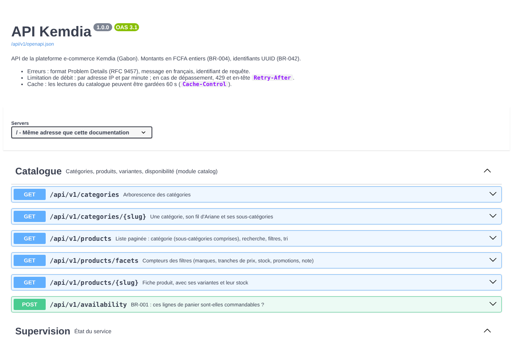

# Rapport — API REST du catalogue et documentation OpenAPI

|                                                 |                                                  |
| ----------------------------------------------- | ------------------------------------------------ |
| **Date**                                        | 2026-10-06                                       |
| **Sprint / tâches**                             | S3 — S3-T04                                      |
| **Version**                                     | v0.3.0 (en cours)                                |
| **Sections du cahier d'architecture modifiées** | §3.2, §3.4, §3.7 (nouvelle), §4, §6.3, §9 (v1.5) |

## 1. Résumé

Le catalogue est maintenant **accessible en HTTP** sous `/api/v1` : catégories, liste de produits (recherche, filtres, tri,
pagination), compteurs des filtres, fiche produit et vérification de disponibilité (BR-001).
L'API est **documentée en OpenAPI 3.1**, avec une page interactive, et **protégée par une limitation de débit**.

La documentation est **générée à partir des schémas Zod** qui valident les requêtes. Des tests vérifient que chaque réponse réelle
respecte ces schémas : la documentation dit exactement ce que fait l'API.



## 2. Fonctionnalités livrées

| Route                               | Ce qu'elle fait, en simple                                                                                     |
| ----------------------------------- | -------------------------------------------------------------------------------------------------------------- |
| `GET /api/v1/categories`            | Toute l'arborescence (112 catégories, 3 niveaux)                                                               |
| `GET /api/v1/categories/{slug}`     | Une catégorie, son fil d'Ariane et ses sous-catégories                                                         |
| `GET /api/v1/products`              | Une page de produits : catégorie (sous-catégories comprises), mots, prix, marques, stock, promotion, note, tri |
| `GET /api/v1/products/facets`       | Les compteurs à côté des filtres (« Beats (3) »)                                                               |
| `GET /api/v1/products/{slug}`       | La fiche produit avec ses variantes et leur stock                                                              |
| `POST /api/v1/availability`         | « Ces lignes de panier sont-elles commandables ? » (BR-001), ligne par ligne, sans rien modifier               |
| `/api/docs`, `/api/v1/openapi.json` | Documentation interactive et description OpenAPI (en développement ; désactivées par défaut en production)     |

**Exemple** — vérifier un panier :

```http
POST /api/v1/availability
{ "lines": [ { "variantId": "8c0f…", "quantity": 2 }, { "variantId": "1a7e…", "quantity": 1 } ] }

200 { "ok": false, "lines": [
  { "variantId": "8c0f…", "quantity": 2, "ok": true },
  { "variantId": "1a7e…", "quantity": 1, "ok": false, "reason": "PRODUIT_INDISPONIBLE" } ] }
```

La description complète est versionnée dans [`docs/api/openapi.json`](../api/openapi.json) : chaque changement de l'API apparaîtra dans le diff d'une PR.

## 3. Décisions techniques

[ADR-0010](../architecture/adr/0010-api-rest-openapi.md) — en résumé :

- **Une seule source pour le contrat** : les schémas Zod. Ils valident les corps de requête, produisent la documentation
  et vérifient les réponses dans les tests. Nous n'utilisons pas `@nestjs/swagger`, qui aurait imposé une deuxième description à tenir à jour.
- **Validation différente selon l'entrée** : un corps invalide reçoit une erreur 400 claire, en français.
  Un lien de recherche abîmé (`?page=-3&sort=n'importe quoi`) affiche quand même une liste : les valeurs farfelues sont ignorées.
- **Le site ne sera pas bloqué par la limite** : au S3-T05, le serveur du site appellera l'API pour tous les visiteurs,
  depuis une seule adresse. Il présentera une clé secrète (`API_INTERNAL_KEY`) qui l'exempte de la limite.

## 4. Sécurité

| Mesure                                                                                                               | Risque couvert                                      |
| -------------------------------------------------------------------------------------------------------------------- | --------------------------------------------------- |
| 120 requêtes/min par adresse IP ; 30/min pour la vérification de disponibilité ; 429 en français + `Retry-After`     | Saturation de la base, robots                       |
| Adresse du client lue seulement via un relais déclaré (`TRUST_PROXY`)                                                | Contourner la limite avec un faux `X-Forwarded-For` |
| Clé interne comparée en temps constant ; jamais dans Git (secret du serveur) ; une fausse clé ne sert à rien (testé) | Usurpation du site                                  |
| Corps validés par schéma ; **champs inconnus refusés** (ex. un `price` envoyé par le client)                         | Montants venant du navigateur (CRIT-01)             |
| Variantes désactivées et produits non publiés jamais renvoyés                                                        | Fuite de produits non validés                       |
| Page de documentation : 3 fichiers servis par l'API (liste fermée), CSP propre, aucun CDN ; désactivée en production | Script tiers, surface d'attaque                     |
| Télémétrie du paquet de documentation (`@scarf/scarf`) bloquée à l'installation                                      | Envoi de données à un tiers                         |

`pnpm audit --prod` : 0 vulnérabilité.

## 5. Qualité

- **123 tests unitaires** de l'API (+28), dont 16 tests HTTP des routes avec un catalogue en mémoire :
  formats, 404, corps invalides, limitation de débit, clé interne, cache, documentation activée ou non.
- **33 tests d'intégration** (+6) : l'API complète sur PostgreSQL avec le catalogue de démonstration.
  **Chaque catégorie (112), chaque fiche produit (50) et chaque page des 5 tris** sont validées par leur schéma.
- **Documentation** : un test vérifie que c'est un OpenAPI 3.1 valide, que chaque référence existe, et que `docs/api/openapi.json` est à jour.
- **Vérifié dans un vrai navigateur** (Chromium sans interface) : la page `/api/docs` s'affiche avec ses 7 routes,
  **sans aucune erreur ni violation de la CSP**, et « Try it out » sur une fiche produit renvoie 200.

## 6. Captures d'écran

Voir § 1 (`captures/S3-T04_documentation-api.png`).

## 7. Limites connues / dette technique

- La limite est gardée **en mémoire** : remise à zéro au redémarrage, non partagée entre plusieurs instances (Redis au S4).
- Après une modification des schémas Zod, régénérer la description : `pnpm --filter @kemdia/api openapi` (le test le rappelle).
- La page de documentation autorise les styles en ligne, exigés par Swagger UI. C'est limité à `/api/docs`, jamais sur les routes de l'API.

## 8. Prochaines étapes

**S3-T05** : le site lit l'API au lieu de son fichier de démonstration (`lib/catalog.ts`), avec la clé interne ;
suppression de la copie du fichier de démonstration côté site.

## Comment essayer

```bash
docker compose up -d db
pnpm --filter @kemdia/api db:deploy && pnpm --filter @kemdia/api db:seed
pnpm --filter @kemdia/api dev        # puis ouvrir http://localhost:4000/api/docs
```
