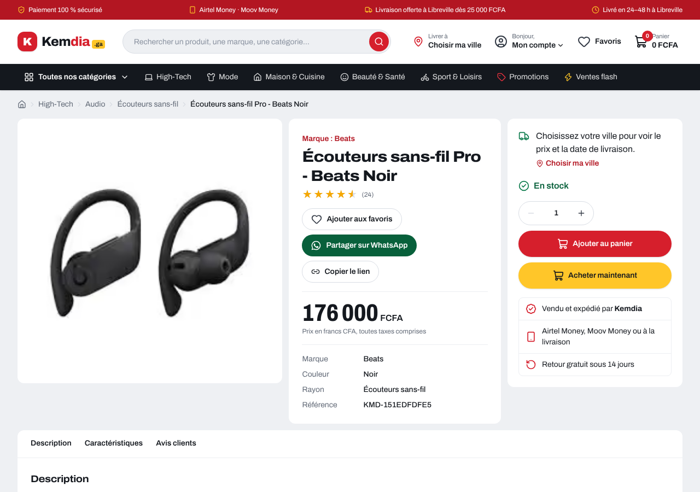
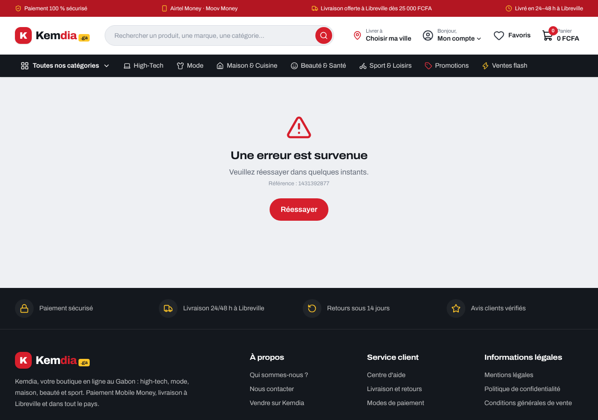

# Rapport — Le site lit l'API

|                                                 |                                                                                    |
| ----------------------------------------------- | ---------------------------------------------------------------------------------- |
| **Date**                                        | 2026-10-06                                                                         |
| **Sprint / tâches**                             | S3 — S3-T05                                                                        |
| **Version**                                     | v0.3.0 (en cours)                                                                  |
| **Sections du cahier d'architecture modifiées** | §3.2, §3.7, §4, §5.1, §5.2, §5.7, §5.8, §5.9 (nouvelle), §6.2, §6.3, §7, §9 (v1.6) |

## 1. Résumé

Le site **lit maintenant le catalogue dans l'API** (catégories, listes, recherche, filtres, fiches produit), avec la clé interne
qui l'exempte de la limitation de débit. Les **mêmes 32 parcours de bout en bout** passent, cette fois contre la vraie API et PostgreSQL.

Tes 4 décisions sont appliquées :

1. **Fichier de secours choisi au démarrage, jamais en repli** : `API_URL` définie → API seule (si elle tombe : page d'erreur) ;
   absente → fichier de démonstration ; `APP_ENV=production` sans `API_URL` → **le site refuse de démarrer**. Les 3 cas sont testés.
2. **Panier par variante** : une ligne = `variantId` (+ `productId` pour l'affichage), clé `kemdia.cart.v2`, la commande envoie `{ variantId, quantity }`.
   Les favoris restent par produit.
3. **Aucun appel à l'API pendant `next build`** : l'image se construit sans API joignable, et la CI le prouve.
4. **Contrat partagé** : nouveau petit paquet `packages/contracts`, seule source des schémas pour l'API et le site.



## 2. Fonctionnalités livrées

| Élément                    | Ce que ça fait, en simple                                                                                                                       | Fichiers principaux                                 |
| -------------------------- | ----------------------------------------------------------------------------------------------------------------------------------------------- | --------------------------------------------------- |
| Contrat partagé            | Les schémas Zod (forme exacte des réponses), les tris, badges, tranches de prix et limites sont écrits **une fois** et utilisés des deux côtés  | `packages/contracts/`                               |
| Port du catalogue          | Les pages demandent « la liste des produits » à `lib/catalog` ; derrière, un adaptateur **API** ou **fichier**                                  | `apps/web/src/lib/catalog/`                         |
| Configuration au démarrage | Le serveur vérifie `API_URL`, `API_INTERNAL_KEY`, `CATALOG_TIMEOUT_MS` et affiche la source choisie, ou s'arrête avec un message clair          | `lib/config/`, `instrumentation.ts`, `.env.example` |
| Lecture de l'API           | Clé interne, délai maximal (5 s), **chaque réponse vérifiée par le contrat**, cache de 60 s, requêtes identiques regroupées                     | `lib/catalog/api-catalog.ts`                        |
| Panne de l'API             | Page « Une erreur est survenue » (500), sans données ; l'en-tête affiche un menu vide plutôt que de casser toutes les pages                     | `global-error.tsx`, `Header.tsx`                    |
| Panier par variante        | `kemdia.cart.v2` ; les anciens paniers sont effacés au chargement ; une carte à plusieurs variantes affiche « dès … » et « Choisir une option » | `lib/cart.ts`, `CartProvider`, `ProductCard.tsx`    |
| Choix de la variante       | Sur la fiche, liens `?variante=<référence>` : prix, stock, caractéristiques et référence de la variante choisie (partageable sur WhatsApp)      | `lib/product-view.ts`, `VariantPicker.tsx`          |
| Accueil                    | Nouveau paramètre `badge` (sélection, nouveautés, meilleures ventes) et tri `ventes` dans l'API                                                 | `product-search.ts`, `prisma-product.repository.ts` |

**Exemple de démarrage** :

```
$ APP_ENV=production node server.js
Configuration du site invalide : le serveur ne peut pas démarrer.
  - API_URL : obligatoire en production (le fichier de démonstration y est interdit)
(code de sortie 1)

$ APP_ENV=demo node server.js
Kemdia — catalogue : fichier de démonstration (aucune API)

$ APP_ENV=staging API_URL=http://127.0.0.1:4000 API_INTERNAL_KEY=… node server.js
Kemdia — catalogue : API http://127.0.0.1:4000 (délai 5000 ms)
```

**Quand l'API est arrêtée** (page pas encore en cache) :



## 3. Décisions techniques

[ADR-0011](../architecture/adr/0011-site-branche-api.md) — en résumé :

- **Pas de bascule automatique** vers le fichier : un site qui affiche des prix faux pendant une panne est pire qu'une page d'erreur.
- **Pages rendues à la demande** (`connection()`), plus une **garde** : si une page essaie de lire le catalogue pendant `next build`,
  la construction échoue avec un message qui renvoie à l'ADR (vérifié en ajoutant volontairement une telle page).
- **`packages/contracts`** : compilé à l'installation (`pnpm install`) et par Turborepo avant les tests. Le sous-chemin
  `@kemdia/contracts/constants` ne contient pas Zod : la couche `application` de l'API peut l'importer, le test d'architecture interdit le reste.
- **Identifiants de démonstration identiques** en mode API et fichier (UUID v5) : un panier fait sur la démo restera valable quand elle passera sur l'API (S3-T07).
- `API_TIMEOUT_MS` a été nommée **`CATALOG_TIMEOUT_MS`** : le premier nom est déjà utilisé par certains outils et faussait la configuration.

## 4. Sécurité

| Mesure                                                                                                                     | Risque couvert                                      |
| -------------------------------------------------------------------------------------------------------------------------- | --------------------------------------------------- |
| Réponses de l'API validées par le contrat avant affichage ; en cas d'écart, seuls les **noms des champs** sont journalisés | Données altérées affichées, fuite dans les journaux |
| Adresse de l'API : `http(s)` uniquement, sans identifiants, sans paramètres ; slug vérifié avant de construire l'URL       | SSRF, injection de chemin                           |
| Clé interne obligatoire avec `API_URL` (32 à 128 caractères), jamais dans Git ; **clé éphémère** générée à chaque CI       | CRIT-02 (secrets), limite contournée                |
| Production sans API refusée au démarrage                                                                                   | Faux prix en production                             |
| Commande : `{ variantId, quantity }` seulement, aucun montant                                                              | CRIT-01                                             |
| Panier relu champ par champ (UUID, slug, quantité ≤ 99), doublons écartés                                                  | Altération du panier                                |
| Aucun appel à l'API depuis le navigateur                                                                                   | Exposition de la clé et de l'API                    |

`pnpm audit --prod` : 0 vulnérabilité.

## 5. Qualité

- **Site** : 147 tests (+27), dont 31 sur la lecture du catalogue : les 3 configurations, l'adaptateur HTTP (délai, 404, réponse hors contrat,
  cache, clé), l'adaptateur fichier (mêmes résultats que l'API) et la garde de construction.
- **API** : 127 tests unitaires (+4) et **35 tests d'intégration** (+2 : badges, tri `ventes`, variante par défaut d'une liste).
- **Contrat** : 8 tests (identifiants stables, OpenAPI). Description régénérée : contrat **1.1.0** (`badge`, `ventes`, `variantId`, `stock`, `variantCount`).
- **Bout en bout, en local contre la vraie API** : 32 parcours ✅, performance 5 pages ✅ ; l'API a reçu 188 requêtes, **0 refus (429)**, 0 erreur.
- **CI** (nouveau) :
  - le site est construit avec une API **injoignable** (`http://api-injoignable.invalid`) : preuve qu'aucune page ne l'appelle au build ;
  - les parcours tournent contre l'API et PostgreSQL ; le job échoue s'il voit un seul 429 ;
  - l'**image Docker** est démarrée dans les 3 configurations (refus, fichier, API muette → 500).
- Un test du tunnel de commande dépassait parfois 5 s quand tous les tests tournent en parallèle : délai porté à 15 s pour ce fichier.

### Corrections promises, livrées dans cette PR

| Problème vu sur ton poste                         | Correction                                                                                                                           |
| ------------------------------------------------- | ------------------------------------------------------------------------------------------------------------------------------------ |
| Avertissement `Image` « parent position »         | Le lien de l'image de la carte produit est positionné (`absolute inset-0`)                                                           |
| Avertissement `scroll-behavior`                   | `data-scroll-behavior="smooth"` sur `<html>`                                                                                         |
| L'API redémarrait sans arrêt en développement     | `node --watch-path=src` : seuls nos fichiers sont surveillés, plus `node_modules`                                                    |
| `Cannot find module '../generated/prisma/…'`      | Le client Prisma est généré à `pnpm install` (`postinstall`)                                                                         |
| `&&`, port 5432 réservé, `.env` illisibles, `nvm` | Guides mis à jour : [base-de-donnees.md](../guides/base-de-donnees.md), [installation-windows.md](../guides/installation-windows.md) |

**Avertissement LCP restant** (« image détectée comme LCP… ajoutez `loading=eager` ») : c'est une **fausse alerte** de Next.js.
L'image de la bannière est déjà chargée en priorité ; mais la même photo apparaît 5 fois plus bas (chargées plus tard), et Next.js
les confond car il les reconnaît par leur adresse. Aucune correction utile ; la mesure réelle (tableau de performance) est bonne.

## 6. Captures d'écran

Voir § 1 (`captures/S3-T05_fiche-produit-api.png`) et § 2 (`captures/S3-T05_api-indisponible.png`).

## 7. Limites connues / dette technique

- **Paniers et favoris existants vidés une fois** (identifiants numériques → UUID). Sans conséquence pour la démo, prévu depuis le S3-T03.
- **Vérification du panier par l'API** (`POST /availability`, BR-001) **reportée au S5** : depuis le serveur du site, elle demande une limite
  par visiteur (sinon un robot pourrait utiliser la clé du site). Aujourd'hui, le panier se fie au stock lu sur la fiche.
- **Démo Render inchangée** : `APP_ENV=demo` sans `API_URL` → fichier de démonstration, jusqu'au S3-T07.
- ⚠️ **Production** : le serveur n'a pas encore d'API. Une release (`v0.3.0`) déployée avant l'API **refuserait de démarrer**
  (puis retour arrière automatique). Ne pas publier de version avant que l'API soit en ligne ; il faudra alors ajouter `API_URL` et `API_INTERNAL_KEY`
  dans `deploy/app/compose.yml`. Le staging du serveur, lui, démarre en mode fichier.
- Toutes les pages du catalogue sont rendues à la demande : quelques millisecondes par page grâce au cache.
- Le mode fichier recopie la logique de recherche de l'API (testée pour donner les mêmes résultats) ; il disparaît au S3-T07.
- Les données de démonstration n'ont qu'une variante par produit : le sélecteur de variante est testé, mais invisible sur la démo.

## 8. Prochaines étapes

**S3-T06** : image Docker de l'API, migrations appliquées au déploiement.

## Comment essayer

Mode fichier (rien à régler) : `pnpm dev`. Avec l'API, commandes à taper **une par une** (PowerShell compris) :

```bash
docker compose up -d db
pnpm install
pnpm --filter @kemdia/api db:deploy
pnpm --filter @kemdia/api db:seed
```

Puis mettre la même clé dans `apps/api/.env` et `apps/web/.env.local` ([base-de-donnees.md §3](../guides/base-de-donnees.md#3-brancher-le-site-sur-lapi-s3-t05)) et lancer `pnpm dev`.
Le terminal affiche `Kemdia — catalogue : API http://localhost:4000`.
