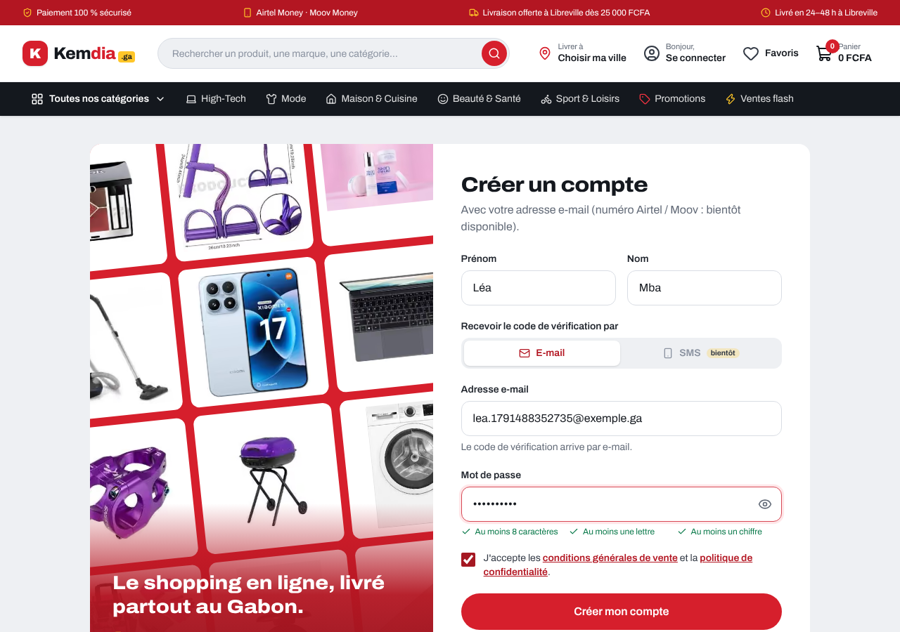
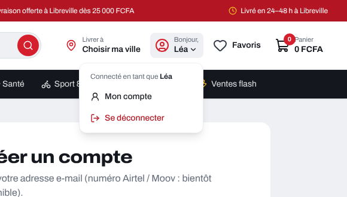
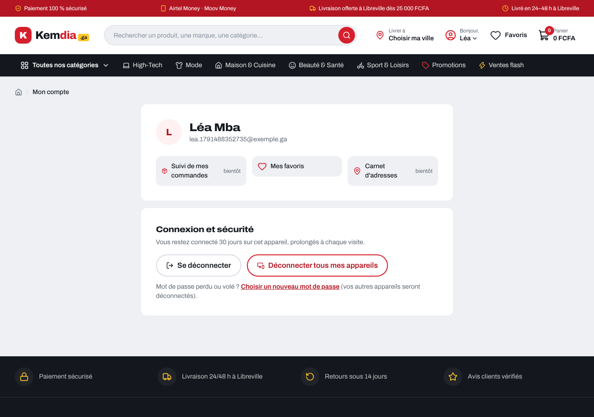
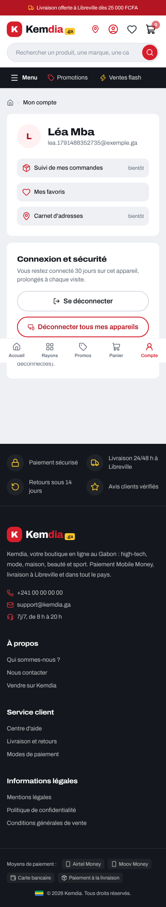
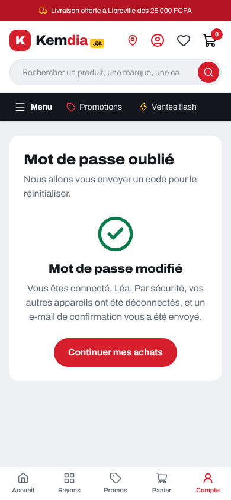

# Rapport — S4-T05 : le site branché sur les comptes

|                                                 |                   |
| ----------------------------------------------- | ----------------- |
| **Date**                                        | 2026-10-08        |
| **Sprint / tâches**                             | S4 — S4-T05       |
| **Version**                                     | v0.4.0 (en cours) |
| **Sections du cahier d'architecture modifiées** | §5.4, §6.2        |

## 1. Résumé

Le site parle maintenant **pour de vrai** à l'API : on peut **créer un compte** (code reçu par e-mail), **se connecter**,
**rester connecté 30 jours**, voir « **Bonjour, Awa** » dans l'en-tête, consulter « **Mon compte** », **se déconnecter**
(cet appareil ou tous) et **choisir un nouveau mot de passe**. Le mode démonstration (code 123456) a disparu.
L'option téléphone est affichée « bientôt disponible ».

## 2. Fonctionnalités livrées

| Élément                    | Ce que ça fait                                                                                                        | Fichiers principaux                               |
| -------------------------- | --------------------------------------------------------------------------------------------------------------------- | ------------------------------------------------- |
| Actions serveur            | Connexion, inscription, code, renvoi, mot de passe oublié, déconnexions                                               | `lib/auth/actions.ts`                             |
| Adaptateur API             | Appelle `/api/v1/auth/*` avec la clé interne ; réponses vérifiées par le contrat                                      | `lib/auth/api-identity.ts`                        |
| Cookies                    | Jeton de session et tickets dans des cookies `__Host-` `HttpOnly` `Secure` `SameSite=Lax`                             | `lib/auth/cookies.ts`                             |
| Cookie glissant            | Repart pour 30 jours à chaque page visitée (comme la session dans l'API)                                              | `src/proxy.ts`                                    |
| En-tête                    | « Bonjour, Awa » + menu (Mon compte, Se déconnecter) ; visiteur : « Se connecter » avec retour                        | `components/layout/AccountMenu.tsx`, `Header.tsx` |
| Mon compte                 | Identité, « Se déconnecter », « Déconnecter tous mes appareils », lien « nouveau mot de passe »                       | `app/compte/page.tsx`                             |
| Formulaires                | E-mail par défaut, SMS « bientôt » ; messages d'erreur de l'API en français, avec les délais                          | `components/auth/*`, `lib/auth/messages.ts`       |
| Retour après connexion     | Retour à la page d'avant (ex. le panier) ; sinon l'accueil                                                            | `lib/search-params.ts`, `app/connexion/page.tsx`  |
| Test de bout en bout en CI | Compte de test dans la base **éphémère** du job ; boîte de test **Mailpit** ajoutée au job (l'API y envoie ses codes) | `e2e/compte.spec.ts`, `.github/workflows/ci.yml`  |

## 3. Décisions techniques

[ADR-0019](../architecture/adr/0019-site-branche-identite.md), avec tes trois choix du 2026-10-08 : **« Bonjour, Awa » + menu**,
**retour à la page d'avant**, **Mon compte avec l'identité et les deux déconnexions**.

- Le navigateur ne parle jamais à l'API : le serveur du site s'en charge (actions serveur de Next.js).
- L'en-tête demande à l'API qui est connecté ; la réponse est gardée **10 secondes**, pour qu'une page et les liens
  qu'elle précharge ne fassent qu'un seul appel.
- **Aucun réglage `.env` ni Render à changer** : le site utilise déjà `API_URL` et `API_INTERNAL_KEY`.

## 4. Sécurité

- Le jeton de session n'est **jamais lisible par JavaScript** (vérifié dans un vrai navigateur : `document.cookie` ne le voit pas).
- Préfixe `__Host-` : cookie envoyé seulement en HTTPS, jamais à un sous-domaine (protège de la « fixation de session »).
- Messages neutres conservés : la connexion, l'inscription et le mot de passe oublié répondent pareil qu'une adresse ait un compte ou non.
- **Problème trouvé pendant l'essai réel** et corrigé : les liens préchargés par Next.js remettaient le cookie qu'on venait
  d'effacer. Le cookie n'est plus prolongé que sur une vraie page (`Sec-Fetch-Dest: document`).
- **Relecture indépendante** (second agent) : aucun défaut critique ni grave ; corrigé avant la PR :
  1. un lien piégé `/connexion?deconnecte=toString` faisait planter la page → seule la valeur `tous` est reconnue ;
  2. une adresse de retour comme `/..//site` est maintenant résolue comme le ferait le navigateur ;
  3. une page lue pendant une déconnexion pouvait garder « connecté » 10 s → mémoire vidée après l'appel à l'API ;
  4. un cookie mal formé n'est plus envoyé à l'API ;
  5. filtre du `proxy` plus précis ;
  6. le menu se ferme quand le focus clavier en sort ;
  7. tests ajoutés pour chacun de ces points.

## 5. Qualité

| Vérification                                      | Résultat                                                                                                                                                                                                                                                                                                                                                 |
| ------------------------------------------------- | -------------------------------------------------------------------------------------------------------------------------------------------------------------------------------------------------------------------------------------------------------------------------------------------------------------------------------------------------------- |
| Tests du site                                     | 189 : adaptateur API, actions (cookies), mémoire de session, `proxy`, messages, menu, formulaires (faux client), page de connexion                                                                                                                                                                                                                       |
| Bout en bout (Playwright, téléphone + ordinateur) | 12 nouveaux : parcours complets avec le **vrai code lu dans la boîte de test Mailpit** (inscription → connecté ; mot de passe oublié depuis un 2ᵉ appareil → le 1ᵉʳ est déconnecté), connexion depuis le panier, cookie protégé, Mon compte (accessibilité), déconnexion, inscription jusqu'au code, mot de passe oublié sans compte ; suite complète OK |
| Essai réel (site compilé + API + PostgreSQL)      | Inscription → code → connecté ; menu ; déconnexion ; connexion depuis le panier ; 2ᵉ appareil ; mot de passe oublié → 2ᵉ appareil déconnecté et son cookie effacé ; « tous mes appareils »                                                                                                                                                               |
| `typecheck`, `lint`, `build`                      | OK                                                                                                                                                                                                                                                                                                                                                       |

## 6. Captures d'écran

| Inscription (ordinateur)                                | Menu du compte                                                    |
| ------------------------------------------------------- | ----------------------------------------------------------------- |
|  |  |

| Mon compte (ordinateur)                               | Mon compte (téléphone)                                      | Mot de passe modifié (téléphone)                                |
| ----------------------------------------------------- | ----------------------------------------------------------- | --------------------------------------------------------------- |
|  |  |  |

## 7. Limites connues / dette technique

- Une session fermée depuis un autre appareil peut encore s'afficher « connectée » dans l'en-tête pendant 10 s au plus.
- Le site appelle l'API avec sa clé interne : les limites par adresse IP ne voient pas encore le visiteur (S4-T07).
- Démo : au réveil de Render, la première connexion peut prendre jusqu'à ~1 minute (S4-T08, page « la boutique se réveille »).
- Brevo gratuit : 300 e-mails par jour sur la démo.

## 8. Prochaines étapes

- **Après la fusion** : essayer sur la démo (inscription avec ta vraie adresse, connexion, Mon compte).
- **S4-T06** : rôles (client, vendeur, administrateur) et journal d'audit.
- **S4-T07** : protection CSRF renforcée, CSP à _nonce_, limites par visiteur.
