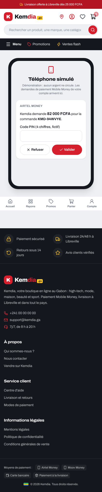
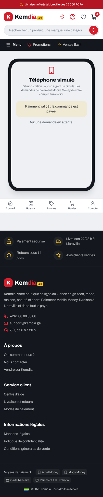

# Rapport — S5-T05 : Mobile Money en bac à sable (notifications signées, téléphone simulé)

|                                                 |                                                   |
| ----------------------------------------------- | ------------------------------------------------- |
| **Date**                                        | 2026-10-11                                        |
| **Sprint / tâches**                             | S5 — S5-T05                                       |
| **Version**                                     | v0.5.0 (en cours) — contrat de l'API **1.11.0**   |
| **Sections du cahier d'architecture modifiées** | §3.7, §3.14, §5.11 (nouvelle), §6.4 — version 3.3 |

## 1. Résumé

Le paiement Mobile Money fonctionne maintenant **de bout en bout en démonstration**. Quand le client demande à payer, la demande
arrive sur un **téléphone simulé** (page `/demo/telephone` du site). Il saisit un code PIN fictif et valide, ou il refuse.
L'**opérateur simulé** prévient alors Kemdia par une **notification signée**, exactement comme le ferait Airtel, Moov ou un
agrégateur : la commande passe « payée ». Aucun argent ne circule, et rien de tout cela n'existe en production.

C'est aussi la fin de la faille **CRIT-01** de l'ancien site : une commande ne passe « payée » que sur une notification signée,
vérifiée par le serveur, et comptée une seule fois.

```
Téléphone simulé ──Valider (PIN)──► Opérateur simulé ──HTTP + signature HMAC──► POST /webhooks/mobile-money
                                                        signature + 5 min ✔ → notification inscrite (une fois) → commande payée
```

## 2. Fonctionnalités livrées

| Élément                     | Ce que ça fait                                                                                                         | Fichiers principaux                                                       |
| --------------------------- | ---------------------------------------------------------------------------------------------------------------------- | ------------------------------------------------------------------------- |
| Notification de l'opérateur | `POST /api/v1/webhooks/mobile-money` : signature HMAC-SHA256 sur le corps brut, fenêtre de 5 min, contenu vérifié      | `payments/interface/webhook.controller.ts`, `domain/webhook-signature.ts` |
| Rejeu refusé                | Chaque notification inscrite une seule fois, dans la même transaction que le paiement ; déjà reçue → ignorée           | `application/notification.service.ts`, table `provider_events`            |
| Opérateur simulé            | Reçoit les demandes, envoie la notification signée **par HTTP** à l'API (3 envois au plus) ; solde fictif 500 000 FCFA | `infrastructure/sandbox-operator.ts`                                      |
| Téléphone simulé (API)      | `GET/POST /api/v1/sandbox/mobile-money/requests` : demandes du compte connecté, valider (PIN fictif) ou refuser        | `interface/sandbox.controller.ts`                                         |
| Téléphone simulé (site)     | Page `/demo/telephone` : cartes des demandes, code PIN, message du résultat, liste relue toutes les 5 s                | `app/demo/telephone/page.tsx`, `components/payments/*`, `lib/payments/*`  |
| Corps brut                  | Gardé pour les seules adresses `/api/v1/webhooks/*` (la signature porte sur les octets reçus)                          | `src/http/configure-app.ts`                                               |
| Base de données             | Table `payments.provider_events` en ajout seul                                                                         | `migrations/20261011120000_notifications_operateur`                       |

## 3. Décisions techniques

[ADR-0027](../architecture/adr/0027-notifications-signees-bac-a-sable.md), avec tes choix du 2026-10-11 :

| Question                        | Ton choix                                                 |
| ------------------------------- | --------------------------------------------------------- |
| Validation dans le simulateur   | **Téléphone simulé** (code PIN fictif, Valider / Refuser) |
| Où tourne le simulateur         | **Dans l'API, coupé en production**                       |
| Clé secrète en démo et en local | **Tirée au hasard au démarrage**                          |
| Rejeu                           | **Refusé, 5 minutes de tolérance**                        |

- L'opérateur simulé passe par le **même chemin** que le vrai (HTTP, signature, rejeu) : la démo prouve la vraie chaîne.
- Brancher plus tard le vrai fournisseur (question ouverte n° 7) = un adaptateur et sa clé secrète. **Cette clé sera une variable d'environnement : je te demanderai ton accord avant de toucher à tes `.env` ou à Render.**

## 4. Sécurité

- **Signature** : format strict, clé de 32 octets, comparaison en temps constant, date signée avec le corps, vérifiée **avant** de lire le contenu.
- **Rejeu** : une notification déjà reçue ne change rien ; un refus n'inscrit rien (l'opérateur peut la renvoyer).
- **Jamais en production** : le simulateur ne s'active qu'avec `APP_ENV=demo` ou `local` (hors `NODE_ENV=production`) ; ailleurs, le webhook répond 503 et le téléphone simulé 404.
- **Chacun son téléphone** : un compte ne voit et ne valide que ses propres demandes.

**Relecture de sécurité indépendante** (agent séparé, avant la PR) : aucun problème critique ni élevé. Corrigé :

| Gravité | Trouvé                                                                                                       | Correction                                                                                    |
| ------- | ------------------------------------------------------------------------------------------------------------ | --------------------------------------------------------------------------------------------- |
| Faible  | Un visiteur de la démo pouvait **saturer le simulateur** pour tout le monde (1 000 demandes, gardées 10 min) | **10 demandes par compte** ; demande oubliée dès la réponse ; gardée 3 min (durée d'un essai) |
| Faible  | Notification refusée par l'API → erreur 500 au lieu de `PAIEMENT_INDISPONIBLE` (503)                         | Erreur convertie, message clair                                                               |
| Faible  | Pas de renvoi sur « commande occupée » (409) ou « trop de notifications » (429)                              | Renvoyée ; limite du webhook portée à 600 par minute (rafales d'un opérateur)                 |
| Faible  | Un essai expiré restait affichable et validable 10 min (remboursements « à faire » fictifs sur la démo)      | Le téléphone ne montre et n'accepte une demande que pendant les 3 min de l'essai              |
| Info    | Page du site active si `APP_ENV` manque ; attente de 10 s par envoi ; horloge de signature                   | Page fermée si `APP_ENV` manque ; 3 s par envoi ; même horloge partout                        |

Gardé et noté (ADR-0027) : demandes du simulateur en mémoire (perdues au redémarrage, l'essai expire alors) ; sur la démo, un visiteur
connecté peut « payer » ses propres commandes sans argent (c'est le but) ; table `provider_events` sans purge (S7).

Aucun secret dans Git ; **aucun `.env` ni réglage Render modifié** (la clé de la démo est tirée au démarrage).

## 5. Qualité

| Vérification                     | Résultat                                                                                                                                                                                     |
| -------------------------------- | -------------------------------------------------------------------------------------------------------------------------------------------------------------------------------------------- |
| Tests unitaires de l'API         | **417** réussis (403) : signature (corps modifié, autre clé, date déplacée, 5 min), opérateur simulé (PIN, solde, renvois, 10 par compte, 3 min), activation par environnement               |
| Tests d'intégration (vraie base) | **132** réussis (127) : 5 bac à sable par **vrai HTTP** — téléphone simulé et paiement, refus, signature exigée, rejeu ignoré, contenu faux, essai inconnu (rien gardé), table en ajout seul |
| Contrat                          | 25 réussis                                                                                                                                                                                   |
| Tests du site                    | **251** réussis (245) : adaptateur du téléphone simulé, page fermée hors local / tests / démo                                                                                                |
| Lint, types, format, builds      | ✅                                                                                                                                                                                           |
| Essai manuel                     | API + site démarrés en local : commande, demande de paiement, PIN « 1234 » sur le téléphone simulé → commande « confirmée » et payée                                                         |

## 6. Captures d'écran

| Demande reçue                                                                        | Paiement validé                                                     |
| ------------------------------------------------------------------------------------ | ------------------------------------------------------------------- |
|  |  |

## 7. Limites connues / dette technique

- Le tunnel de commande du site n'est pas encore branché : la demande de paiement se lance par l'API (S5-T07 : vrai tunnel et attente de validation).
- Vrai fournisseur Mobile Money : question ouverte n° 7 (adaptateur + clé, avec ton accord pour la variable d'environnement).
- Demandes du simulateur en mémoire (une seule instance de l'API au MVP).

## 8. Prochaines étapes

- Fusion de la PR (c'est toi qui fusionnes).
- **S5-T06** : factures (FR-015) — numérotation continue, PDF, envoi par e-mail. Questions de choix d'abord.
