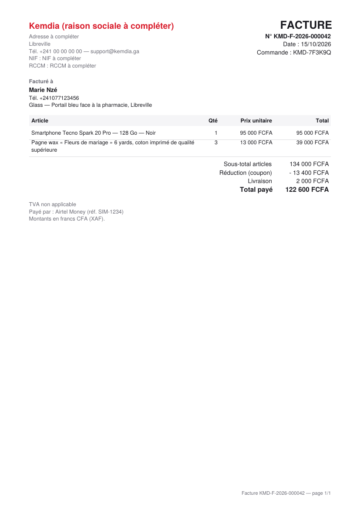
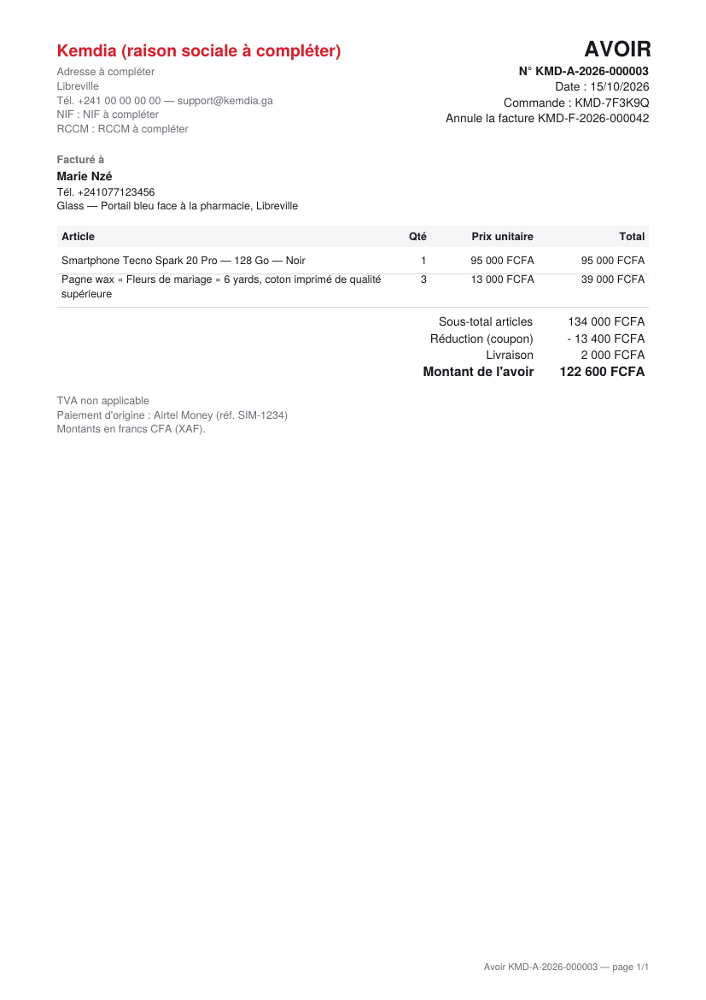

# Rapport — S5-T06 : factures et avoirs

|                                                 |                                                   |
| ----------------------------------------------- | ------------------------------------------------- |
| **Date**                                        | 2026-10-15                                        |
| **Sprint / tâches**                             | S5 — S5-T06                                       |
| **Version**                                     | v0.5.0 (en cours) — contrat de l'API **1.12.0**   |
| **Sections du cahier d'architecture modifiées** | §3.7, §3.10, §3.15 (nouvelle), §6.4 — version 3.4 |

## 1. Résumé

Kemdia établit maintenant une **facture** dès que l'argent est reçu (Mobile Money confirmé, ou espèces encaissées), dans la même
opération que le paiement (FR-015). Les numéros se suivent **par année, sans trou** (`KMD-F-2026-000001`). Si une commande facturée
est annulée, un **avoir** du même montant est établi (`KMD-A-2026-000001`). La facture ne change plus jamais.

Le client la reçoit **par e-mail** (PDF joint) et peut la **télécharger** depuis sa commande. Les informations de l'entreprise
(raison sociale, adresse, NIF, RCCM, mention de TVA) se règlent par un administrateur. Pour l'instant, elles valent « à compléter »,
et la mention est « TVA non applicable ».

```
Paiement reçu ──même transaction──► Facture KMD-F-2026-000042 (copie figée) ──chaque minute──► e-mail + PDF joint
Annulation (admin) ──même transaction──► Avoir KMD-A-2026-000003            Client ──► GET …/invoices/{numéro} → PDF
```

## 2. Fonctionnalités livrées

| Élément             | Ce que ça fait                                                                                                                | Fichiers principaux                                               |
| ------------------- | ----------------------------------------------------------------------------------------------------------------------------- | ----------------------------------------------------------------- |
| Facture au paiement | Établie dans la transaction qui confirme le paiement (Mobile Money) ou note l'encaissement (espèces) ; une seule par commande | `payments/application/invoice.service.ts`                         |
| Avoir               | Établi quand l'administrateur annule une commande facturée                                                                    | `invoice.service.ts`, `payment-admin.service.ts`                  |
| Numéros sans trou   | Compteur par type et par année, verrouillé dans la transaction ; année à l'heure du Gabon                                     | `domain/invoice.ts`, `prisma-invoice.repository.ts`               |
| PDF                 | Refait à l'identique depuis la copie figée (pdf-lib) ; plusieurs pages si besoin ; aucun texte ne le fait échouer             | `infrastructure/invoice-pdf.ts`                                   |
| Téléchargement      | `GET /api/v1/orders/{ref}/invoices` et `…/invoices/{numéro}` : le client de la commande seulement                             | `interface/invoice.controller.ts`                                 |
| E-mail              | Chaque minute, PDF joint, à l'adresse **vérifiée** du compte ; 5 essais espacés (1 min → 6 h), jamais deux fois               | `invoice-mailer.ts`, `invoice-emails.ts`                          |
| Entreprise          | `GET/PUT /api/v1/admin/settings/billing` (journal d'audit) ; copiée dans chaque nouvelle facture                              | `billing-settings.service.ts`, `billing-settings.controller.ts`   |
| Rattrapage          | Les commandes payées restées sans facture en reçoivent une                                                                    | `invoice.service.ts` (`issueMissingInvoices`)                     |
| E-mails partagés    | Transports (Mailpit, Brevo, console) déplacés vers `src/mail/`, pièces jointes ; contact du client via `AccountDirectory`     | `src/mail/*`, `identity/application/account-directory.service.ts` |
| Base de données     | Tables `invoices`, `invoice_counters`, `billing_settings` ; contraintes et déclencheurs (§4)                                  | `migrations/20261015120000_factures`                              |

Nouvelle dépendance : **pdf-lib 1.17.1** (version figée, sans dépendance native).

## 3. Décisions techniques

[ADR-0028](../architecture/adr/0028-factures.md), avec tes choix du 2026-10-11 :

| Question                       | Ton choix                                      |
| ------------------------------ | ---------------------------------------------- |
| Quand établir la facture       | **Au paiement reçu**                           |
| Numérotation                   | **Par année, sans trou**                       |
| TVA                            | **Sans TVA pour l'instant** (mention réglable) |
| Informations de l'entreprise   | **Réglage administrateur, provisoire**         |
| Commande facturée puis annulée | **Avoir automatique**                          |
| Remise au client               | **E-mail + téléchargement**                    |

- **Aucune nouvelle variable d'environnement** : les e-mails de factures utilisent le même réglage que les codes (`EMAIL_TRANSPORT`). Je n'ai touché ni aux `.env` ni à Render.
- **À faire avant la production** : renseigner la vraie raison sociale, l'adresse, le NIF et le RCCM dans `/api/v1/admin/settings/billing`. En production, aucune facture n'est émise avant (voir §4).

## 4. Sécurité

- **Chacun ses factures** : la liste et le PDF passent par la commande du compte connecté ; sinon 404.
- **Factures figées par la base** : rien ne change après émission, sauf le suivi de l'e-mail. Le compteur n'avance que d'un. Rien ne s'efface. Un avoir doit correspondre à une facture de la même commande, du même montant.
- **Le paiement ne dépend pas du PDF** : le PDF n'est jamais fabriqué pendant le paiement. L'e-mail part après.
- **E-mail** : seulement à une adresse vérifiée ; HTML échappé ; ni destinataire ni contenu dans les journaux.

**Relecture de sécurité indépendante** (agent séparé, avant la PR) : aucun problème critique ni élevé. Corrigé :

| Gravité | Trouvé                                                                                                | Correction                                                                                                                  |
| ------- | ----------------------------------------------------------------------------------------------------- | --------------------------------------------------------------------------------------------------------------------------- |
| Moyen   | En production, des factures légales auraient pu partir avec « NIF à compléter », figées pour toujours | En **préproduction et production**, pas de facture tant qu'un admin n'a pas renseigné l'entreprise ; **rattrapage** ensuite |
| Faible  | Un même e-mail pouvait partir deux fois (deux instances, ou erreur juste après l'envoi)               | Envoi **réservé** avant (essai compté en une mise à jour conditionnelle) ; « envoyé » noté hors de la gestion des erreurs   |
| Faible  | Une panne de Brevo de 5 minutes épuisait les 5 essais                                                 | Essais espacés : 1 min, 10 min, 1 h, 6 h ; abandon journalisé                                                               |
| Faible  | Le compteur des avoirs restait verrouillé pendant toute l'annulation                                  | Avoir établi en dernier, juste avant le journal d'audit                                                                     |
| Faible  | Un texte sans espace (repère, titre) pouvait sortir de la page                                        | Mots trop longs coupés ; 4 lignes au plus par article                                                                       |
| Info    | Un avoir affichait « Total remboursé » alors que le remboursement peut être encore « à faire »        | « Montant de l'avoir »                                                                                                      |

Gardé et noté (ADR-0028) : les confirmations de paiement passent une à une sur la ligne du compteur de l'année ; un compte sans e-mail
vérifié n'a pas d'e-mail (téléchargement seulement) ; pas encore d'écran admin pour voir ou renvoyer une facture (S6) ; pdf-lib ne
reçoit plus de mises à jour (aucune faille connue, isolé derrière le port `InvoiceRenderer`).

Aucun secret dans Git ; **aucun `.env` ni réglage Render modifié**.

## 5. Qualité

| Vérification                     | Résultat                                                                                                                                                                                                                                                 |
| -------------------------------- | -------------------------------------------------------------------------------------------------------------------------------------------------------------------------------------------------------------------------------------------------------- |
| Tests unitaires de l'API         | **429** réussis (417) : numéros, année du Gabon, montants, PDF (refait à l'identique, caractères inconnus, mot de 600 lettres, 50 articles sur plusieurs pages), e-mail (pièce jointe, échappement), transport, alignement contrat = domaine = base      |
| Tests d'intégration (vraie base) | **140** réussis (132) : 8 factures par HTTP — facture et PDF (client seulement), une seule facture, numéros sans trou en parallèle, espèces, avoir, e-mail (panne, nouvel essai, une fois), entreprise figée, attente puis rattrapage, règles de la base |
| Contrat                          | 25 réussis                                                                                                                                                                                                                                               |
| Tests du site                    | 251 réussis (aucun changement visible)                                                                                                                                                                                                                   |
| Lint, types, format, builds      | ✅                                                                                                                                                                                                                                                       |

## 6. Captures d'écran

| Facture                                                   | Avoir                                                 |
| --------------------------------------------------------- | ----------------------------------------------------- |
|  |  |

## 7. Limites connues / dette technique

- Le site ne montre pas encore les factures : bouton « Télécharger la facture » dans « Mes commandes » au S5-T07.
- Informations légales et TVA : décision du client et de l'expert-comptable attendues (question ouverte n° 6).
- Pas d'écran d'administration des factures (voir, renvoyer) avant le S6.

## 8. Prochaines étapes

- Fusion de la PR (c'est toi qui fusionnes).
- **S5-T07** : site branché sur le vrai tunnel de commande (compte obligatoire), attente de validation sur le téléphone, « Mes commandes » avec les factures. Questions de choix d'abord.
