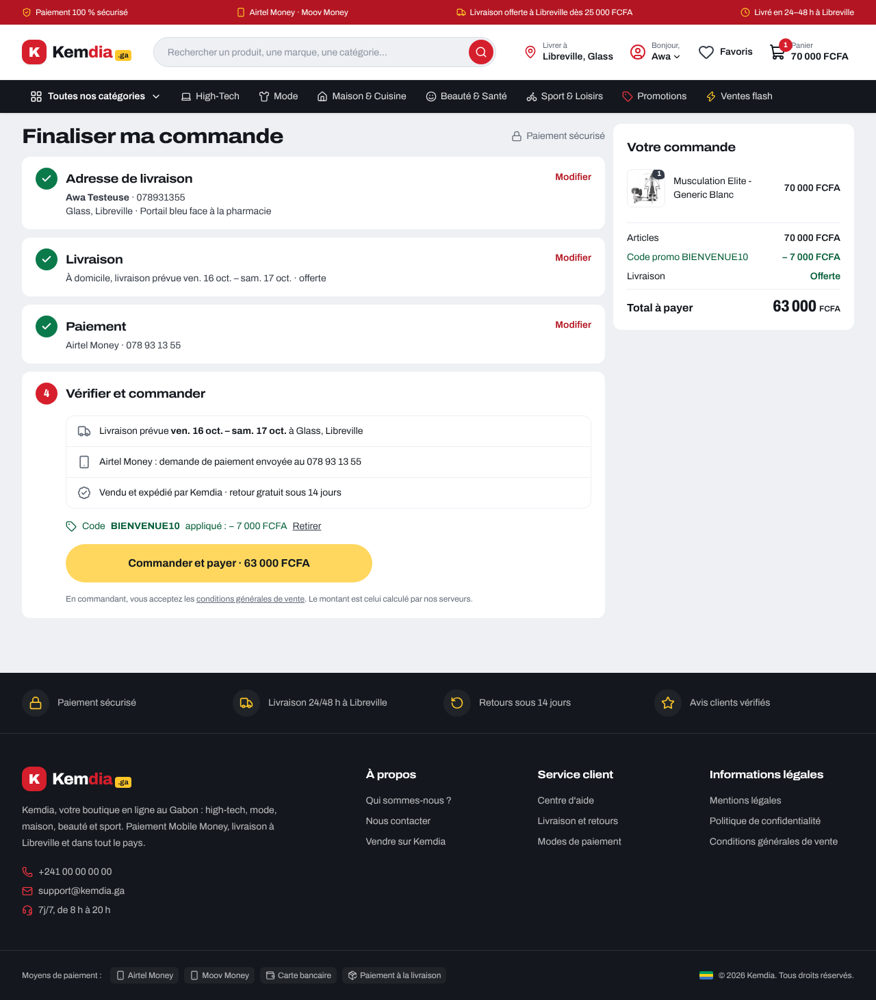
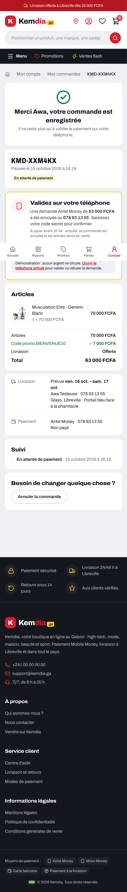
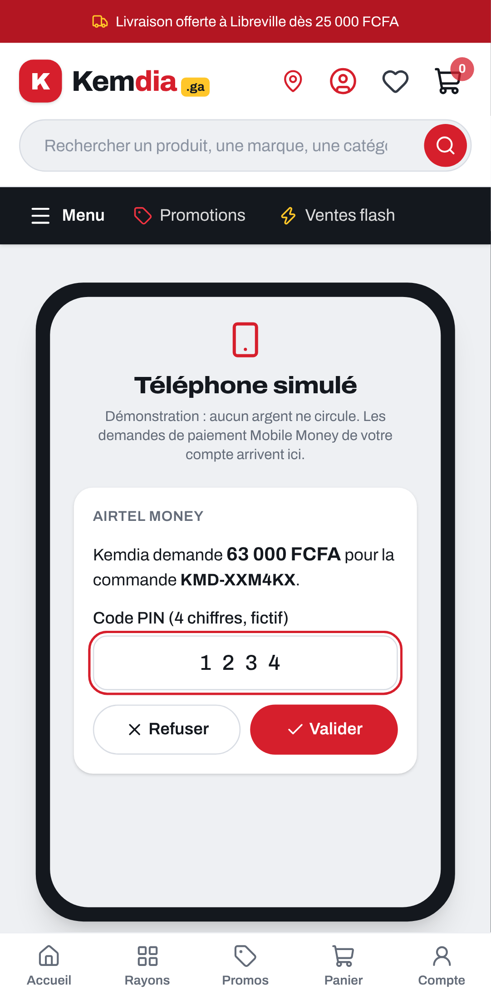
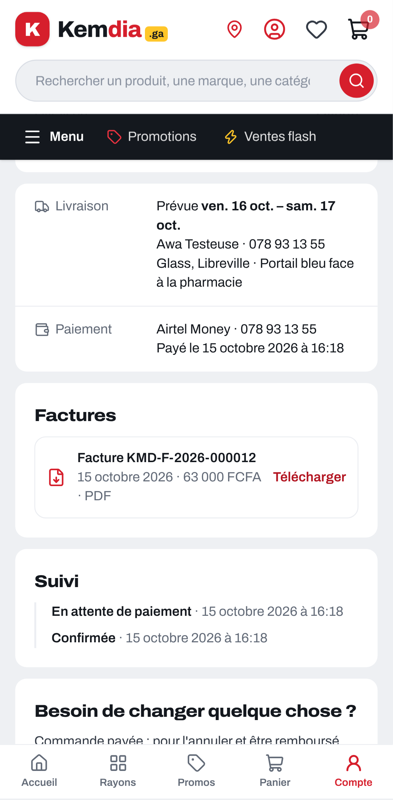

# Rapport — S5-T07 : site branché sur les commandes, attente du paiement, « Mes commandes »

|                                                 |                                                                    |
| ----------------------------------------------- | ------------------------------------------------------------------ |
| **Date**                                        | 2026-10-15                                                         |
| **Sprint / tâches**                             | S5 — S5-T07                                                        |
| **Version**                                     | v0.5.0 (en cours) — contrat de l'API **1.13.0**                    |
| **Sections du cahier d'architecture modifiées** | §3.7, §3.12, §3.14, §5.7, §5.12 (nouvelle), §6.4, §7 — version 3.5 |

## 1. Résumé

Le site passe maintenant de **vraies commandes**. Le tunnel `/commande` demande un compte, affiche les montants calculés par
le serveur (frais, code promo, total) et crée la commande dans l'API. Avec Mobile Money, la demande part aussitôt sur le
téléphone. Le client attend la validation sur la **page de sa commande**, qui se met à jour toute seule. « Mes commandes »
liste ses commandes, permet d'annuler avant l'expédition et de **télécharger les factures**. L'adaptateur de démonstration du S2
(`KMD-DEMO-…`) est supprimé.

```
/panier ─► /commande ──(pas connecté)──► /connexion?retour=/commande
              │ devis du serveur · code promo · « Commander et payer · 63 000 FCFA »
              ▼
/compte/commandes/KMD-XXM4KX ── « Validez sur votre téléphone » (relue toutes les 5 s) ── /demo/telephone (démo)
              │ payée
              ▼
Confirmée · Facture KMD-F-2026-000012 (PDF) · /compte/commandes
```

## 2. Fonctionnalités livrées

| Élément                        | Ce que ça fait                                                                                                                                            | Fichiers principaux                                                                   |
| ------------------------------ | --------------------------------------------------------------------------------------------------------------------------------------------------------- | ------------------------------------------------------------------------------------- |
| Compte obligatoire             | Visiteur sur `/commande` → connexion, puis retour au tunnel ; nom et téléphone du compte pré-remplis                                                      | `app/commande/page.tsx`, `lib/orders/orders.ts` (`requireAccount`)                    |
| Devis du serveur               | Frais, remise, total, paiement à la livraison et Mobile Money possibles : tout vient de `POST /orders/quote`                                              | `components/checkout/CheckoutFlow.tsx`, `lib/orders/order-actions.ts`                 |
| Code promo                     | Champ au récapitulatif (étape 4) : refus expliqué sous le champ (expiré, épuisé…), remise visible dans le récapitulatif                                   | `CheckoutFlow.tsx`, `OrderSummary.tsx`                                                |
| Commande                       | Envoi de l'adresse, du paiement, du total affiché et d'une clé d'idempotence ; **aucun article ni prix** ; total changé → nouveau total à confirmer       | `lib/checkout.ts`, `order-actions.ts`                                                 |
| Mobile Money                   | Demande envoyée dès la commande ; si elle ne part pas, la commande existe quand même et la page propose de l'envoyer                                      | `order-actions.ts` (`placeOrder`)                                                     |
| Attente du paiement            | Page de la commande relue toutes les 5 s (onglet visible) ; « Réessayer » avec les essais restants ; heure limite ; lien vers le téléphone simulé en démo | `app/compte/commandes/[reference]/page.tsx`, `components/orders/PaymentPanel.tsx`     |
| « Mes commandes »              | Liste (10 par page), détail : articles, totaux, livraison, paiement, suivi                                                                                | `app/compte/commandes/page.tsx`, `[reference]/page.tsx`                               |
| Annulation                     | En deux temps, avant l'expédition ; une commande payée renvoie au service client                                                                          | `components/orders/CancelOrderForm.tsx`                                               |
| Factures                       | Facture et avoir téléchargeables en PDF, relayés par le serveur du site                                                                                   | `app/compte/commandes/[reference]/factures/[numero]/route.ts`                         |
| Panier après commande          | Relu depuis le compte (l'API a retiré les articles commandés)                                                                                             | `components/providers/CartProvider.tsx` (`reload`)                                    |
| API : Mobile Money disponible  | Le devis dit si Mobile Money est possible ; sans fournisseur, une commande Mobile Money est refusée (`MOBILE_MONEY_INDISPONIBLE`)                         | `apps/api/src/config/mobile-money.ts`, `orders/application/order.service.ts`          |
| API : annulation par le client | Les demandes de paiement en attente sont expirées dans la même transaction et retirées du téléphone simulé                                                | `orders/application/order-cancel-hooks.ts`, `payments/application/payment.service.ts` |

## 3. Décisions techniques

[ADR-0029](../architecture/adr/0029-site-tunnel-commande-mes-commandes.md), avec tes choix du 2026-10-15 :

| Question                               | Ton choix                                      |
| -------------------------------------- | ---------------------------------------------- |
| Visiteur non connecté sur `/commande`  | **Redirection vers la connexion**              |
| Où attendre la validation Mobile Money | **Page de la commande** (relue toutes les 5 s) |
| « Mes commandes »                      | **Liste + détail + annulation**, factures      |
| Code promo                             | **Au récapitulatif**                           |

Points ajoutés (prévus par l'ADR-0026, sans nouveau choix métier) :

- **Mobile Money seulement s'il existe un fournisseur.** En préproduction et en production, tant que la question n° 7 n'est pas
  tranchée, le site grise Mobile Money et propose la livraison ; l'API refuse aussi. Une seule règle pour les deux modules
  (`config/mobile-money.ts`). Contrat **1.13.0**.
- **CI** : l'API du job de bout en bout tourne en `APP_ENV=demo` (opérateur simulé, factures), comme la démo publique.
- **Aucune migration** de base de données dans cette tâche. **Aucun `.env` ni réglage Render modifié.**

Questions métier toujours ouvertes (valeurs provisoires gardées, rien d'inventé) : n° 1 paiement à la livraison (Grand Libreville,
100 000 FCFA), n° 2 coupons non cumulables, n° 6 TVA et informations légales, n° 7 fournisseur Mobile Money, limite de
3 commandes ouvertes par compte.

## 4. Sécurité

- **Le navigateur ne décide d'aucun montant** : ni article ni prix envoyés ; total du devis renvoyé tel quel (`expectedTotal`),
  refusé par l'API s'il a changé (BR-004).
- **Jeton jamais exposé** : appels à l'API depuis le serveur du site uniquement (`server-only`), jeton lu dans le cookie `HttpOnly`.
- **Actions serveur revérifiées** : forme et longueur de chaque argument (UUID, numéro `KMD-…`, code promo, téléphone), objet strict.
- **Factures** : numéros revérifiés avant l'appel, session obligatoire, pièce jointe, `nosniff`, `private, no-store`, contenu
  vérifié (`%PDF-`). L'API ne rend que les factures du compte (sinon 404).
- **Journaux** sans jeton, sans numéro de commande ni de facture, sans adresse.

**Relecture de sécurité indépendante** (agent séparé, avant la PR) : aucun problème critique ni élevé. Corrigé :

| Gravité | Trouvé                                                                                                                                               | Correction                                                                                                                                                   |
| ------- | ---------------------------------------------------------------------------------------------------------------------------------------------------- | ------------------------------------------------------------------------------------------------------------------------------------------------------------ |
| Moyen   | Après une réponse perdue puis une modification, `CLE_DEJA_UTILISEE` faisait tirer une nouvelle clé en silence : risque de deuxième commande          | Message clair « une commande a peut-être déjà été enregistrée », panier relu, lien vers « Mes commandes »                                                    |
| Faible  | Annulation par le client : la demande restait sur le téléphone ; le client pouvait valider une commande annulée (débit puis remboursement à la main) | Demandes en attente **expirées dans la transaction de l'annulation** (registre `OrderCancelHooks`) et retirées du téléphone simulé ; avertissement à l'écran |
| Faible  | PDF lu en entier avant le contrôle de taille quand la taille n'est pas annoncée                                                                      | Lecture par morceaux, arrêtée dès 2 Mo                                                                                                                       |
| Info    | Refus `MOBILE_MONEY_INDISPONIBLE` vérifié avant la clé d'idempotence (un renvoi d'une commande déjà créée aurait pu être refusé)                     | Contrôle déplacé après la clé : une commande déjà créée est toujours rendue                                                                                  |

Gardé et noté (ADR-0029) : l'objet `MOBILE_MONEY` reste modifiable (sert au test) ; les liens `?nouvelle=1` / `?paiement=` ne montrent
que des textes fixes ; l'annulation chez le **vrai** opérateur sera à brancher avec le fournisseur ; le parcours « préproduction »
n'est couvert que par les tests d'intégration de l'API.

## 5. Qualité

**La CI GitHub Actions est toujours bloquée (facturation)** : tout a été lancé ici, en local.

| Vérification                                      | Résultat                                                                                                                                                                                                                                                                                                     |
| ------------------------------------------------- | ------------------------------------------------------------------------------------------------------------------------------------------------------------------------------------------------------------------------------------------------------------------------------------------------------------ |
| Format, lint, types, construction (tout)          | ✅ (site construit avec une API **injoignable**, comme en CI)                                                                                                                                                                                                                                                |
| Tests unitaires de l'API                          | **429** réussis                                                                                                                                                                                                                                                                                              |
| Tests d'intégration (vraie base `kemdia_test`)    | **142** réussis (140) : devis et refus Mobile Money sans fournisseur, renvoi d'une commande déjà créée ; annulation par le client → demande expirée et retirée du téléphone simulé                                                                                                                           |
| Contrat                                           | 25 réussis                                                                                                                                                                                                                                                                                                   |
| Tests du site                                     | **279** réussis (251) : adaptateur (contrat, journaux, PDF), actions serveur (arguments refusés, Mobile Money, `PAIEMENT_EN_COURS`), tunnel (devis, code promo, total changé, clé déjà utilisée, Mobile Money indisponible), panneau de paiement, annulation, route PDF                                      |
| Bout en bout (Playwright, téléphone + ordinateur) | **58** réussis contre l'API construite (`APP_ENV=demo`) + Mailpit : visiteur renvoyé à la connexion ; **premier achat Airtel Money validé sur le téléphone simulé → confirmée, facture PDF téléchargée, panier vide** ; paiement à la livraison puis annulation ; parcours d'achat répétés 3 fois sans échec |
| Gitleaks 8.30.1                                   | ✅ aucune fuite dans les commits de la branche                                                                                                                                                                                                                                                               |

Notes sur le poste de travail : le téléchargement des moteurs Prisma est bloqué par le réseau ; la génération du client a été faite
sans eux, et les migrations appliquées avec `psql` dans l'ordre (ce que fait `prisma migrate deploy`). **`db:check` n'a pas pu tourner
ici** — mais cette tâche ne touche pas la base.

## 6. Captures d'écran

| Tunnel (code promo, total du serveur)                        | Attente du paiement                                                     |
| ------------------------------------------------------------ | ----------------------------------------------------------------------- |
|  |  |

| Téléphone simulé                                                     | Commande payée, facture                                          | « Mes commandes »                                              |
| -------------------------------------------------------------------- | ---------------------------------------------------------------- | -------------------------------------------------------------- |
|  |  |  |

## 7. Limites connues / dette technique

- Mobile Money réel : fournisseur à choisir (question n° 7) ; l'annulation d'une demande chez lui sera à brancher (`PaymentProvider.cancel`).
- Pas de carnet d'adresses : l'adresse est ressaisie à chaque commande (« bientôt » dans « Mon compte »).
- Un seul numéro Mobile Money par essai depuis le site (l'API accepte un autre numéro du même opérateur : pas encore proposé à l'écran).
- Avertissement sans conséquence dans les journaux du site quand un onglet se ferme pendant une relecture automatique (« destination stream closed early »).

## 8. Prochaines étapes

- Relire et fusionner la PR (c'est toi qui fusionnes). Pas de migration : `db:check` n'est pas nécessaire pour cette PR.
- **Démo Render** : elle ne se met plus à jour toute seule (CI bloquée). Pour montrer le premier achat, il faudra redéployer le site
  et l'API à la main après la fusion.
- **Alléger la CI** pour quand elle reviendra : par exemple ne lancer le job « bout en bout » que sur les PR qui touchent `apps/` ou
  `packages/` (filtre `paths`), et le budget de performance seulement sur `main` — dis-moi si tu veux une PR pour ça.
- **S5-T08** : démo, parcours complet du premier achat, versions 0.5.0, clôture du sprint.
