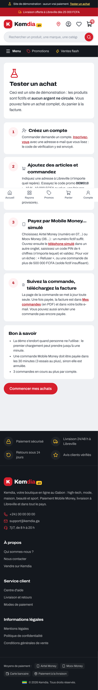

# Rapport — S5-T08 : démo du premier achat, CI allégée, versions 0.5.0

|                                                 |                                                 |
| ----------------------------------------------- | ----------------------------------------------- |
| **Date**                                        | 2026-10-15                                      |
| **Sprint / tâches**                             | S5 — S5-T08                                     |
| **Version**                                     | **v0.5.0** — contrat de l'API 1.13.0 (inchangé) |
| **Sections du cahier d'architecture modifiées** | §3.13, §5.13 (nouvelle), §7 — version 3.6       |

## 1. Résumé

Un testeur peut maintenant faire seul un **achat complet sur la démo**. Un bandeau dit que rien n'est réel et mène à la page
**`/demo`**, qui explique le parcours en 4 étapes. Le code promo de démonstration **`DEMO10`** est créé automatiquement au démarrage
de la démo. Une PR qui ne change que la documentation ne lance plus les jobs lourds de la CI. L'API, le contrat et le site passent en
**0.5.0**. Le Sprint 5 est clos ([rapport de clôture](2026-10-15_S5_cloture.md)).

## 2. Fonctionnalités livrées

| Élément          | Ce que ça fait                                                                                                                  | Fichiers principaux                                               |
| ---------------- | ------------------------------------------------------------------------------------------------------------------------------- | ----------------------------------------------------------------- |
| Bandeau « Démo » | « Site de démonstration : aucun vrai paiement. Tester un achat », au-dessus de l'en-tête                                        | `components/layout/DemoBanner.tsx`, `app/layout.tsx`              |
| Page `/demo`     | Parcours en 4 étapes (compte, achat et `DEMO10`, téléphone simulé, facture) et « Bon à savoir » ; chiffres lus dans le contrat  | `app/demo/page.tsx`                                               |
| Où               | Bandeau et page seulement en `local`, `e2e`, `demo` ; ailleurs ni bandeau ni page (404)                                         | `lib/payments/sandbox.ts` (`sandboxPageEnabled`, inchangé)        |
| `DEMO10`         | 10 %, 10 000 FCFA au plus, une fois par compte ; créé par l'import de démonstration, jamais modifié s'il existe                 | `orders/infrastructure/demo-coupon.ts`, `database/demo-import.ts` |
| CI allégée       | Job « Ce qui a changé » : PR de documentation seulement → base de données, bout en bout et images sautés ; `main` : tout tourne | `.github/workflows/ci.yml`                                        |
| Versions         | API, contrat et site en 0.5.0                                                                                                   | `apps/*/package.json`, `packages/contracts/package.json`          |
| Guide de la démo | Étape 10 « Tester le premier achat »                                                                                            | `docs/guides/demo-gratuite.md`                                    |

## 3. Décisions techniques

[ADR-0030](../architecture/adr/0030-demo-premier-achat-ci-allegee.md), avec tes choix du 2026-10-15 :

| Question                    | Ton choix                         |
| --------------------------- | --------------------------------- |
| Guider le testeur           | **Page `/demo` + bandeau**        |
| Code promo de démonstration | **Oui, démo seulement**           |
| Versions                    | **API, contrat et site en 0.5.0** |
| Alléger la CI               | **Oui, sans rien perdre**         |

- Aucune migration de base de données. **Aucun `.env` ni réglage Render modifié.**
- Questions métier toujours ouvertes (valeurs provisoires) : n° 1, 2, 6, 7 et la limite de 3 commandes ouvertes.

## 4. Sécurité

- `DEMO10` ne naît **jamais** en préproduction ni en production : démo Render (`APP_ENV=demo`), ou poste de développement avec une
  base locale. Les images Docker fixent `APP_ENV=production` et ne contiennent pas `db:seed`.
- Page et bandeau : liste autorisée d'environnements ; absent ou `production` → rien.

**Relecture de sécurité indépendante** (agent séparé, avant la PR) : aucun problème critique ni élevé. Corrigé :

| Gravité | Trouvé                                                                                                          | Correction                                                                                                         |
| ------- | --------------------------------------------------------------------------------------------------------------- | ------------------------------------------------------------------------------------------------------------------ |
| Moyen   | `APP_ENV` absent vaut `local` : un `db:seed` lancé contre une vraie base distante aurait créé un `DEMO10` actif | `DEMO10` seulement sur la démo, ou sur une base **locale** hors `NODE_ENV=production` (`demoCouponAllowed`, testé) |
| Faible  | Un fichier de code renommé vers `docs/` passait pour de la documentation                                        | Les anciens noms comptent aussi                                                                                    |
| Faible  | Un nom de fichier avec un retour à la ligne pouvait tromper le filtre                                           | Nom avec un caractère de contrôle → tout tourne                                                                    |
| Faible  | Panne de l'API GitHub : job en échec au lieu de tout lancer                                                     | Panne → tout tourne                                                                                                |
| Faible  | Liste de l'API limitée à 3000 fichiers                                                                          | Liste incomplète ou trop longue → tout tourne                                                                      |

Gardé et noté (ADR-0030) : `DEMO10` n'est pas au journal d'audit (créé par l'import) ; l'allègement de la CI économise du temps mais
n'est pas une barrière (pas de protection de branche).

## 5. Qualité

**CI GitHub Actions toujours bloquée** : tout a été lancé en local.

| Vérification                                     | Résultat                                                                                                                                                      |
| ------------------------------------------------ | ------------------------------------------------------------------------------------------------------------------------------------------------------------- |
| Format, lint, types, construction                | ✅ (site construit avec une API injoignable)                                                                                                                  |
| Tests unitaires API / site / contrat             | **432** / **280** / 25 ✅ (`demoCouponAllowed` : démo, base locale, base distante, préproduction, production ; bandeau)                                       |
| Tests d'intégration (base `kemdia_test`)         | **143** ✅ : `DEMO10` créé une fois, jamais réactivé par un nouvel import, 10 % plafonnés à 10 000 FCFA                                                       |
| Bout en bout (Playwright, API en `APP_ENV=demo`) | **65** ✅, budget de performance compris : bandeau et `/demo`, achat Mobile Money complet, `DEMO10` dans le paiement à la livraison (63 000 FCFA), annulation |
| Import relancé                                   | « code promo de démonstration créé », puis « déjà présent » (aucun doublon)                                                                                   |
| Script de la CI                                  | Rejoué avec un faux `gh` : documentation seule → sauté ; code, renommage, nom avec retour à la ligne, panne, liste tronquée → tout tourne                     |
| Gitleaks 8.30.1                                  | ✅ aucune fuite                                                                                                                                               |

## 6. Captures d'écran

| Page `/demo` et bandeau (téléphone)                                |
| ------------------------------------------------------------------ |
|  |

## 7. Limites connues / dette technique

- Le texte de `/demo` parle de la démo Render (« la démo s'endort ») aussi sur le poste de développement.
- `DEMO10` supprimé par un administrateur de la démo revient au redémarrage suivant.
- La démo Render ne reçoit le S5-T07 et le S5-T08 qu'après un passage de la CI sur `main`.

## 8. Prochaines étapes

- Relire et fusionner la PR. Pas de migration : `db:check` n'est pas nécessaire.
- **Démo Render** : après la remise en route de GitHub Actions (dépôt public ou facturation réglée), lancer **Actions → CI/CD → Run
  workflow** sur `main`, puis tester le parcours de `/demo`.
- Étiqueter **v0.5.0** une fois la CI passée sur `main` (voir le [rapport de clôture](2026-10-15_S5_cloture.md) §8).
- **Sprint 6** : module `vendors` et back-office.
