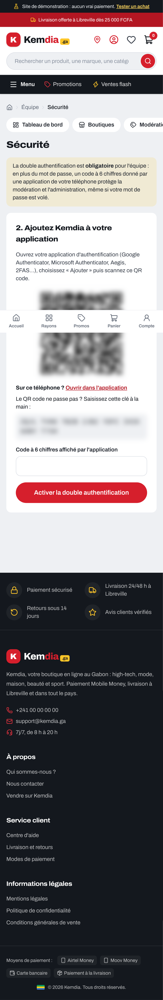
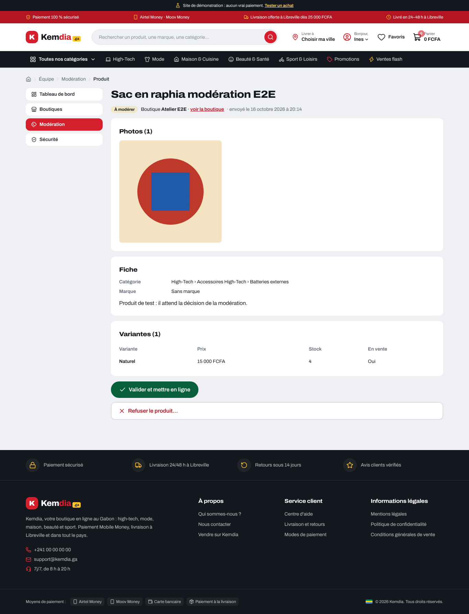
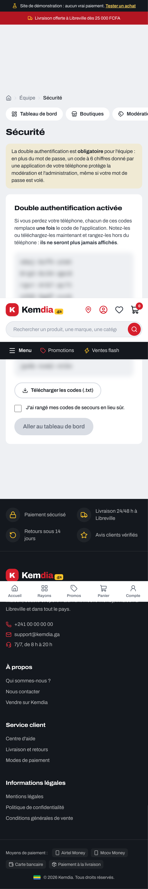
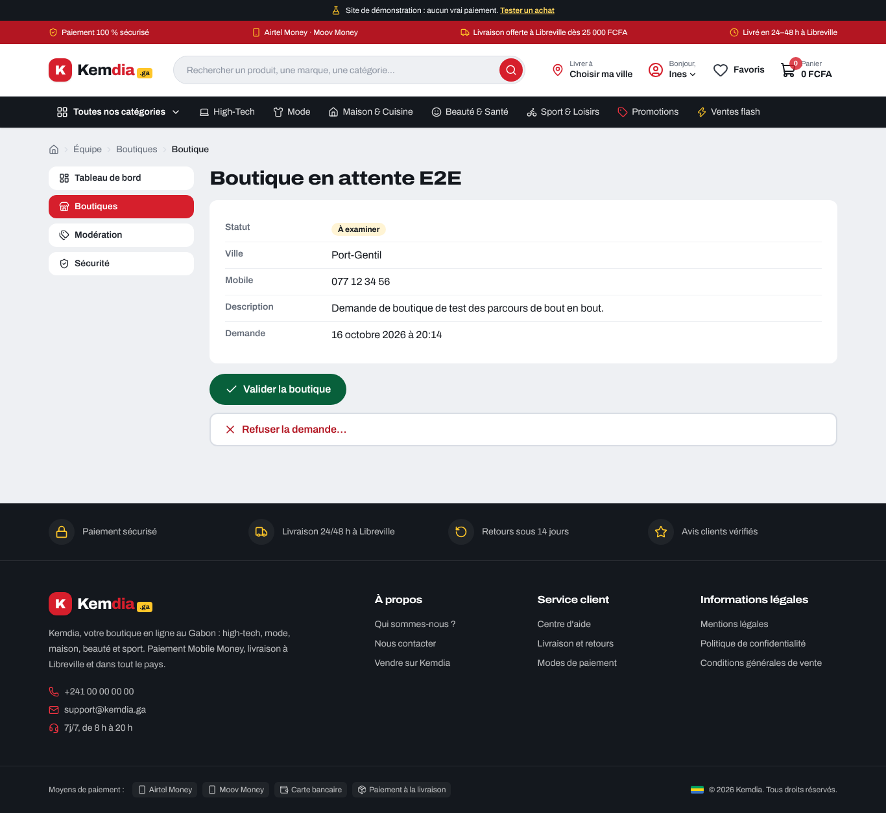
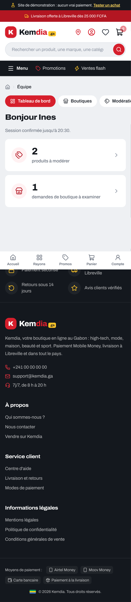
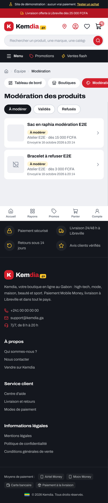
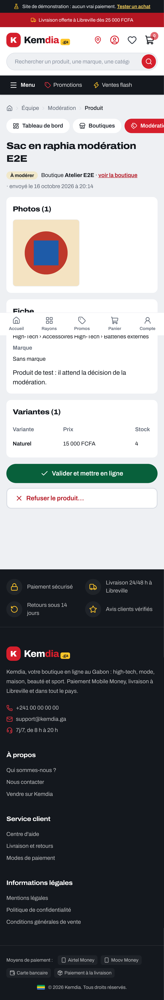

# Rapport — S6-T05 : écrans de l'équipe sur le site

|                                                 |                                                                               |
| ----------------------------------------------- | ----------------------------------------------------------------------------- |
| **Date**                                        | 2026-10-16                                                                    |
| **Sprint / tâches**                             | S6 — S6-T05                                                                   |
| **Version**                                     | v0.5.0 (versions des paquets inchangées) ; contrat de l'API 1.17.0 (inchangé) |
| **Sections du cahier d'architecture modifiées** | §5.1, §5.15 (nouvelle), §6.4, §7 — version 4.2                                |

## 1. Résumé

Les modérateurs et les administrateurs ont maintenant **leur espace sur le site**, à l'adresse `/equipe`. Jusqu'ici, les tâches
S6-T01 à S6-T04 n'existaient que dans l'API : on ne pouvait rien voir ni tester sans outil technique. Désormais, depuis un
téléphone ou un ordinateur, l'équipe active sa **double authentification**, voit ce qui attend une décision, **valide ou refuse
les boutiques** et **modère les produits avec leurs photos**. Le parcours complet « demande → validation → produit en ligne » est
testé dans un vrai navigateur.

```
Membre de l'équipe ─► /equipe ─► connecté ? équipe ? 2FA activée ? confirmée depuis moins de 15 min ?
   ├─ non activée  ─► /equipe/securite : mot de passe → QR code → premier code → 10 codes de secours
   ├─ non confirmée ─► /equipe/confirmer : code de l'application (ou de secours) → retour à la page
   └─ prêt ─► tableau de bord ─► Modération (photos, fiche, variantes) ─► Valider / Refuser (motif)
                              └─► Boutiques (administrateurs) ─► Valider / Refuser / Suspendre / Réactiver
```

## 2. Fonctionnalités livrées

| Élément             | Ce que ça fait                                                                                                                                                                                     | Fichiers principaux                                                                                                                 |
| ------------------- | -------------------------------------------------------------------------------------------------------------------------------------------------------------------------------------------------- | ----------------------------------------------------------------------------------------------------------------------------------- |
| Tableau de bord     | « Bonjour Ines », nombre de produits à modérer et de demandes de boutique (administrateurs)                                                                                                        | `app/equipe/page.tsx`                                                                                                               |
| Sécurité (2FA)      | Activation en 3 étapes ; QR code dessiné par le serveur + lien « Ouvrir dans l'application » + clé à taper ; codes de secours montrés une fois (téléchargeables en `.txt`) ; état ; nouveaux codes | `app/equipe/securite/`, `components/staff/SecondFactorSetup.tsx`, `RecoveryCodes.tsx`, `RegenerateCodesForm.tsx`, `lib/staff/qr.ts` |
| Confirmation        | Code de l'application ou code de secours, puis retour à la page demandée                                                                                                                           | `app/equipe/confirmer/`, `components/staff/VerifyCodeForm.tsx`                                                                      |
| Boutiques           | Onglets par statut, fiche (ville, mobile, description, motif), décisions selon le statut                                                                                                           | `app/equipe/boutiques/`                                                                                                             |
| Modération          | File (la plus ancienne d'abord), fiche avec photos, catégorie lisible, variantes ; valider ou refuser la **version lue**                                                                           | `app/equipe/moderation/`                                                                                                            |
| Photos à modérer    | Relais réservé à l'équipe, jamais en cache                                                                                                                                                         | `app/equipe/moderation/[productId]/photos/[imageId]/route.ts`                                                                       |
| Garde et adaptateur | Accès côté site (404 pour qui n'est pas de l'équipe), appels à l'API, actions serveur, messages en français                                                                                        | `lib/staff/*.ts`                                                                                                                    |
| « Mon compte »      | Lien « Ouvrir l'espace de l'équipe » pour les modérateurs et administrateurs (remplace « les outils arriveront bientôt »)                                                                          | `components/account/RoleList.tsx`                                                                                                   |
| Bout en bout        | Administrateur de test, boutique à examiner, deux produits à modérer (dont un avec photo) ; parcours `equipe.spec.ts`                                                                              | `e2e/fixtures/equipe-e2e.sql`, `e2e/equipe.spec.ts`, `ci.yml`                                                                       |

Nouvelle dépendance : **`uqr` 0.1.3** dans le site (MIT, gratuite, **aucune** dépendance). J'avais proposé `qrcode` : il fait le
même travail mais tire `yargs`, `pngjs` et `dijkstrajs`. `uqr` n'est utilisé que sur le serveur.

## 3. Décisions techniques

[ADR-0036](../architecture/adr/0036-ecrans-equipe.md), avec tes choix du 2026-10-16 : **écrans de l'équipe d'abord**, **2FA +
boutiques + modération**, adresse **`/equipe`**, QR code **dessiné côté serveur**, **téléphone et ordinateur**.

- **L'API reste juge** : la garde du site évite seulement d'afficher une page vide. Chaque lecture et chaque décision repasse par
  les contrôles de l'API (rôle + 2FA confirmée depuis moins de 15 minutes).
- **Décisions = formulaires HTML simples** vers des actions serveur : aucun JavaScript en plus, et ils marchent même sans.
- **Aucun changement d'API ni de base** : tout ce dont l'écran avait besoin existait déjà (contrat 1.17.0).

## 4. Sécurité

- **Accès** : un visiteur va à la connexion ; un client ou un vendeur reçoit une 404 (il ne sait même pas que l'espace existe) ;
  un modérateur ne voit ni le menu ni les pages des boutiques.
- **Adresse de retour** : seulement une page `/equipe/…` aux caractères simples ; jamais un autre site ni une boucle.
- **Secrets** : mot de passe, secret TOTP et codes de secours ne passent que dans la réponse d'une action POST ; jamais dans une
  adresse, un cookie, un journal ou un cache. Le fichier `.txt` des codes est fabriqué dans le navigateur.
- **QR code** : le navigateur ne reçoit qu'un tracé de chiffres et de lettres `M h v z`, affiché par React (aucun HTML injecté).
- **Messages** : `?ok=` et `?erreur=` ne sont que des codes d'une liste fermée ; le texte affiché vient toujours du site.
- **Photos à modérer** : jeton présenté à l'API à chaque photo ; seul un WebP vérifié de 2 Mo au plus est relayé, `private,
no-store`. Une photo pas encore validée reste introuvable à l'adresse publique (testé).

**Relecture de sécurité indépendante** (agent séparé, avant la PR) : **aucune faille exploitable**. Quatre constats, tous corrigés :

| Gravité | Trouvé                                                                                                                                | Correction                                                                                                          |
| ------- | ------------------------------------------------------------------------------------------------------------------------------------- | ------------------------------------------------------------------------------------------------------------------- |
| Moyenne | La donnée de test crée un **administrateur** au mot de passe connu ; lancée par erreur sur la démo, elle ouvrirait l'administration   | Le fichier **refuse de s'exécuter** sans le réglage `kemdia.e2e = on`, que seule la CI passe (testé : erreur sinon) |
| Basse   | Session fermée ailleurs : la garde envoyait à la connexion sans oublier la session de la mémoire de 10 s → **boucle de redirections** | Session oubliée avant la redirection (testé)                                                                        |
| Info    | Le relais de photos répondait 403 « Réservé à l'équipe » : il signalait l'existence de l'espace                                       | 404 « Photo introuvable », comme une photo inconnue                                                                 |
| Info    | Rôle retiré pendant la mémoire de 10 s → page d'erreur générique                                                                      | 404                                                                                                                 |

En plus, Semgrep (règles publiques complètes) signalait l'expression régulière de l'adresse de retour comme un possible **ReDoS** :
elle est remplacée par un découpage simple, sans expression imbriquée.

## 5. Qualité

Tout a été lancé **en local** (espace cloud, PostgreSQL 16, Mailpit 1.31.4), puis la CI GitHub sur la PR :

| Vérification                             | Résultat                                                                                                                                                                                                          |
| ---------------------------------------- | ----------------------------------------------------------------------------------------------------------------------------------------------------------------------------------------------------------------- |
| Format, lint, types (tout le dépôt)      | ✅                                                                                                                                                                                                                |
| Construction de l'API et du site         | ✅ (site construit avec une API **injoignable**)                                                                                                                                                                  |
| Tests unitaires du site                  | ✅ **348** (287 avant ; +61 : adaptateur, garde, actions, adresse de retour, messages, QR code redessiné et comparé, rôles)                                                                                       |
| Tests unitaires de l'API / du contrat    | ✅ 541 / 32 (inchangés)                                                                                                                                                                                           |
| Tests d'intégration (base `kemdia_test`) | ✅ 178 (inchangés : l'API ne change pas)                                                                                                                                                                          |
| Bout en bout (Playwright)                | ✅ nouveaux parcours de l'équipe : **8 réussis** (accès × 2 appareils, parcours complet et code de secours sur téléphone) ; suite complète : 71 réussis, 1 achat instable sous charge locale, réussi relancé seul |
| Accessibilité (axe, WCAG A et AA)        | ✅ sur chaque page de l'équipe (un tableau défilant a dû être rendu atteignable au clavier)                                                                                                                       |
| Budget de performance                    | ✅ JavaScript des pages publiques : **169 à 172 Ko**, comme avant ; pages de l'équipe ≈ fiche produit, sans Zod                                                                                                   |
| Gitleaks v8.30.1 (empreinte vérifiée)    | ✅ (voir la PR)                                                                                                                                                                                                   |
| Semgrep 1.179.0                          | ✅ sur les fichiers changés : plus aucun constat de sécurité (règles clonées depuis GitHub, semgrep.dev étant bloqué)                                                                                             |
| `db:check`                               | Sans objet : aucune migration                                                                                                                                                                                     |

## 6. Captures d'écran

QR code, clé et codes de secours **floutés** (compte de test local).

| Téléphone                                                          | Ordinateur                                                              |
| ------------------------------------------------------------------ | ----------------------------------------------------------------------- |
|         |      |
|    |  |
|      |                                                                         |
|   |                                                                         |
|  |                                                                         |

## 7. Limites connues / dette technique

- Si l'API refuse une décision, le motif déjà tapé est perdu (la page revient avec le message).
- Compteurs du tableau de bord limités à « 100+ ».
- Pas encore à l'écran : rôles des comptes, journal d'audit, coupons, réglages (paiement à la livraison, facturation), annulation
  d'une commande par l'équipe.
- Pas d'espace vendeur : c'est la tâche suivante.

## 8. Prochaines étapes

1. **Toi, pour essayer** : avec ton compte administrateur, ouvre « Mon compte » → « Ouvrir l'espace de l'équipe », installe une
   application d'authentification (Google Authenticator, Aegis, 2FAS…) et suis les étapes. **Range les codes de secours.** Il faut
   que `TOTP_ENCRYPTION_KEY` soit réglée (déjà fait au S6-T03 chez toi ; la démo utilise la clé de développement).
2. `pnpm install` (nouvelle dépendance `uqr`). Pas de migration : ni `db:deploy` ni `db:check` à lancer pour cette PR.
3. La démo Render ne se met plus à jour toute seule : les écrans y arriveront au prochain déploiement manuel.
4. Toujours en attente : activer le « Dependency graph » (sinon « Revue des nouvelles dépendances » échoue, et cette PR ajoute
   justement une dépendance) ; question n° 3 au client (commission).
5. Suite proposée : **S6-T06 espace vendeur** (boutique, produits, envoi des photos), puis KYC (BR-024), commandes vendeur (BR-013).
