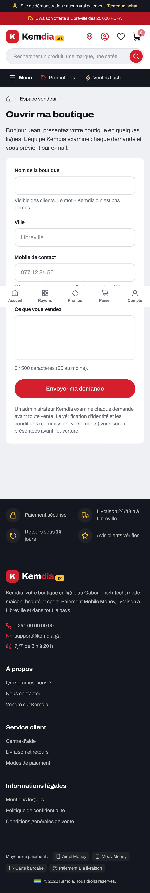
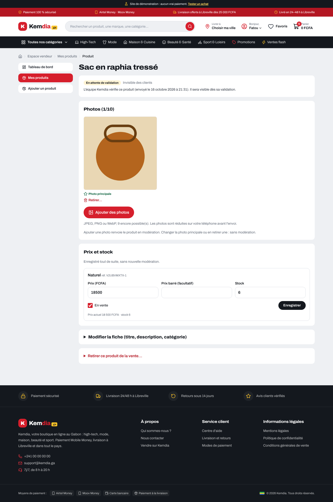
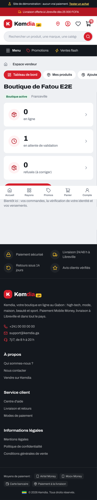
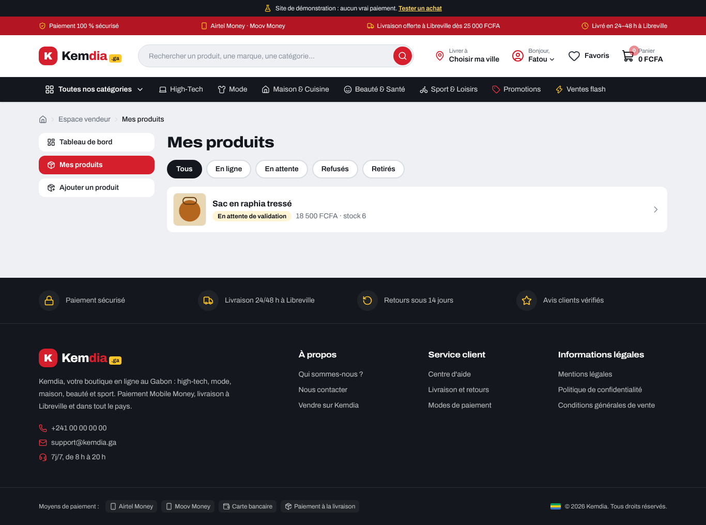
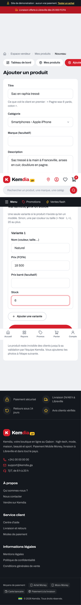
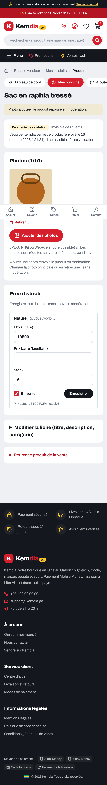

# Rapport — S6-T06 : espace vendeur sur le site

|                                                 |                                                                               |
| ----------------------------------------------- | ----------------------------------------------------------------------------- |
| **Date**                                        | 2026-10-16                                                                    |
| **Sprint / tâches**                             | S6 — S6-T06                                                                   |
| **Version**                                     | v0.5.0 (versions des paquets inchangées) ; contrat de l'API 1.17.0 (inchangé) |
| **Sections du cahier d'architecture modifiées** | §5.1, §5.16 (nouvelle), §6.4, §7, §8 — version 4.3                            |

## 1. Résumé

Les vendeurs ont maintenant **leur espace sur le site**, à l'adresse `/vendeur`. Depuis un téléphone, une personne connectée
**demande l'ouverture de sa boutique** ; une fois la boutique validée par l'équipe (S6-T05), elle **crée ses produits**,
**ajoute ses photos** (réduites sur le téléphone avant l'envoi), **change ses prix et ses stocks** et retire un produit de la
vente. La page `/vendre` n'a plus de faux formulaire et n'annonce plus de taux de commission.

```
Visiteur ─► /vendre ─► « Devenir vendeur » ─► connexion ─► /vendeur : demande de boutique
Équipe (S6-T05) ─► valide la boutique
Vendeur ─► /vendeur : tableau de bord ─► Ajouter un produit (fiche + variantes) ─► photos (réduites, envoyées)
   └─► en attente de validation ─► équipe (S6-T05) ─► en ligne ─► prix et stock modifiables sans nouvelle modération
```

## 2. Fonctionnalités livrées

| Élément             | Ce que ça fait                                                                                                                | Fichiers principaux                                                               |
| ------------------- | ----------------------------------------------------------------------------------------------------------------------------- | --------------------------------------------------------------------------------- |
| Accueil `/vendeur`  | Selon la boutique : demande, « en cours d'examen », refus (motif + nouvelle demande pré-remplie), suspension, tableau de bord | `app/vendeur/page.tsx`, `components/vendor/ShopRequestForm.tsx`                   |
| Mes produits        | Onglets (tous, en ligne, en attente, refusés, retirés), vignette, prix, stock                                                 | `app/vendeur/produits/page.tsx`                                                   |
| Nouveau produit     | Titre, catégorie (toutes, rangées par catégorie principale), marque, description, 1 à 20 variantes                            | `app/vendeur/produits/nouveau/`, `components/vendor/ProductForm.tsx`              |
| Page d'un produit   | État et motif de refus, photos (ajout, principale, retrait confirmé), prix et stock par variante, fiche, retrait de la vente  | `app/vendeur/produits/[productId]/page.tsx`                                       |
| Photos              | Réduction dans le navigateur (1 600 px, JPEG 85) ; route d'envoi ; relais d'aperçu                                            | `components/vendor/PhotoUploader.tsx`, `app/vendeur/produits/[productId]/photos/` |
| Logique             | Adaptateur API, garde d'accès, actions serveur, règles des formulaires, messages                                              | `lib/vendor/*.ts`                                                                 |
| `/vendre`           | Faux formulaire supprimé (`VendorInterestForm`, `lib/vendor-lead.ts`) ; bouton vers `/vendeur` ; commission sans chiffres     | `app/vendre/page.tsx`                                                             |
| « Mon compte »      | Lien « Mon espace vendeur » pour les vendeurs                                                                                 | `components/account/RoleList.tsx`                                                 |
| Composants partagés | `TextAreaField` (zone de texte accessible), `StatusBadge` déplacé dans `components/ui`                                        | `components/ui/`                                                                  |
| Proxy               | Corps de requête borné à 6 Mo (production et préproduction) ; vérifié avec `caddy adapt` 2.10.2                               | `deploy/proxy/Caddyfile`                                                          |
| Bout en bout        | Vendeuse avec boutique active, compte sans boutique ; parcours `vendeur.spec.ts`                                              | `e2e/fixtures/vendeur-e2e.sql`, `e2e/vendeur.spec.ts`, `ci.yml`                   |

Aucune nouvelle dépendance. Aucun changement d'API ni de base.

## 3. Décisions techniques

[ADR-0037](../architecture/adr/0037-espace-vendeur.md), avec tes choix du 2026-10-16 : **vraie demande dans `/vendeur`**,
**photos réduites dans le navigateur**, **chiffres de commission retirés**, adresse **`/vendeur`**.

- **Photos** : une photo de téléphone de 3 000 px part à 1 600 px (vérifié dans le test). L'envoi passe par une **route** du
  site plutôt qu'une action serveur : fichier lu en flux, sans formulaire multipart.
- **Prix et stock** : simples formulaires HTML, sans JavaScript ; le stock n'est envoyé que s'il a changé, avec la valeur lue.
- **Pas de nouvelle variante** sur un produit existant : l'API ne le permet pas encore.

## 4. Sécurité

- **Accès** : produits seulement avec une boutique active ; l'API vérifie à chaque appel le rôle vendeur, la boutique active et
  que le produit est bien **celui de la boutique** (un autre produit → 404, testé).
- **Identifiants** vérifiés (UUID) avant d'entrer dans une adresse : impossible d'atteindre une autre route de l'API.
- **Photos** : type lu dans les premiers octets (SVG, HTML refusés) ; l'API décode et réencode toujours, sans métadonnées.
- **Messages** : `?ok=` et `?erreur=` en listes fermées ; l'explication de l'API n'est reprise que pour un champ mal rempli.

**Relecture de sécurité indépendante** (agent séparé, avant la PR) : **aucun problème bloquant**. Constats corrigés :

| Gravité | Trouvé                                                                                                                         | Correction                                                                                                                  |
| ------- | ------------------------------------------------------------------------------------------------------------------------------ | --------------------------------------------------------------------------------------------------------------------------- |
| Moyenne | Garde-fou des données de test inopérant si `psql` est lancé sans `-v ON_ERROR_STOP=1` : la suite créait quand même les comptes | `\set ON_ERROR_STOP on` + une seule transaction, dans `vendeur-e2e.sql` **et** `equipe-e2e.sql` (prouvé : rien n'est écrit) |
| Moyenne | Corps d'envoi (5 Mo) lu avant de vérifier la session : un faux cookie suffisait à consommer de la mémoire                      | Session vérifiée avant la lecture ; 4 envois à la fois ; corps borné à 6 Mo par Caddy                                       |
| Basse   | « 12.50 » lu 1 250 (le point retiré comme séparateur de milliers)                                                              | Point accepté seulement en milliers (« 12.500 ») ; sinon refusé                                                             |
| Basse   | Délai de 20 s trop court pour une photo en file d'attente → doublons possibles                                                 | 35 s ; en cas de délai dépassé : « rechargez la page avant de la renvoyer », liste relue                                    |
| Basse   | Session refusée sans effacement du cookie dans la route d'envoi                                                                | Session oubliée et cookie effacé, comme les actions                                                                         |
| Basse   | Retrait d'une photo (définitif) en un seul clic                                                                                | Confirmation repliée, comme le retrait de la vente                                                                          |
| Info    | Commentaire inexact sur les métadonnées ; boutique de test pas remise à « active » au relancement                              | Commentaire corrigé ; boutique remise à « active »                                                                          |

**Gardé et noté** (ADR-0037) : entre deux onglets, la dernière écriture du **prix** l'emporte (le **stock**, lui, est protégé) ;
une petite photo envoyée telle quelle garde ses métadonnées jusqu'à l'API, qui les retire.

## 5. Qualité

| Vérification                             | Résultat                                                                                                                  |
| ---------------------------------------- | ------------------------------------------------------------------------------------------------------------------------- |
| Format, lint, types (tout le dépôt)      | ✅                                                                                                                        |
| Construction de l'API et du site         | ✅ (site construit avec une API **injoignable**)                                                                          |
| Tests unitaires du site                  | ✅ **392** (348 avant ; +47 pour l'espace vendeur, −3 avec le faux formulaire supprimé)                                   |
| Tests unitaires de l'API / du contrat    | ✅ 541 / 32 (inchangés)                                                                                                   |
| Tests d'intégration (base `kemdia_test`) | ✅ 178 (inchangés)                                                                                                        |
| Bout en bout (Playwright)                | ✅ **78 réussis**, 4 sautés (parcours avec état : téléphone seulement), API en démo + Mailpit, `E2E_SANDBOX=1`            |
| Accessibilité (axe, WCAG A et AA)        | ✅ sur la demande, le tableau de bord, le nouveau produit, la page produit et la liste                                    |
| Budget de performance                    | ✅ pages publiques 169 à 172 Ko de JavaScript, comme avant ; pages vendeur ≈ fiche produit (40 à 42 Ko propres), sans Zod |
| Gitleaks v8.30.1 (empreinte vérifiée)    | ✅ (voir la PR)                                                                                                           |
| Semgrep 1.179.0                          | ✅ aucun constat de sécurité sur les fichiers changés (règles clonées depuis GitHub)                                      |
| `db:check`                               | Sans objet : aucune migration                                                                                             |

## 6. Captures d'écran

| Téléphone                                                           | Ordinateur                                                |
| ------------------------------------------------------------------- | --------------------------------------------------------- |
|  |  |
|       |  |
|       |                                                           |
|             |                                                           |

## 7. Limites connues / dette technique

- Pas d'ajout de variante à un produit existant (l'API ne le permet pas).
- Pas d'ordre complet des photos : on choisit seulement la principale.
- Les compteurs du tableau de bord s'arrêtent à « 100+ ».
- Pas encore : commandes du vendeur (BR-013), vérification d'identité (KYC, BR-024), versements et commission (BR-020).

## 8. Prochaines étapes

1. **Toi, pour essayer** : avec un compte sans boutique, va sur `/vendre` → « Devenir vendeur », envoie une demande ; valide-la
   depuis `/equipe` (S6-T05) ; reviens sur `/vendeur` pour ajouter un produit et ses photos depuis ton téléphone.
2. Pas de dépendance ni de migration : **ni `pnpm install` ni `db:deploy` / `db:check`** pour cette PR.
3. **Serveur** : `deploy/proxy/Caddyfile` change (corps limité à 6 Mo) ; il sera pris en compte au prochain déploiement du proxy.
   La démo Render ne se met plus à jour toute seule.
4. Toujours en attente : question n° 3 au client (commission). Le texte de `/vendre` sera complété avec sa réponse.
5. Suite proposée : **KYC des vendeurs (BR-024)**, puis **commandes vendeur (BR-013)**.
